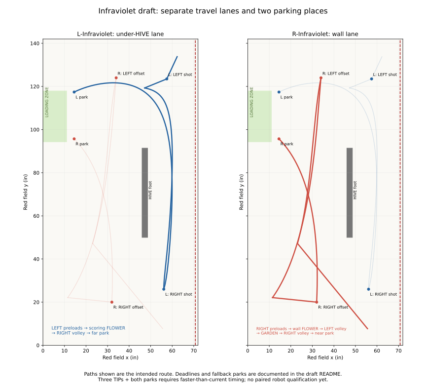

# Auto sources (`.pp` files)

Every Autonomous drawn in our [Visualizer fork](https://mona-shores-ftc-robotics.github.io/Visualizer/)
has its `.pp` file committed here, in the same PR as the Java generated from it. The Java goes in
`opmodes/auto/generated/` (package `org.firstinspires.ftc.teamcode.opmodes.auto.generated`).

**New to the Visualizer?** Start with [How to plan an Auto](how-to-plan-an-auto.md).

## Local event work (Belding)

Keep this checkout on the event branch in Android Studio, then connect that same folder using
Visualizer's **Workspace** button. Open the auto and a partner there; **Save** or Ctrl+S writes
the source and generated Java into this checkout, including affected autos when team spots move.
No push, PR, CI run, or merge is needed for each local edit. You run Sloth Load yourself.

After testing a saved candidate, use Workspace's **Mark saved auto tested**. Its checkpoint
keeps the auto workspace together, including the other autos that share spots; Restore first
backs up the experiment, then restores those related files. These laptop checkpoints live under
`TeamCode/.auto-workspace/` and are ignored by Git. Commit/push successful working sources on
the event branch for a shared backup, then bring the successful changes into master through a PR.

For detailed local simulations and AdvantageScope logs, see
[`tools/simulate-auto`](../../tools/simulate-auto/README.md). Drafts need their `BuiltAuto` OpMode
prepared before selection on the Driver Station. The full Visualizer workflow is documented in
[local-workspace.md](https://github.com/Mona-Shores-FTC-Robotics/Visualizer/blob/main/docs/local-workspace.md).

## Open the Autos on master

One link each, always the latest on `master` (the Visualizer reads the file from GitHub):

| Auto | Open it |
|---|---|
| L-NoCross | <https://mona-shores-ftc-robotics.github.io/Visualizer/#team=master/l-no-cross.pp> |
| R-Solo | <https://mona-shores-ftc-robotics.github.io/Visualizer/#team=master/r-solo.pp> |
| R-NoCross | <https://mona-shores-ftc-robotics.github.io/Visualizer/#team=master/r-no-cross.pp> |
| L-Infraviolet + R-Infraviolet (a pair) | <https://mona-shores-ftc-robotics.github.io/Visualizer/#team=master/l-infraviolet.pp,r-infraviolet.pp> |

The Belding work order is **L-NoCross, R-NoCross, R-Solo-Nudge, then the
L-Infraviolet / R-Infraviolet three-TIP pair** (now competition Autos; see
[below](#l-infraviolet--r-infraviolet-the-coordinated-three-tip-pair)). R-Solo stays the existing reference.
L-NoCross was L-Partner; R-NoCross was R-Partner-Tip. This lineup change only renames
those routines: their paths, waits and fallback behavior have not been tuned yet.
In particular, L-NoCross's existing no-TIP fallback still crosses to RIGHT; replace
that in the Visualizer before qualifying it as a true no-cross routine. R-NoCross's
CELL-up timeout also still proceeds to launch. See `doc/robot-todo.md` for the checks.

Inside the Visualizer, the same list is **View → Team Autos: the latest from biobuzz, together…**
(pick a branch, tick up to four Autos, Reload latest). A pull request's draft opens with its branch
in the link: `#team=auto/r-solo/r-solo.pp`.

**Drafts** (`drafts/`, no competition OpMode; a draft may have an isolated test Utility) are listed in Team Autos under their own heading, and
open beside a partner stand-in the same way: R-Solo-Nudge with its pushed partner is
<https://mona-shores-ftc-robotics.github.io/Visualizer/#team=master/drafts/r-solo-nudge.pp,partners/partner-push-start.pp>.
Edit and **Save to GitHub and simulate…** as for any Auto: the path stays in `drafts/`, and the fast
lane takes a `.pp` in `drafts/` or `partners/` (Visualizer
[#67](https://github.com/Mona-Shores-FTC-Robotics/Visualizer/pull/67) lists the drafts).

**The polish loop.** Open the Auto from master, change it, **Save to GitHub and simulate…** under
the same name: that makes or updates its `auto/<name>` branch and pull request, the simulator runs
on it, and a mentor merges it once the robot has driven it. A change to a spot is **Save team
spots…** instead: its own pull request, and every Auto that uses the spot is re-exported in it.
Offline, **Save to repo folder…** writes the same two files (the `.pp` here and its Java in
`generated/`) straight into this checkout on the laptop; commit them on an `auto/<name>` branch
afterwards (or do Save to GitHub once online), so master has the Auto the robot ran.

**The competition loop.** The night before, with Wi-Fi: open the Visualizer once (it keeps an
offline copy of itself), open the Autos, and pick this checkout once in **File → Save to repo
folder…** (Chrome or Edge; the folder that holds `TeamCode`). At the event, no internet needed:
change the Auto, **Save to repo folder** (the browser asks once to allow the folder), then Sloth
Load from Android Studio over USB. The Files panel opens the checkout's Autos from the laptop, and
the team spots come from its `spots.json` while GitHub is out of reach. Commit the changed `.pp`
and Java on an `auto/<name>` branch when back online.

- **The `.pp` is the source; the Java is generated.** Change an Auto by opening its `.pp` in the
  Visualizer, editing it, and exporting again (Export → Export Auto (Java)). Never edit the
  generated Java by hand: the next export overwrites it.
- **The file name is the one the Java names.** A generated class says where it came from:
  `public static final String SOURCE = "hive-rush.pp";`. That file goes here, under exactly that
  name. `AutoSourcesTest` fails CI when it is missing.
- **Commit both together.** A PR that changes an Auto shows the path change as a diff of the
  `.pp`, and a reviewer can open that exact file in the Visualizer (the upload button in its top
  bar).
- **The file carries the robot's size and motion settings.** They time the preview and the park
  guard's seconds in the Java, so the same `.pp` exports the same Java on any laptop.
- **Each Auto gets a five-line OpMode** in `opmodes/auto/`, `<Class>OpMode extends BuiltAuto`
  (see `BuiltAuto`'s javadoc), which is what the Driver Station lists. The generated class itself
  is not an OpMode. Its name ends with the time the `.pp` was saved, Michigan time
  (`R-Simple 10-31|12:22AM`), from the generated class's `SAVED`: after a Sloth Load, the Driver
  Station shows which save is on the robot.

## L-Infraviolet / R-Infraviolet: the coordinated three-TIP pair

**L takes the garden early; R takes both flowers.** Promoted from `drafts/` to
competition Autos (**Autonomous → L-Infraviolet / R-Infraviolet**) after it ran well on
the robots. Run both together, one on each robot: each half assumes the other is its
partner. The previous Infraviolet assignment is
[preserved in history](BENCH.md#previous-infraviolet-assignment). Open the pair:
<https://mona-shores-ftc-robotics.github.io/Visualizer/#team=master/l-infraviolet.pp,r-infraviolet.pp>.

| Phase | L-Infraviolet | R-Infraviolet |
|---|---|---|
| TIP 1 | Move to LEFT_LAUNCH_CATCH; **wait for LEFT CELL up**, then shoot preloads | Shoot RIGHT preloads, then collect WALL FLOWER |
| TIP 2 | Immediately cross south under HIVE; gather GARDEN | Wall lane to LEFT_LAUNCH_CLOSE; wait for LEFT up and shoot the wallflower load |
| Reload | Turn out of garden to the existing RIGHT_LAUNCH_OFFSET | Immediately collect SCORING FLOWER while TIP 2 settles, then turn forward into the south crossing |
| TIP 3 | Wait for RIGHT up, contribute four from the offset, then leave | Contribute four from local RIGHT_PAIR_CLOSE |
| Park | Wall lane to far LEFT_PARK, passing outside a robot already in near park | Clear above L's offset, then wall lane to near RIGHT_PARK |

Both crossings under HIVE go south, at different stages. L's garden collection
runs during R's LEFT work. L does not wait for TIP 2 before collecting, and the
scoring flower belongs only to R. Loose pieces encountered in transit are not
credited as a substitute for either four-piece pickup. There is no robot-to-robot
position signal: CELL-up gates establish scoring state, not partner clearance.

### Reused paths and the RIGHT shooting space

The opening LEFT_CATCH path is copied from L-NoCross. R's opening wallflower path,
wallflower-to-LEFT_CLOSE curve control point and LEFT_CLOSE-to-scoring-flower path
come from R-Solo. The wallflower exit turns north over the first 12% of travel
instead of continuing the old, slower heading change. L's empty crossing uses
R-Solo's under-HIVE controls and the straight R-NoCross garden approach. R uses the
upper controls of that corridor after its new forward flower exit. These are reused
drawing elements, not a claim that the newly combined routine has run on hardware.

Shared `spots.json` is unchanged. L keeps **RIGHT_LAUNCH_OFFSET (41, 20, 68.7°)**,
which the mentor reports is reliable. R's one new shooting point is
**RIGHT_PAIR_CLOSE (59.5, 31, approximately 97.2°)**: about **30.0 in** from turret
axis to the raised target row, approximately **9.4°** off straight-on. Its shot
needs qualification; no launcher tuning is changed here.

The old far LEFT offset is removed: with L already gone, R uses the existing
LEFT_CLOSE, about 37 in and straight-on. The original RIGHT offset and RIGHT_CATCH
body footprints overlap. Moving catch right makes the stationary positions fit,
but leaves too little space for a loaded turn beside L. This candidate instead
moves R toward a closer shot, allowing its approach and exit to clear L even if L
remains at the offset. The modeled centre-line margin there is only about 1 in along the approach (about 2 in at the shot):
check actual robot dimensions, tracking error and both alliance orientations.

### Loaded motion

Keep the normal short flower/garden backing-out routines; the mentor tunes those
as separate events. L turns forward out of the garden, R turns north promptly out
of the wallflower, and R turns forward out of the scoring flower before crossing.
The long loaded under-HIVE leg faces south throughout. Compound path sections are
one continuous drive, not a stop at every control point or junction.

There is still a short backward component while R turns into the final shot,
roughly six inches projected along its heading in the drawing. It is not a long
backward crossing, but retention during that final alignment must be tested. The
path drawing does not impose a special low runtime speed there. Intake holding
power and pickup backing-out settings are unchanged.

### Deadlines and parks

| Gate | Latest accepted match time | Timeout / late arrival |
|---|---:|---|
| L: LEFT up for preloads | Before 8 s | Far park; no garden or RIGHT volley |
| R: LEFT up for wallflower volley | Before 14 s | Near park from LEFT_CLOSE |
| L: RIGHT up at offset | Before 20 s | Far park without final volley |
| R: RIGHT up at close shot | Before 22.5 s | Near park without final volley |

Timeout rows come first: arriving at or after a deadline parks even if the CELL-up
trigger is true. R collects the scoring flower immediately after its LEFT volley;
the final RIGHT-up gate confirms TIP 2 before firing. This overlaps pickup with
TIP settling instead of spending about 1.4 s waiting at LEFT_CLOSE. L's
volleys and R's LEFT volley use a 1 s readiness timeout; R's final volley uses 0.5 s
to reserve its longer park. Qualify that shorter readiness window on the robot.
Once feeding starts, existing AutoKit protection allows the four-shot completion
or 3.5 s feed backstop; **one second is not the volley duration**. A late failed
pickup or stalled drive can still consume the park margin. 

### Full simulator result

At code commit `63cdc72b`, the L-first paired request runs both generated Autos,
Pedro paths and AutoKit against the turret-locked robot physics model:

| Seed | AUTO TIPs | L parked | R parked | Both LEAVE |
|---|---:|---:|---:|---|
| 1 | 3 (third at 25.52 s) | 23.20 s | 26.80 s | Yes |
| 2 | 2 | 23.42 s | 26.80 s | Yes |
| 3 | 2 | 23.48 s | 26.80 s | Yes |

All three execute all five volleys: L launches 8 pieces and R launches 12.
R reaches its final gate at 21.28 s and begins firing at 21.30 s, before the
22.5 s cutoff. The two incomplete third tips are scoring/retention outcomes in
the physics model, not skipped final volleys: the raised CELL ends about 91%
and 87% loaded. No robot overlap, centre-line crossing or HIVE-frame contact
is reported in these three runs. The wall-flower routine reports contact with
the FLOWER during pickup; this is inherited pickup motion, not frame clearance.

With R driving 20% slower, all three seeds get two tips and both parks. With
R missing every shot, both park without a tip. These are model results, not a
measured success rate or proof of the new shot on hardware. In particular the
simulator's intake can collect loose pieces whenever it has room; it does not
prove fourth-piece retention on the real robot.

The R-first request also gets three/two/two tips in nominal seeds 1–3. With L
driving 20% slower it retains those tip counts, both parks and both LEAVEs,
without robot overlap, centre-line crossing or HIVE-frame contact. L departs
toward the wall first (park controls 25,20 and 35,95), then north past the near
parked robot, clearing R's final aiming turn even in that slower-L case.

[Final full simulator run](https://github.com/Mona-Shores-FTC-Robotics/biobuzz/actions/runs/42265501484).

### Desk checks and the next robot test

The local paired model uses 16.2 in square bodies plus the drawn protrusion,
animated pickup motion, and 20 ms samples. Nominal, slower, missed-shot and
mismatched-speed runs had no sampled overlaps. R's final approach and park also
clear L held stationary at the RIGHT offset. Driven paths clear the HIVE and
centre line; the inherited wall-touching starts overlap the larger model by 0.4 in.

**A failed L robot still sitting at its start is not protected:** R's reused LEFT
approach/scoring-flower area overlaps it. This is a coordinated pair for two
functioning robots, not a recovery Auto for a dead partner. Stop the run when a
robot fails or loses its route. No clock or CELL-up event proves a shared area clear.

| Timing scenario | TIPs modeled | L finishes | R finishes |
|---|---:|---:|---:|
| Existing timing facts: initial 5.1 s launch, later 4 s, flower 3.7 s, garden 5 s | 2 | 24.8 s | 30.2 s |
| Faster scenario: initial 3.3 s, later 2.5 s, flower 3 s, garden 4.21 s, driving 20% faster | 3 | 21.7 s | 25.7 s |
| Faster mechanisms, L driving at 0.8× instead | 3 | 25.5 s | 25.7 s |
| Faster mechanisms, R driving at 0.8× instead | 2 | 21.9 s | 28.9 s |

The faster scenario's third TIP settles around **24.6 s**. It is a planning
scenario, not a measured paired result. The slower existing-facts case overruns
R's park by 0.2 s in this planning model, which does not execute AutoKit's runtime
endgame guard; it is not a guaranteed two-park result. The three-TIP plan needs the planned five volleys, with little margin for missed pieces. The local analysis budgets the full feeding time despite short
readiness limits, and uses the registered/measured garden time; the browser
preview can look faster because it currently truncates those durations.

Bring-up: verify L's first-tip wait, run each route empty, test the final RIGHT
positions and R's turn with L stationary, qualify the new close shot and loaded
exits, then run the full pair. Measure R ready to fire RIGHT before **22.5 s**; measure L ready at its offset
before **20 s**. Details: [robot-todo §3](../../doc/robot-todo.md).

### Same-day run order

The launcher stays on between volleys. Each launch asks the existing speed table
for the current camera/pose range (with the table enabled); it does not retain
the opening shot's target blindly. Intake remains controlled by the existing
pickup/feed routines. RIGHT_PAIR_CLOSE and its turret-offset aiming heading are
local to R-Infraviolet, not a team spot; shared catch/close spots are unchanged.

Use this single candidate pair; the roomier catch-distance alternative was screened
out because its loaded approach took longer and its park crossed an occupied L
shooting footprint.

1. Sloth Load master on both robots.
2. Select **L-Infraviolet** and **R-Infraviolet** in the Autonomous list.
3. Place both at their normal LEFT_START / RIGHT_START marks with four preloads;
   choose the same alliance and start together.
4. Film the complete run. Check the first-tip wait, both parks, and whether the
   fourth piece survives R's last aiming turn. Stop if either robot stalls.

The full simulator initially truncated feeding at readiness timeouts; its registry
now protects an active feed and uses the robot's feed backstop/shot-count cutoff.
This correction changes simulated outcomes, not robot feed behavior. A regression
check exercises the short-timeout wallflower volley. R's missed-tip fallback now
passes below L's far park after clearing the HIVE, and its wallflower-to-LEFT
heading uses explicit quarter turns rather than an ambiguous half-turn reversal.

## The bench

R-Partner-Preload and R-Solo-Staging are on `autos-experiment`, with their latest
drawings, generated Java, OpModes and simulation requests preserved. They have no
files or selectable OpModes in the active lineup. See [BENCH.md](BENCH.md) for the
reasons, exact snapshot and links to reopen them. Earlier experiments remain on that
branch as well. To bring one back, promote its files in a normal PR; adding a drawing
alone does not register it on the Driver Station.

Drafts remain separate: no OpMode until we deliberately prepare one for a robot test.
The Team Autos top-level list therefore matches the Driver Station's competition Autos.

## Partner stand-ins (`partners/`)

`partners/` holds the Autos a teammate might run beside one of ours, for the simulator only: a
`.pp` each, its generated class in `opmodes/auto/generated/`, and no OpMode, so the Driver Station
never lists one. The Visualizer's Team Autos list reads the folder's own files and skips
subfolders, so none of these shows up as an Auto of ours. To open one, give the link the whole
path: `https://mona-shores-ftc-robotics.github.io/Visualizer/#gh=TeamCode/autos/partners/partner-l-launch-park.pp`
(a branch goes in front: `#gh=master/TeamCode/autos/partners/…`). Their spots are a teammate's
(`PARTNER_START`, `PARTNER_PARK`), not the team's. `AutoSourcesTest`
accepts a `SOURCE` here as it does in the folder itself.

| Stand-in | What it does |
|---|---|
| `partner-still` | A partner that is not going to move: it starts where we ask it to, out of the way, back on the side wall in the corner by our alliance wall at (15, 133.8), and sits there for the whole of AUTO. One spot, ours to pick, so there is no right-side twin (mentor, 3 Nov 2026). |
| `partner-r-broken-down`, `partner-l-broken-down` | A partner that meant to run an Auto and broke down: sits on the right or left start for the whole of AUTO. The "dead" runs use it. |
| `partner-park-1`, `partner-park-2` | Sits on the left start until 15 s, then parks (two different starts and park spots). |
| `partner-r-launch-park`, `partner-l-launch-park` | Spins up, waits for its own CELL to be up (at most 12 s), fires all four preloads at it, parks. The right CELL is up at the start, so the right one fires at once; the left one fires once our first TIP raises the left CELL. |
| `partner-r-launch-stay` | The right launch-park stand-in's spin-up, CELL wait, and preload volley, then stays at its start instead of driving to park. Select it locally to compare shoot-and-stay behavior. |
| `partner-l-tip-park` | The left launch-park, then the scoring FLOWER, four more at the left CELL (eight pieces: a TIP), then parks. |
| `partner-push-start` | A motionless 16 x 16 in partner at (10.254, 82), heading 70°, one corner on the wall. Matches the angled `drafts/r-solo-nudge` and the isolated `drafts/partner-nudge-test`. The Utility applies real speed limits; the full draft's push simulation is still a placeholder. |
| `partner-l-stage-park` | Starts against the wall facing the HIVE with its four POLLEN on the tiles along its left side (the simulator places them, `AutoStudyTest.alongLeftSide`, touching the frame as G304 asks), waits 2 s, drives off along the wall and parks, leaving them. |

A stand-in is drawn and exported like any Auto (Visualizer, or `node scripts/export-auto.mjs`
from a Visualizer checkout); a new one goes here with its class, and into the curation below.

To change a stand-in's start position or route, open its `.pp`, edit it, then **Save to GitHub
and simulate…**. The save keeps the source in `partners/` and creates or updates its own
`TeamCode/sim-requests/<name>.json` to preview the stand-in alone. These requests are valid just
like a competition Auto's or a draft's; they do not require an OpMode or put the stand-in on the
Driver Station. Requests for our Autos still list it under `partners` to simulate it beside us.

### Which partners an Auto is simulated with

Each Auto's `TeamCode/sim-requests/<name>.json` lists its runs: the Auto alone, then each
stand-in as a partner (`"partners"`; the request format is in `SimRunTest`'s javadoc). The
"Simulate Auto" workflow runs every entry and publishes each one. **The simulator acts as our
driver:** an entry gives the one number we ask a partner, `"lastShotS"` ("when does your last
preload leave?"). That times the stand-in's launch, and sets our partner wait as the driver would
in INIT: the last shot plus the TIP lag (`partnerTipLagS` in `timing.json`, 4 s). Each Auto with a
partner runs it **on time**, **missing** (`"fails": "misses"`: every shot wide, no TIP, it still
parks on schedule) and **dead** (a broken-down stand-in on its start). Nothing in between: "later than
they said" and "breaks down partway" are not modelled (mentor, 3 Nov 2026). The curation, the mentor's to correct:

| Auto | Alone | On time | Missing | Dead |
|---|---|---|---|---|
| L-NoCross | yes | `partner-r-launch-park`, last shot at 2, 5, 8 and 12 s: our partner wait runs to 6, 9, 12 and 16 s | the same, said 8 s | `partner-r-broken-down`, said 8 s: we wait to 12 s, then take the Otherwise branch |
| R-NoCross | yes | `partner-l-tip-park` at 50 in/s; `partner-still` (out of the way) | the same | `partner-l-broken-down` |
| R-Solo | yes | `partner-park-1` (no launches), `partner-still` (out of the way) | | `partner-l-broken-down` |
| L-Infraviolet | yes | `r-infraviolet` (its pair) at 50 and 40 in/s | `r-infraviolet`, missing | `partner-r-broken-down` |
| R-Infraviolet | yes | `l-infraviolet` (its pair) at 50 and 40 in/s | `l-infraviolet`, missing | `partner-l-broken-down` |
| R-Solo-Nudge (draft, `drafts/`) | yes | `partner-push-start`, pushable: pushed off the wall into the LOADING ZONE | | |

**The results table** in the workflow's job summary has a row per seed of each run: points, our
launches and the partner's (and how many went at a down CELL), the TIPs, **the partner's last shot
and our first CellUp** (the TIP lag, seed by seed), how our first wait ended, the first collision,
and who parked. For an Auto with a partner wait, a run's name ends with the second that wait runs to.

- **The two launch-park stand-ins fire from PLAY only on the right.** The right CELL is up at the
  start, so `partner-r-launch-park`'s last shot lands where `lastShotS` says. The left one waits
  for its CELL (our TIP raises it), so its last shot comes no sooner than that: the "Partner's
  last shot" column says when it did.
- **L-NoCross's dead-partner run collides.** Its Otherwise branch drives to `RIGHT_LAUNCH_CATCH`,
  10 in in front of `RIGHT_START`, where a dead partner sits; the mentor kept that spot for now
  (3 Nov 2026), and a "Right CELL up?" check before that launch is shelved until the basics work.
- **The raw knobs are an override for studies.** An entry's `"timing"` is four knobs, each
  optional: `startDelayS` (seconds after PLAY before its first card), `speed` (its drive profile,
  as a spec writes it after `@`), `launchS` (seconds per launch volley: a four-piece launch is the
  1 s spin-up and then three of these) and `pickS` (seconds it stands at a FLOWER with its intake
  on). One given wins over what `lastShotS` derives.

**A partner we push** (`"pushable": true` on an entry): while the stand-in is not driving, our robot moves it
along with itself on contact instead of overlapping it, at `AutoSim.PUSH_SPEED_FRACTION` (half, a placeholder)
of its path's speed. Translation only: it keeps its heading, and a wall stops it. It is judged for LEAVE and
AUTO PARK where it ends, so a push off the wall into the LOADING ZONE scores both. LEAVE is ruled (Q&A Q28, 19 Oct
2026: "regardless of how it gets there (so long as no rules are violated), the state will be awarded"); PARK for
a pushed robot is not asked yet, and reads the same way. The results table adds the partner's LEAVE, how far it
went and how long we pushed.

Partner runs use `partnerSeeds` (five) so each job stays under about five minutes; the Auto alone
keeps its ten.

The thinking behind the curation, what a wait is really waiting for, the one number to ask a
partner for, and which partner states get simulated, is in `doc/partner-timing.md`.

**The Visualizer's Save & Simulate must keep `partners` and `partnerSeeds`** when it rewrites the
request (it writes the rest from its dialog): the curation lives in the request, nowhere else.

## Team spots (`spots.json`)

`spots.json` here is the team's list of named spots: poses every Auto can use, so nobody types or
places them again. They work like PathPlanner's linked waypoints. **Every Auto on master uses only
these spots**, so a reviewer reads steps and triggers, never coordinates:

| Spot | What it is |
|---|---|
| `RIGHT_START`, `LEFT_START` | The measured starts (`localization/StartPositions`). |
| `RIGHT_LAUNCH_CATCH`, `LEFT_LAUNCH_CATCH` | In front of that CELL, just outside where its spill lands, clear of a partner on the start. |
| `RIGHT_LAUNCH_OFFSET`, `LEFT_LAUNCH_OFFSET` | Off to the side of that CELL and angled at it, so a partner in front of the CELL is not disturbed. |
| `RIGHT_LAUNCH_CORNER`, `LEFT_LAUNCH_CORNER` | The long shot (about 55 in) from the corner of our wall, for the TeleOp's go-to-launch-spot button. RIGHT is where 20245 scored it on 4 Nov; LEFT is its place mirrored across the axle line, turned to aim the turret (which sits off-centre) at the LEFT CELL; not yet fired from. |
| `WALL_FLOWER_STAGING`, `SCORING_FLOWER_STAGING` | Where a Pick flower step starts (on the FLOWER's line, 18–24 in out). |
| `GARDEN_STAGING` | Where a Garden gather step starts; the gather pose itself is the robot code's (`GardenFieldPoints`). |
| `RIGHT_PARK`, `LEFT_PARK` | 14.5 in off the alliance wall, facing 0 (the intake toward the field), in the LOADING ZONE. |
| `PARTNER_STAGED_POLLEN` | Where a partner on `LEFT_START` sets its four preloads down for us: a drawing until a partner says where they stage (`partners/partner-l-stage-park` is the simulator's guess; see "Partner stand-ins"). |

Names are side (or thing) first, then role, then variant, so a side's spots sort together. An Auto
that needs a spot not in this list is drawn on the `autos-experiment` branch until the spot earns
its place here.

- **Using one.** In the Visualizer, pick it from a step's spot dropdown (under "Team spots"), or
  select a path and press 🔗 on its end in the Path panel, then pick the spot: the end jumps to it
  and stays on it. The `.pp` keeps a copy of the pose and lists the name in `auto.teamSpots`.
- **Making one.** 🔗 on a path's end → *Make team spot*, or tick *Also a team spot* when naming a
  new spot from a field click.
- **Locked by default.** Dragging a team spot's end snaps it back. Press its lock (on the step, or
  in the Path panel) to unlock it and move it. The move is a change in that browser until saved.
- **Saving.** *Save team spots…* writes `spots.json` and re-exports every Auto here that uses a
  changed spot, `.pp` and Java, in one commit on a new `spots/…` branch, then opens a pull
  request. Once it is merged, every Auto and the robot code use the new spot. Saving needs the
  same GitHub token as Save to GitHub.
- **Never edit `spots.json` by hand.** Change spots in the Visualizer, so the Autos that use them
  are re-exported in the same commit. A hand edit changes no Auto until each is opened and
  exported again.
- **Starts are team spots named `…_START`.** The builder's start buttons are the team's
  `_START` spots (`RIGHT_START` → *Right start*); make one to add a start. A start measured on the
  field is also in `localization/StartPositions` (`TEAM_SPOTS` names its spot), and
  `TeamSpotsTest` fails while the two differ: measure, then change both. Both `RIGHT_START` and
  `LEFT_START` are measured (31 Oct 2026): back flat on the wall, the frame's left side on a seam's
  teeth. To move a start, press *Unlock … start to move it* under the start buttons, then set it in
  the START panel.
- Poses are drawn for RED, in Pedro's frame (inches, degrees), like everything in an Auto; the
  robot turns them for BLUE.

## A drive straight into a launch or a pick

Put `LaunchAll` or `PickFlower` directly after the drive to its spot, with no step between. The
robot then gets ready on the way in: it lowers the FLOWER stick over the last 18 in, and opens the
launch gate in the last few inches once it faces the HIVE and the launcher is at speed. So never
draw a separate stick step or an early fire step. A drive that turns onto the HIVE only at the stop
fires once the robot is aimed and slowing, as it did before (`LaunchCards`, `PathEndSettle`;
mentor, 4 Nov 2026). If the guard parks instead of launching, the gate closes again.

## Parking when time runs short

The endgame guard (`autokit/AutoKit.guarded`) puts a TIP before the park, and otherwise gets the
robot to PARK by 30 s (mentor, 4 Nov 2026, quals and playoffs alike):

- **First, before each step it asks: can this, and every step up to the next Launch all, be done
  with that volley's last ball out before 30 s?** It adds the steps' times (a drive's drawn time, a
  pick's or gather's typical time, a wait's "at most") and then `AutoRegistration.LAUNCH_ALL_LAST_PIECE_S`
  (4.0 s from the Launch all's start to its last ball). If yes, the robot goes, and nothing parks or
  cuts it until that volley has fired. Why: an AUTO TIP is 20 points and counts toward the
  POLLINATOR RPs; AUTO PARK is 5. AUTO PARK does count toward the SWARM RP (both robots' LEAVE +
  PARK points, AUTO and end of match, 16 or more of 26: manual TU03 Tables 10-2 and 10-3), but
  both robots leaving and both parking at the end already make 16, so our AUTO PARK decides SWARM
  only when the partner misses its LEAVE or its end-of-match park; with a dead partner SWARM is out
  of reach either way. A TIP complete before TELEOP starts is assessed as AUTO (§10.5 B), but
  §10.5 also says achievements scored in the AUTO-to-TELEOP transition "may be subject to
  penalties": an open question, not in `doc/game/qa-review.md`. So the guard asks only that the
  last ball be out by 30 s, and nothing here plans on a TIP that finishes after 30 s. The robot then ends AUTO at the launch spot, off the walls,
  so LEAVE is kept. A step it cannot time (a block whose rows run their own steps, a wait with a
  command alongside) ends the look-ahead with no.
- **No switch for a partner with no Auto.** If the partner does not move in AUTO, our AUTO PARK is
  what makes SWARM (our LEAVE 3 + AUTO PARK 5 + both end-of-match parks 10 = 18; 13 without it).
  When SWARM matters in that match, the drive team runs a short Auto that leaves and parks (a
  nudge) instead of a scoring one; when it does not, the TIP-first guard as above. There is no INIT
  option to make the guard protect the park (mentor, 4 Nov 2026).
- **If not: can I do this, then still park from where it leaves me?** If not, the robot parks now,
  from the spot it is on. A wait or a launch that has not started feeding is cut when the park needs
  the time; a drive, a pick, a gather or a feed under way never is.
- **Each spot has its own park path,** made by the Visualizer's builder: a straight line to the
  PARK spot, shared by every drive to that spot. Press **P** on a drive step to see it (everything
  else dims) and bend it with a control point. The drive just before Park needs none.

- **Practice: time the whole plan.** Panels → `BuiltAuto.endgameGuard` off (and the Driver Station's
  30 s timer off) runs every card whatever the clock says, so the match log shows how long the whole
  Auto really takes, and says once where the guard would have parked. The Driver Station shows it in
  red while it is off; it is back on after a restart. Never in a match.
- **What the log says.** `going for it, not parking` is the guard choosing a volley over the park
  (once per volley, at the first moment the park alone would have stopped it); `not starting …`,
  `parking now` and `cutting card short` are the park rule, as before.

## When the TIP does not come (a Wait's Otherwise)

A Wait step's **Otherwise** steps run only if the wait times out. Its **then** picks what comes
after them:

- **go on with the steps below**: the robot carries on with the steps under the wait, as if the
  TIP had come (L-NoCross: back to `LEFT_LAUNCH_CATCH`, then the rest of the plan).
- **park**: the Otherwise ends with its own Park step, and the steps under the wait run only when
  the TIP comes. In the `.pp` and the Java the wait is then the Auto's last step, each of its two
  outcomes holding the rest of its own route.

Either way, every drive in an Otherwise has a park path from its spot (P on the step), as the
main list's drives do, so a guard that parks early parks from where the robot is. A long one may
need a bend: L-NoCross's park from `RIGHT_LAUNCH_CATCH` bends west of the Red HIVE.

## Changing an Auto at the field (INIT options)

A partner tells us in the queue when they shoot. The drive team enters it in INIT with
**gamepad 1's D-pad**, no new export needed (`opmodes/auto/InitOptions`):

| D-pad | Changes | Offered by |
|---|---|---|
| Left / Right | the PARK spot: `LEFT_PARK` or `RIGHT_PARK` | a Park step with *Drive team may pick in INIT* ticked; no Auto on master does (below) |
| Up / Down | the partner's last shot (their answer to "when does your last preload leave?"), 1 s a press; our partner wait gives up the TIP lag after it, on the match clock | a Wait step set to *until the match clock reads …* with *The drive team can change it in INIT* ticked (one per Auto) |

- **Nothing touched, the Auto runs as drawn.** The INIT page shows the options on one line, green
  as drawn and amber once changed; PLAY locks them, and the match log records them
  (`AutoOptions`).
- **The park: agree it in the queue, don't switch it.** Each Auto parks on its own side's spot
  (R- Autos `RIGHT_PARK`, L-NoCross `LEFT_PARK`); if a partner's Auto parks there, ask them to
  take the other. The INIT park choice exists but no Auto offers it (mentor, 3 Nov 2026): the two
  spots are 21.7 in apart on one wall, two parked robots have about 3.7 in between them, and a
  route to the other spot passes the partner sitting on ours (R-Solo's went within 3 to 8 in of
  `RIGHT_PARK`). The builder's collision check knows the field, not a partner. Offering it again
  needs each park path its own bend to the other spot, and that check. With a choice offered,
  every park path (the Park step's and each spot's, P) is driven to the picked park, the same path
  with its end moved, and the endgame guard reserves that park's time.
- **The partner wait on the match clock.** "Until 8 s" ends at 8 s into the match however late
  the robot got there, unlike "at most 7 s", which starts counting when the wait begins. The
  driver enters the partner's last shot and the wait ends `AutoRegistration.PARTNER_TIP_LAG_S`
  (4 s, `partnerTipLagS` below) after it: the shot's flight, the dwell, the swing and the camera
  settling, 1.5 to 5 s in the simulator's model. The page shows both numbers, never only the sum:
  "partner's last shot ▲▼ 8 s, waiting until 12 s" (mentor, 3 Nov 2026).
- Today: L-NoCross offers the partner's last shot (drawn: wait until 8 s, which reads as a last
  shot at 4 s). No Auto offers another park.

## Timing: two sets of numbers

The preview and the robot time an Auto from two places. Measured values go in both, with where
they came from.

| Numbers | Live in | Used by |
|---|---|---|
| Each command's typical seconds (`LaunchAll`, `PickFlower`, `GardenGather`…), and `LaunchAll`'s seconds to its last ball (`LAUNCH_ALL_LAST_PIECE_S`, the robot's only) | `AutoRegistration` in the robot code, copied to `TeamCode/auto-registry.json` by `AutoRegistrationTest` (`UPDATE_AUTO_REGISTRY=1`), and into each `.pp`'s `registry.typicalS` when the Visualizer loads the robot's commands | The endgame guard on the robot (a step goes if it and the steps up to the next volley's last ball fit; else a grab starts only if its typical time and the park fit), the simulator (which reads them from `AutoRegistration`), and the Visualizer's Instant preview |
| How the robot and the HIVE behave: drive speed, spin-up, a volley, time to full, a TIP's start and swing, the CELL loads | `timing.json` here (`version`, then each fact's `value`, `source` and `note`) | The Visualizer's Typical preview and its **Timing facts** dialog, which reads this file from the branch Team Autos last listed. It never changes the robot or the export |

- **A fact's `source` says how sure it is**: `measured, <robot>, <dates>`, or `estimate`. The
  `note` is one line, shown under the fact in the dialog; the longer story goes below.
- **Where the measured facts came from** (20245, the 29 Oct to 3 Nov 2026 logs on the `logs/*`
  branches; each note in the file is the one-line version):
  - `driveSpeed` 1.0: logged drive time against the export's `kit.path` seconds. 2 Nov R-Quals
    (12.76 V) ran its three drives at 0.98, 1.05 and 1.25, and R-Simple's park at 0.83. 1 Nov
    R-Simple, 19 runs of one 3.1 s path: 0.88 to 1.11, median 1.0. The 1.5 of 25 Oct was the light
    chassis.
  - `spinUpS` 1.1: 83 spin-ups from rest to launch speed (1500 to 1625 ticks/s), median 1.1 s,
    middle half 1.0 to 1.3, all 0.9 to 2.1 (slowest on a sagging battery). The first LaunchAll at
    PLAY waited 0.94 to 1.36 s for it.
  - `volleyS` 4.0: LaunchAll after a drive with the launcher at speed, the settle, the wait for
    speed and `LaunchCards`' set 3.5 s feed. Every LaunchAll with the 3.5 s feed after a drive in the
    2 to 4 Nov logs (8: R-Quals 2 Nov, R-Solo 3 Nov 17:30 and 17:59, R-Solo-Staging 4 Nov 00:48):
    3.60 to 4.64 s, median 4.04. The slowest two (4.45, 4.64 s) were 4 Nov 00:48, where the gate
    opened 0.98 to 1.12 s after the drive: the settle took 0.38 to 0.57 s, and the launcher
    overshot to about 1680 ticks/s (target 1595 ±60) and was not at speed for about 0.7 s. The last
    ball left 1.7 to 2.9 s after the gate opened (the launcher's shot count; 2.2 to 2.85 s on 4 Nov
    00:48). The robot's own numbers are `AutoRegistration.LAUNCH_ALL_TYPICAL_S` (4.5, which covers
    all but those two and the first volley at PLAY, 4.45 to 4.83 s) and `LAUNCH_ALL_LAST_PIECE_S`
    (4.0 from the card's start to the last ball: 2.1 to 3.97 s after a drive). All measured before a LaunchAll right
    after a path opened its gate on the approach and the settle became "aimed and slowing" (4 Nov
    2026), which should take most of the settle off: re-measure from the next match logs before
    lowering them.
  - `cellCheckS` 0.75: the limit for a "Wait for TIP or CELL up" that only checks, on arrival at a
    launch spot, that the CELL is up. At `LEFT_LAUNCH_OFFSET` the camera saw the CELL up 0.33 and
    0.44 s after the drive ended when the approach had turned the camera away (from
    `SCORING_FLOWER_STAGING`, turning about 200°/s to the end: 3 Nov 17:59, 4 Nov 00:48), and 0.22 s
    when the approach already faced the HIVE. 0.75 covers those with room for a slower settle. The
    Visualizer does not know this fact yet (it drops unknown facts when it loads this file); it is
    here for the Visualizer's next change to the builder's wait. A wait for a partner's TIP is not a
    check, and keeps its own limit.
  - `intakeFullS` 1.9 (estimate): the last piece's current spike came a median 1.5 s after the push
    started (middle half 1.2 to 1.9; 33 picks that took pieces), and the one pick that filled the
    lane latched full 0.44 s after its last spike, 1.43 s in.
  - `tipStartS` 1.0: the two TIPs our own preload volleys made on 3 Nov 2026 (R-Solo 17:59,
    R-NoCross 18:06; 3 NECTAR plus four POLLEN, as `startLoad` and `tipLoad` say). The camera
    first read TRANSITION 0.91 and 1.08 s after the LaunchAll ended (its gate closed), which was
    1.9 to 2.8 s after the last ball left. The camera sees a swing late, so this errs late. The
    17:59 TIP was confirmed: the camera saw the left CELL up at `LEFT_LAUNCH_OFFSET`.
  - `tipSwingS` 0.7 (estimate): the camera saw two swings, both tipped by hand (1 Nov 23:16, 2 Nov
    16:51), 0.57 and 0.43 s from TRANSITION to settled. It sees a swing late.
  - `partnerTipLagS` 4.0 (estimate): from the partner's last shot leaving to our `CellUp`: the flight
    (about 0.6 s), the dwell before the rocker moves (0.25 to 3.4 s, `FieldSim.FILMED_TIP_DWELL_SECONDS`),
    the swing (0.58 to 1.12 s, `FILMED_TIP_SECONDS`) and the camera settling; 1.5 to 5 s in all, and 4
    covers all but the longest dwells. The partner wait ends this long after the last shot the driver
    enters. In the 3 Nov 2026 simulations of L-NoCross with four preloads on top of the starting
    NECTAR it came out 0.7 to 1.2 s (a heavy load dwells little). A match log replaces it.
- **Change `timing.json` by hand, in a PR**, or in the dialog, which keeps a change on that laptop
  until it is copied in. Unknown facts are dropped when it loads.
- **`partnerTipLagS` is also the robot's** (`AutoRegistration.PARTNER_TIP_LAG_S`: the partner wait
  ends at the partner's last shot plus it). Change both in one PR; `PartnerWaitTest` fails while
  they differ, and catches a copy from the dialog that dropped it.
- **After changing a typical time in `AutoRegistration`**, update `auto-registry.json` (the test
  above) and load the robot's commands into every `.pp` here, then export again: the Java does not
  change, the `.pp`'s copy does.

## Opening a committed Auto from a link

Once a `.pp` is pushed, anyone with a laptop and a browser can open it, no login needed:

| Link | Opens |
|---|---|
| `https://mona-shores-ftc-robotics.github.io/Visualizer/#gh=hive-rush.pp` | the latest `hive-rush.pp` on `master` |
| `https://mona-shores-ftc-robotics.github.io/Visualizer/#gh=a1b2c3d/hive-rush.pp` | exactly that commit, forever |
| `https://mona-shores-ftc-robotics.github.io/Visualizer/#gh=claude/some-branch/hive-rush.pp` | the latest on a branch, e.g. a PR's |

- **In a PR that changes an Auto,** link the branch form so reviewers see the path, not just the Java.
- **For "this is the Auto we ran"** (a match, a meeting note), use the commit form: it never changes.
- A branch can show the previous push for up to 5 minutes; a commit is always exact.
- It opens as a copy with a "From biobuzz …" bar. The viewer's own work is set aside, not saved
  over. To change the Auto, edit the `.pp` here and push, as above.

The file format, including the `auto` section, is described in the Visualizer's
[`docs/auto-format.md`](https://github.com/Mona-Shores-FTC-Robotics/Visualizer/blob/main/docs/auto-format.md).

## Why here, and what was left out

- **`TeamCode/autos/`, not next to the Java in `src/main/java`.** Outside the source tree nothing
  in Gradle, lint or the APK ever sees these files. Next to the Java would pair them visually but
  depends on the Android build ignoring non-Java files there.
- **Not checked: that the Java still matches its `.pp`.** Regenerating in CI would need Node and
  the Visualizer repo in this build. To check by hand, from a Visualizer checkout:
  `node scripts/export-auto.mjs <path>/TeamCode/autos/hive-rush.pp /tmp/out`, then compare with
  the committed class.
- **`FieldFrameTest` skips `opmodes/auto/generated/`.** Generated Autos contain `mirrorAroundPoint(70.75, 70.75)`
  (the half turn to the other alliance) and wall coordinates such as 141.5; they come from the Visualizer's own 141.5 in field, not
  from someone typing a field size.
- **Short links need the repo public.** They read the file from GitHub without a login; if
  biobuzz is made private, they stop working for everyone.

Decided in #118.
