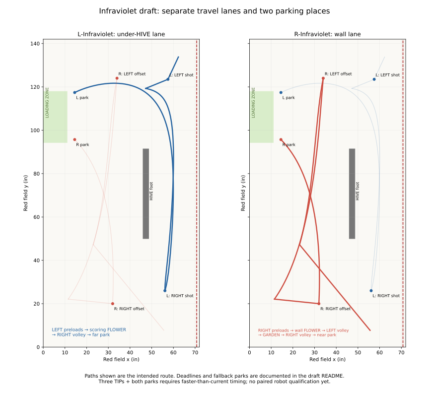

# Drafts

Planning Autos on master: a `.pp` here, its generated class and its request in
`TeamCode/sim-requests/`. The Infraviolet pair has Utility trials for bring-up, not
competition Autonomous entries. The Visualizer's Team Autos lists them
under "Drafts", and Save to GitHub saves back here.

## L-Infraviolet / R-Infraviolet: coordinated three-TIP draft

The selected pair follows the mentor's fresh-pickup plan. **R owns the wall lane;
L owns the lane under the HIVE.** Both have separate final parks, off every wall.
These are planning drafts with generated Java and simulation requests. Run them
from **Utility → Drive: L-Infraviolet / Drive: R-Infraviolet** for bring-up; the trial
requests STOP at 30 s. They are **not in the competition Autonomous menu**. L-NoCross and R-NoCross remain the qualified baseline
pending their robot runs. The older A/B alternatives are [benched](../BENCH.md).

Open both:
<https://mona-shores-ftc-robotics.github.io/Visualizer/#team=master/drafts/l-infraviolet.pp,drafts/r-infraviolet.pp>.

| Phase | R-Infraviolet | L-Infraviolet |
|---|---|---|
| TIP 1 | RIGHT preloads; collect WALL FLOWER | Move to LEFT_LAUNCH_CATCH; wait for LEFT up, then fire preloads |
| TIP 2 | Wall lane to LEFT_PAIR_OFFSET; add four | Hold position after preloads until TIP 2 starts; do not pick the scoring flower while R is shooting |
| Reload | Wall lane south to GARDEN; gather | SCORING FLOWER; cross south under HIVE |
| TIP 3 | Four into RIGHT from RIGHT_PAIR_OFFSET | Four into RIGHT from RIGHT_LAUNCH_CLOSE |
| Park | Wall lane to near RIGHT_PARK | North under HIVE to far LEFT_PARK |

L may finish its LEFT volley before R arrives. Their contributions still make the
same TIP; forcing L to wait solely to fire simultaneously would add no scoring.
The scoring-flower handoff uses **Tip**, after L's first volley: TIP 1 has already
settled before that volley starts, so the next event is TIP 2. This is evidence
that LEFT received enough weight, **not direct sensing of the partner's position**.
A missed TIP event takes the park fallback; the routine does not guess the flower
is free. R's departure and L's pickup must still be qualified together.

### Space and the two offset shots

The original RIGHT offset and close spots crowd the two robots. This draft uses
local wider offset points, leaving shared `spots.json` and the baseline Autos alone:

| Point (red frame) | x | y | Heading |
|---|---:|---:|---:|
| LEFT_PAIR_OFFSET (R) | 34 | 124 | 303.161° |
| LEFT_LAUNCH_CATCH (L) | 57.5 | 123.5 | 273.4° |
| RIGHT_PAIR_OFFSET (R) | 32 | 20 | 57.714° |
| RIGHT_LAUNCH_CLOSE (L) | 56.1 | 26 | 90° |
| RIGHT_PARK (R) | 14.5 | 95.7 | 0° |
| LEFT_PARK (L) | 14.5 | 117.4 | 0° |

The offset headings are geometric aim at the raised CELL row with the existing
turret offset. **Neither new offset shot is tuned on a robot.** The under-HIVE
paths turn outside the narrow corridor and hold a square heading through it.
Control points shape continuous curves; they are not extra stop positions.

### Explicit time limits and fallbacks

| Gate | Success | Timeout / late arrival |
|---|---|---|
| L: LEFT up before 8 s | Fire LEFT preloads | Wait until 21 s, then far park |
| R: LEFT up before 14 s | Fire LEFT, depart toward GARDEN | Near park from the LEFT offset |
| L: TIP 2 starts before 16 s | Pick scoring FLOWER and cross | Wait until 21 s, then far park |
| R: RIGHT up at GARDEN before 19 s | Gather and go to RIGHT offset | Near park without gathering |
| L: RIGHT up at close spot before 21.5 s | Final volley, far park | Far park without shooting |
| R: RIGHT up at offset before 22.5 s | Final volley, near park | Near park without shooting |

Timeout rows come first, so arriving after the cutoff parks even when the CELL-up
condition is already true. Every branch ends at that robot's assigned park. The
21 s clearance window prevents L's fallback from crossing R's LEFT shooting space.
It assumes R completes its scheduled departure; a mechanically stuck robot is not
detected by this pair. Stop the test if either robot loses its path.

R's LEFT volley and both final volleys have **1 s readiness timeouts**. Existing
AutoKit behavior protects an active feed: once it begins, it finishes at four
counted shots or the 3.5 s feed backstop. The timeout is not a one-second volley.
This budgets about 4.5 s for readiness plus feeding; the final cutoffs reserve the
drawn park time and a small arrival margin. A skipped or missed volley means the
three-TIP attempt fails; neither robot improvises a recovery through the other's lane.

### What the desk analysis does and does not establish

With all four pieces landing per volley, current timing facts do **not** demonstrate
three TIPs plus both parks. The planning comparison below uses the current drawing,
16.2 in square bodies plus the drawn protrusion, and estimated path motion:

| Timing scenario | Modeled TIPs | L ends | R ends |
|---|---:|---:|---:|
| Current timing: 4 s volleys + initial spin-up; 3.7 s flower; 5 s garden | 2 | 22.9 s | 23.1 s |
| Optimistic: 2.5 s volleys, 0.8 s spin-up, 3 s flower, 4.21 s garden, drives 10% faster | 3 | 27.1 s | 26.1 s |
| Both drive 20% slower than the drawing, current mechanism timing | 1 | 23.3 s | 16.7 s |
| Optimistic mechanisms, only L drives slower (0.8×) | 2 | 27.5 s | 26.1 s |
| Optimistic mechanisms, only R drives slower (0.8×) | 2 | 26.2 s | 27.5 s |

The optimistic third TIP settles around **25.5 s**. Those favorable values are a
scenario, not a measured paired run. Landing fewer than four per volley defeats
the five-volley, three-TIP budget; no spill catch is assumed.

The local analysis corrects two browser-preview limitations: it does not truncate
an already-feeding LaunchAll at its readiness timeout, and it budgets the measured/
registered GARDEN duration instead of the shorter drawn GARDEN animation. **The
current Visualizer clock can therefore look faster than this table**, especially
on the one-second readiness cards. Robot Java tests exercise protected feeds and
late-arrival branching; generic physics simulations are additional evidence, not
physical qualification.

Sampled nominal, slower, mismatched-speed, missed-shot and stationary-partner
scenarios showed no robot-to-robot overlap, including animated pickup/gather motion.
Driven paths clear the HIVE and centre line in the 16.2 in model. The inherited
wall-touching start poses overlap the model's wall by 0.4 in because its frame is
larger than the drawing's 15.44 in length; use the actual start marks, not that
simulation overlap, to reset the robot. None of these checks proves clearance under
odometry error, a snag, arbitrary start delay, or a robot stalled in a shared area.

Robot bring-up order is in [robot-todo §3](../../../doc/robot-todo.md): dry paths,
new offset volleys, actual handoff, measured reloads, then a complete paired run.
The critical target is **L ready to launch on RIGHT by 21.5 s**, with R ready by
22.5 s. If these cannot be met repeatably, keep the NoCross pair for Belding rather
than treating this draft as a qualified three-TIP Auto.

## R-Solo-Nudge, for a partner with no Auto

The revised draft uses the current R-Solo scoring positions and CELL-up branch, with
a short push after the WALL FLOWER pick. The partner drawing and our path are edited
together. The old 12.5 in diagonal push and its old simulation scores are superseded.

1. Partner starts nominally at **(8, 84), heading 90°**, square toward the loading
   zone, motionless for AUTO. Its 16 in drawn width touches the alliance wall and its
   front feature starts about 1.1 in outside the loading zone. Physical placement
   must use the actual robot's wall contact and envelope, not an assumed frame size.
2. Our robot curves from WALL_FLOWER_STAGING to **PARTNER_CONTACT (10.5, 67.8, 270°)**.
   It finishes turning over the first 60% and holds that heading on the final approach.
3. A deliberate **300 ms hold** lets the follower brake before pushing. The following
   straight path ends at **PARTNER_PUSH_END (10.5, 72, 270°)**: 4.2 in of our travel,
   including the initial contact gap, rather than a long diagonal shove. The drawn
   body contact model translates the partner about 3.4 in, leaving part of its body
   in the loading zone. It does not attempt to earn the partner LEAVE.
4. One continuous curve peels east and slightly south, then goes north to
   LEFT_LAUNCH_CLOSE. Its three control points **(30,68), (36,68), (26,116)** shape the
   curve; none is a robot stop. The separate PUSH_CLEAR stop is removed.
5. Continue Solo's shooting sequence, with our final park at **LEFT_PARK**, the far
   end of the zone. The partner occupies the near end. The timeout branch and spot
   parks also route around that occupied space.

The hold and short stroke are a controlled-contact draft, **not a numerical robot
speed or force cap**. The current Auto drawing has no per-path runtime speed setting;
changing its preview velocity would not enforce a gentle push on the robot. Before
an automated push, measure the contact gap, rolling resistance and actual approach
speed with the real partner. See `doc/robot-todo.md` §3. Two TIPs and both parks remain
the goal, not a newly measured result; the browser's conservative endgame preview
can skip the last volley, and its guard differs from the robot's.

The simulation request uses the locked-turret design and retains
`PartnerPushStartAuto` with `"pushable": true`. Its push-speed fraction remains a
placeholder, so simulation timing is not a measurement of contact behavior.

Open both the draft and its partner together:
<https://mona-shores-ftc-robotics.github.io/Visualizer/#team=master/drafts/r-solo-nudge.pp,partners/partner-push-start.pp>.
The first file is our editable draft; the second draws the partner placement beside it.
The simulation request retains `PartnerPushStartAuto` and `"pushable": true`.
There is no R-Solo-Nudge OpMode yet: this is a planning draft, not a qualified competition Auto.
