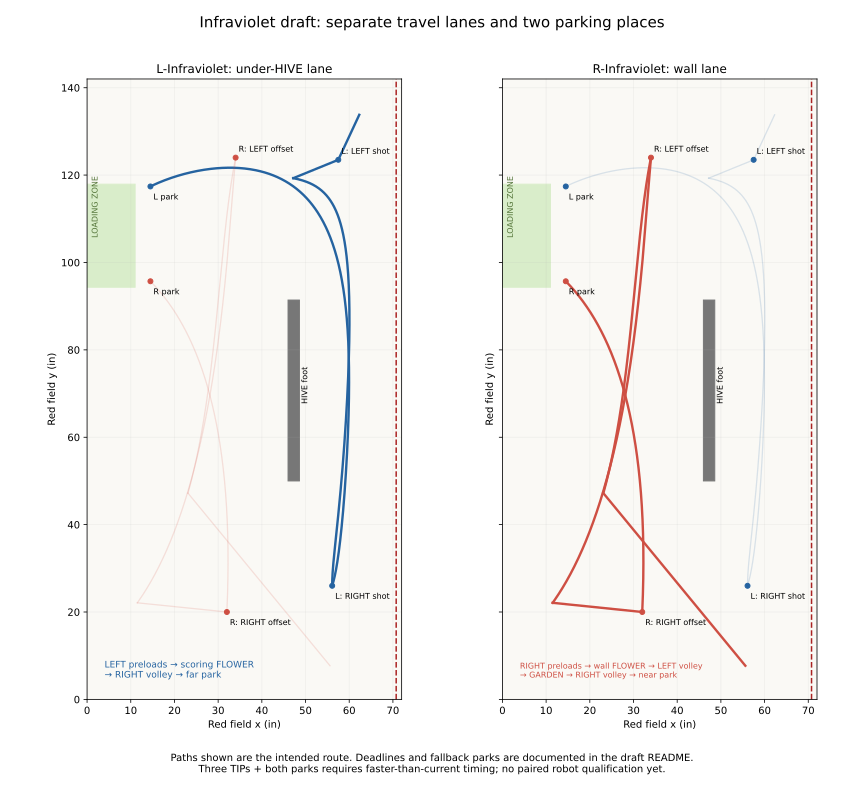

# L-Infraviolet / R-Infraviolet: coordinated three-TIP pair

**Competition Autos.** The pair was run on the robots and promoted from its Utility trials:
select **Autonomous → L-Infraviolet** on the LEFT_START robot and
**R-Infraviolet** on the RIGHT_START robot. They are a pair: run one only when the partner
runs the other. The Driver Station's 30 s AUTO timer stops them, as for any Autonomous.

**The assignment: L takes the garden early; R takes both flowers.** The previous
Infraviolet assignment is [preserved in history](BENCH.md#previous-infraviolet-assignment),
not another selectable Auto. NoCross and Solo remain unchanged.

Open the pair together:
<https://mona-shores-ftc-robotics.github.io/Visualizer/#team=master/l-infraviolet.pp,r-infraviolet.pp>.

| Phase | L-Infraviolet | R-Infraviolet |
|---|---|---|
| TIP 1 | Move to LEFT_LAUNCH_CATCH; **wait for LEFT CELL up**, then shoot preloads | Shoot RIGHT preloads, then collect WALL FLOWER |
| TIP 2 | Immediately cross south under HIVE; gather GARDEN | Wall lane to LEFT_LAUNCH_CLOSE; wait for LEFT up and shoot the wallflower load |
| Reload | Turn out of garden to the existing RIGHT_LAUNCH_OFFSET | Immediately collect SCORING FLOWER while TIP 2 settles, then turn forward into the south crossing |
| TIP 3 | Wait for RIGHT up, contribute four from the offset, then leave | Contribute four from local RIGHT_PAIR_CLOSE |
| Park | Wall lane to far LEFT_PARK, passing outside a robot already in near park | Clear above L's offset, then wall lane to near RIGHT_PARK |

Both crossings under HIVE go south, at different stages. L's garden collection
runs during R's LEFT work. L does not wait for TIP 2 before collecting, and the
scoring flower belongs only to R. Loose pieces encountered in transit are not
credited as a substitute for either four-piece pickup. There is no robot-to-robot
position signal: CELL-up gates establish scoring state, not partner clearance.

## Reused paths and the RIGHT shooting space

The opening LEFT_CATCH path is copied from L-NoCross. R's opening wallflower path,
wallflower-to-LEFT_CLOSE curve control point and LEFT_CLOSE-to-scoring-flower path
come from R-Solo. The wallflower exit turns north over the first 12% of travel
instead of continuing the old, slower heading change. L's empty crossing uses
R-Solo's under-HIVE controls and the straight R-NoCross garden approach. R uses the
upper controls of that corridor after its new forward flower exit. These are reused
drawing elements, not a claim that the newly combined routine has run on hardware.

Shared `spots.json` is unchanged. L keeps **RIGHT_LAUNCH_OFFSET (41, 20, 68.7°)**,
which the mentor reports is reliable. R's one new shooting point is
**RIGHT_PAIR_CLOSE (59.5, 31, approximately 97.2°)**: about **30.0 in** from turret
axis to the raised target row, approximately **9.4°** off straight-on. Its shot
needs qualification; no launcher tuning is changed here.

The old far LEFT offset is removed: with L already gone, R uses the existing
LEFT_CLOSE, about 37 in and straight-on. The original RIGHT offset and RIGHT_CATCH
body footprints overlap. Moving catch right makes the stationary positions fit,
but leaves too little space for a loaded turn beside L. This candidate instead
moves R toward a closer shot, allowing its approach and exit to clear L even if L
remains at the offset. The modeled centre-line margin there is only about 1 in along the approach (about 2 in at the shot):
check actual robot dimensions, tracking error and both alliance orientations.

## Loaded motion

Keep the normal short flower/garden backing-out routines; the mentor tunes those
as separate events. L turns forward out of the garden, R turns north promptly out
of the wallflower, and R turns forward out of the scoring flower before crossing.
The long loaded under-HIVE leg faces south throughout. Compound path sections are
one continuous drive, not a stop at every control point or junction.

There is still a short backward component while R turns into the final shot,
roughly six inches projected along its heading in the drawing. It is not a long
backward crossing, but retention during that final alignment must be tested. The
path drawing does not impose a special low runtime speed there. Intake holding
power and pickup backing-out settings are unchanged.

## Deadlines and parks

| Gate | Latest accepted match time | Timeout / late arrival |
|---|---:|---|
| L: LEFT up for preloads | Before 8 s | Far park; no garden or RIGHT volley |
| R: LEFT up for wallflower volley | Before 14 s | Near park from LEFT_CLOSE |
| L: RIGHT up at offset | Before 20 s | Far park without final volley |
| R: RIGHT up at close shot | Before 22.5 s | Near park without final volley |

Timeout rows come first: arriving at or after a deadline parks even if the CELL-up
trigger is true. R collects the scoring flower immediately after its LEFT volley;
the final RIGHT-up gate confirms TIP 2 before firing. This overlaps pickup with
TIP settling instead of spending about 1.4 s waiting at LEFT_CLOSE. L's
volleys and R's LEFT volley use a 1 s readiness timeout; R's final volley uses 0.5 s
to reserve its longer park. Qualify that shorter readiness window on the robot.
Once feeding starts, existing AutoKit protection allows the four-shot completion
or 3.5 s feed backstop; **one second is not the volley duration**. A late failed
pickup or stalled drive can still consume the park margin. The DS AUTO timer still stops both at 30 s.

## Full simulator result

At code commit `63cdc72b`, the L-first paired request runs both generated Autos,
Pedro paths and AutoKit against the turret-locked robot physics model:

| Seed | AUTO TIPs | L parked | R parked | Both LEAVE |
|---|---:|---:|---:|---|
| 1 | 3 (third at 25.52 s) | 23.20 s | 26.80 s | Yes |
| 2 | 2 | 23.42 s | 26.80 s | Yes |
| 3 | 2 | 23.48 s | 26.80 s | Yes |

All three execute all five volleys: L launches 8 pieces and R launches 12.
R reaches its final gate at 21.28 s and begins firing at 21.30 s, before the
22.5 s cutoff. The two incomplete third tips are scoring/retention outcomes in
the physics model, not skipped final volleys: the raised CELL ends about 91%
and 87% loaded. No robot overlap, centre-line crossing or HIVE-frame contact
is reported in these three runs. The wall-flower routine reports contact with
the FLOWER during pickup; this is inherited pickup motion, not frame clearance.

With R driving 20% slower, all three seeds get two tips and both parks. With
R missing every shot, both park without a tip. These are model results, not a
measured success rate or proof of the new shot on hardware. In particular the
simulator's intake can collect loose pieces whenever it has room; it does not
prove fourth-piece retention on the real robot.

The R-first request also gets three/two/two tips in nominal seeds 1–3. With L
driving 20% slower it retains those tip counts, both parks and both LEAVEs,
without robot overlap, centre-line crossing or HIVE-frame contact. L departs
toward the wall first (park controls 25,20 and 35,95), then north past the near
parked robot, clearing R's final aiming turn even in that slower-L case.

[Final full simulator run](https://github.com/Mona-Shores-FTC-Robotics/biobuzz/actions/runs/42265501484).

## Desk checks and the next robot test

The local paired model uses 16.2 in square bodies plus the drawn protrusion,
animated pickup motion, and 20 ms samples. Nominal, slower, missed-shot and
mismatched-speed runs had no sampled overlaps. R's final approach and park also
clear L held stationary at the RIGHT offset. Driven paths clear the HIVE and
centre line; the inherited wall-touching starts overlap the larger model by 0.4 in.

**A failed L robot still sitting at its start is not protected:** R's reused LEFT
approach/scoring-flower area overlaps it. This is a coordinated pair for two
functioning robots, not a recovery Auto for a dead partner. Stop the run when a
robot fails or loses its route. No clock or CELL-up event proves a shared area clear.

| Timing scenario | TIPs modeled | L finishes | R finishes |
|---|---:|---:|---:|
| Existing timing facts: initial 5.1 s launch, later 4 s, flower 3.7 s, garden 5 s | 2 | 24.8 s | 30.2 s |
| Faster scenario: initial 3.3 s, later 2.5 s, flower 3 s, garden 4.21 s, driving 20% faster | 3 | 21.7 s | 25.7 s |
| Faster mechanisms, L driving at 0.8× instead | 3 | 25.5 s | 25.7 s |
| Faster mechanisms, R driving at 0.8× instead | 2 | 21.9 s | 28.9 s |

The faster scenario's third TIP settles around **24.6 s**. It is a planning
scenario, not a measured paired result. The slower existing-facts case overruns
R's park by 0.2 s in this planning model, which does not execute AutoKit's runtime
endgame guard; it is not a guaranteed two-park result. The three-TIP plan needs the planned five volleys, with little margin for missed pieces. The local analysis budgets the full feeding time despite short
readiness limits, and uses the registered/measured garden time; the browser
preview can look faster because it currently truncates those durations.

Bring-up: verify L's first-tip wait, run each route empty, test the final RIGHT
positions and R's turn with L stationary, qualify the new close shot and loaded
exits, then run the full pair. Measure R ready to fire RIGHT before **22.5 s**; measure L ready at its offset
before **20 s**. Details: [robot-todo §3](../../doc/robot-todo.md).

## Same-day run order

The launcher stays on between volleys. Each launch asks the existing speed table
for the current camera/pose range (with the table enabled); it does not retain
the opening shot's target blindly. Intake remains controlled by the existing
pickup/feed routines. RIGHT_PAIR_CLOSE and its turret-offset aiming heading are
local to this pair (not team spots); shared catch/close spots are unchanged.

Use this single candidate pair; the roomier catch-distance alternative was screened
out because its loaded approach took longer and its park crossed an occupied L
shooting footprint. It is not on master.

1. Sloth Load master on both robots.
2. Select **L-Infraviolet** and **R-Infraviolet** in the Autonomous menu.
3. Place both at their normal LEFT_START / RIGHT_START marks with four preloads;
   choose the same alliance and start together. The DS AUTO timer stops both at 30 s.
4. Film the complete run. Check the first-tip wait, both parks, and whether the
   fourth piece survives R's last aiming turn. Stop if either robot stalls.

The full simulator initially truncated feeding at readiness timeouts; its registry
now protects an active feed and uses the robot's feed backstop/shot-count cutoff.
This correction changes simulated outcomes, not robot feed behavior. A regression
check exercises the short-timeout wallflower volley. R's missed-tip fallback now
passes below L's far park after clearing the HIVE, and its wallflower-to-LEFT
heading uses explicit quarter turns rather than an ambiguous half-turn reversal.
