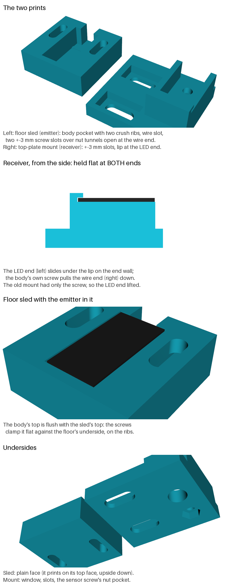
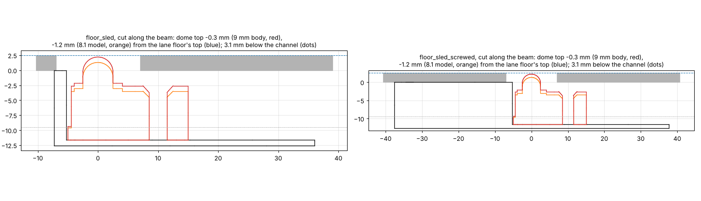
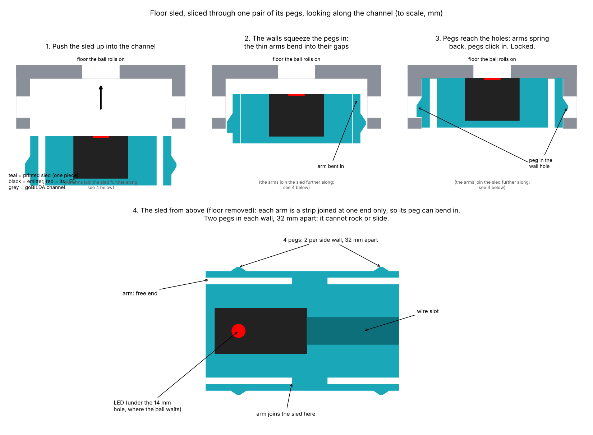
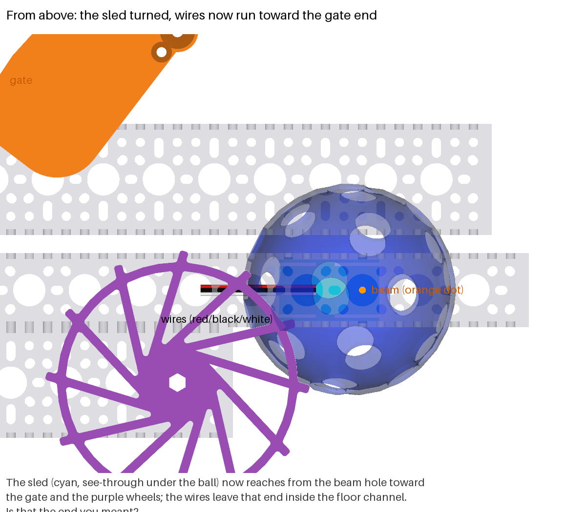
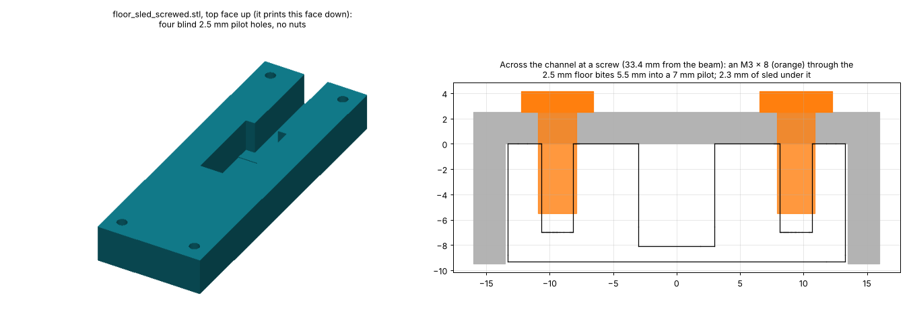
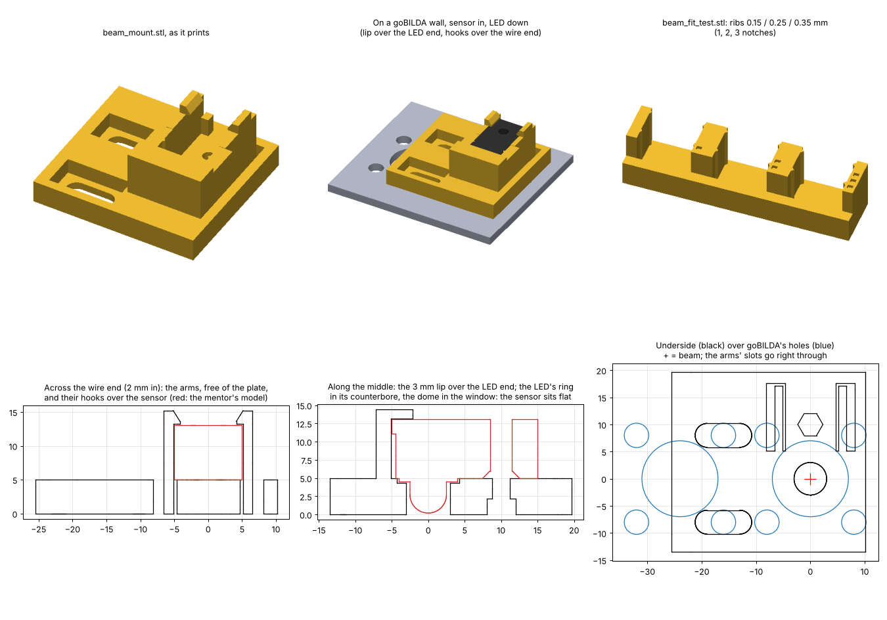

# Beam mounts: the new transfer's gate beam, and a holder for any goBILDA face

Two printed holders for the Adafruit 2168 IR break beam (issue #213), placed on the new transfer (the mentor's Onshape
export of 23 Nov 2026):

- **`floor_sled`**: the **emitter**, inside the lane's floor channel, under the spot where a ball waits at the gate.
  It shines up through the channel's 14 mm hole.
- **`beam_mount`**: the **receiver**, on the top plate over the lane, looking down through one of the plate's 14 mm
  holes. It bolts to any goBILDA face.




| File | What it is | Print |
|---|---|---|
| `floor_sled.stl` / `.3mf` | 28.6 x 43.3 x 9.3 mm (pins included). Upside down: its top face (the one with the sensor pocket) on the bed | 1 per robot |
| `floor_sled_screwed.stl` / `.3mf` | Option B: 26.6 x 75.3 x 9.3 mm, four pilot holes for floor screws (use 2 to 4), no pins, no nuts. Prints like the sled | 1 per robot, to try |
| `beam_mount.stl` / `.3mf` | 35.7 x 33.2 x 15.2 mm. Plate down, as exported | 1 per robot |
| `beam_fit_test.stl` / `.3mf` | 42.9 x 10.0 x 10.1 mm: three short receiver pockets, crush ribs 0.15 / 0.25 / 0.35 mm (1, 2, 3 notches). Press the body in wire end first, against the stop. Print it first | 1, once |
| `*.step` | The same parts as solids: import these into Onshape, not the STLs | |
| `floor_sled.py`, `parts.py` | Make them. Every size is a constant at the top | `pip install cadquery` |
| `render.py` | Draws `parts.png` (the receiver mount), `floor_sled_screwed.png` and `sensor_fit_sleds.png`, the sensor model seated in each | `+ trimesh manifold3d matplotlib` |
| `ref/ir_break_beam_5mm.step` | The mentor's model of the sensor (emitter and receiver): the fit reference | |

**Print:** PETG (PLA is fine indoors, but it creeps under the screws in a hot pit and its snap arms crack), 0.2 mm
layers, 4 walls, 40 % gyroid. No supports, no brim. Orientation, as exported:

- **Both sleds upside down**, the top face (the sensor pocket's open side) on the bed. The screwed sled's pilot holes
  open on the bed: if the first layer squashes them shut, run a 3/32 in (2.4 mm) drill through by hand.
- **`beam_mount` plate down.** The receiver's 3 mm lip prints as a bridge between the side walls; each snap arm stands
  on the bed on its own, joined at one end, so it bends along its layers, never across them. Its hooks overhang 1 mm.
- **`beam_fit_test` plate down.**

The sled's pins stick out 1 mm from its sides and print clean.

## Where the beam crosses, and why there

- **Behind the gate, under the ball's last spot.** Every ball passes this spot, and a ball waiting at the gate sits
  in the beam. The beam runs straight up, 5.7 mm from the waiting ball's centre: the floor channel's 14 mm hole nearest
  that ball (CAD x 14.1, z 140, in the transfer export's frame). In the CAD nothing else crosses that line: the gate
  swings 40 mm clear of it, and the purple wheel stack 32 mm clear.
- **It tells the code "a ball is at the gate", not "a ball has left".** While the gate is shut and a ball waits, it
  reads blocked. During a volley the balls come through touching, so it stays blocked until the last one has gone,
  then clears: that moment is "empty". It cannot count balls, because two touching balls leave no gap the robot can
  see. **The merged code (`throatBeam`, `FeedWatch`) expects a beam past the gate that clears between balls**, so this
  beam needs its own small code change before its switch goes on (see `doc/robot-todo.md`).
- **The emitter is below and the receiver above.** Looking down, the receiver sees the dark floor channel, not the
  venue lights through the top plate's hole and the ball's holes (halogen and sunlight carry enough IR to make a
  broken beam read clear). And dust falls on a window that faces up: on the emitter, a little dust does not matter.
- **The range** is the floor to the top plate, about 100 to 130 mm: the team's sensor is the Adafruit 2168, the 5 mm
  version, rated to 50 cm (the 2167 is the 3 mm one, 25 cm, in the same housing).

## Fitting the emitter (the floor sled)

> **Open question (27 Nov 2026), both sleds:** the mentor's model shows the LED's dome standing 4.8 mm above the
> body's face. With the face flush with the sled's top, against the floor's underside, the dome comes up through
> the floor's 14 mm hole and stands **2.3 mm above the lane floor**, under the waiting ball
> (`sensor_fit_sleds.png`). The sleds are unchanged until that is decided; do not fit one in the lane as drawn.







The floor there is the 11-hole goBILDA Mini U-Channel, lying open side down. Its inside is 27.0 mm wide and 9.5 mm
tall, and the sled is 26.6 wide and 9.3 tall: **nothing sticks out below the channel's edges, and nothing is on the
floor the balls roll on.** It holds by the channel's side walls: their 4 mm holes, every 8 mm, one level with each
14 mm hole. Four pins, two in each wall 32 mm apart, so it cannot rock, slide or drop.

1. Push the emitter into the sled's pocket, LED end against the closed end, wires along the middle slot to the far
   end. Its top face sits flush with the sled's top.
2. From below, put the sled up into the channel under the 14 mm hole nearest the ball's last spot, its long end (the
   wire end) away from the gate and the purple wheels, so the wires leave toward that end of the channel. Push it straight up: each pin sits on a springy arm (a strip of the sled joined at one end only), the
   channel's edges bend the arms in, and at the side-wall holes they spring back and the pins click in. The LED then
   sits on the 14 mm hole's centre: the holes place it, nothing to adjust.
3. **Wires** run inside the channel to its open end, with a zip tie through a side-wall hole there. Nothing hangs
   below.
4. **To take it out:** push the open side's two pins (the side facing the purple wheels, with nothing beside it
   there) in through
   their holes with two small screwdrivers, and pull the sled down. The other side's pins are ramped both ways and
   let go.
5. **Backup, only if a sled ever works loose:** drop an M3 nut into the slot in the sled's top (open side, halfway
   between the pins) before pushing it in, then an **M3 x 10 button head** through the open side's wall hole there
   into it. The head is outside the channel's wall on the open side, nowhere near the ball, reached straight on;
   unused, the slot is just an empty pocket.

### Option B: the screwed sled (`floor_sled_screwed`)



The same pocket, no pins, **no nuts** (head mentor, 27 Nov 2026: nothing hidden to drop or lose): 75 mm long, reaching
38 mm each way along the channel from the beam's hole. The screws cut their own threads in the plastic. Print both
sleds and keep the one that holds better.

1. Emitter in as for the snap sled.
2. Put the sled up into the channel, LED under the beam's 14 mm hole, wire end away from the gate. The pilot holes
   line up with the floor's 4 mm holes, and they place the sled: the LED lands on the hole's centre.
3. From the top, **M3 x 8 button heads** down through the floor's 4 mm holes 9.4 mm either side of the centre line,
   33 mm along the channel each way from the beam's hole, into the sled's **2.5 mm pilot holes** (blind, 7 mm
   deep). Four places, one per corner: use any two, one at each end, or all four. Turn them in slowly; they cut
   their thread. The two on the wheel side at the gate end sit under the purple wheels, so use them only if a
   screwdriver gets there.
4. **Where the screw ends:** through the 2.5 mm floor it bites 5.5 mm into the sled, inside a 7 mm pilot with 2.3 mm
   of sled still under it, so nothing comes out of the bottom. Each pilot has at least 2.5 mm of solid plastic on
   every side: to the sled's side, to the wire slot, to its end, and 15 mm or more to the sensor pocket. Only the
   head is in the lane: the balls cross the channel at the beam, 28 mm and more away, and a NECTAR's surface is
   10 mm or more above these heads, a POLLEN's 4.5 mm or more. Use M3 x 8: an M3 x 10 still ends inside (1.8 mm
   short of the bottom), an M3 x 12 would come through.
5. Snug, not tight: it pulls the sled, and the emitter on its crush ribs, flat against the floor. A thread that
   strips: see `doc/robot-todo.md`.

**Screws for option B:** 2 to 4 M3 x 8 button head. No nuts.

## Fitting the receiver (`beam_mount`, on the top plate)



The sensor is captured with no screw: the robot showed the first holder (a 1.5 mm lip and the body's own M2 screw)
let it work loose. Now:

- a **3 mm lip** over the LED end (printed as a bridge between the side walls);
- a **counterbore for the LED's ring** round the window, so the body's face sits flat on the plate;
- **side walls the body's full height**, each with two **crush ribs** that grip its sides (how hard is `RIB_CRUSH`,
  picked with `beam_fit_test`);
- two **snap arms**, one in each side wall at the wire end, each a strip of wall joined only at its LED end, with a
  hook 1 mm over the body's top edge (the floor sled's springy-arm idea);
- an **end wall** behind the wire end, so the body cannot slide out from under the lip, with a 6 mm slot to the
  plate for the wires.

1. **Print `beam_fit_test` first** and press the receiver into its three pockets; keep the rib size that grips it
   (see `doc/robot-todo.md`), set `RIB_CRUSH`, then print `beam_mount`.
2. Find the top plate's 14 mm hole straight over the emitter's hole (a square laid on the floor hole, or a laser
   level). Within about 5 mm is enough: the emitter's cone is wide, and the slots take up the rest.
3. Put the receiver in, **LED down**: slide its LED end under the lip, against the end wall, then press the wire end
   down between the arms until both click over its top edge. The wires leave through the end wall's slot. Pushed
   against the end wall, the LED sits over the window.
4. **To take it out:** spread the two arms outward with two thumbnails and lift the wire end.
5. **Backup only, if it ever works loose:** an **M2 x 12** through the body's 2.4 mm hole into an M2 nut in the small
   hex pocket underneath. Not needed otherwise.
6. Put a plain M4 nut in each of the two big tracks on top. Bolt the mount down onto the top plate with two **M4 x 8
   button heads** from underneath (the lane side), through the 4.5 mm holes 16 mm apart beside the beam hole. For a
   plate thicker than 2.5 mm use (plate + 5.5 mm), rounded up. The mount turns 180°, so the screws can go either side.
7. Slide it within its slots (±3 mm) until Check: Hardware reads the beam clear with nothing in it and broken with a
   hand in it, then tighten.

**Screws for the receiver:** 2 M4 x 8 button head and 2 M4 nuts. Backup only: 1 M2 x 12 and 1 M2 nut.

## The sensor: Adafruit 2168 (5 mm LEDs), as bought

The fit reference is the mentor's 3D model, **`ref/ir_break_beam_5mm.step`** (27 Nov 2026: one emitter and one
receiver, the same housing). `render.py` draws it seated in every part. Measured from it:

- **Body:** 20 x 10 x **8.1** mm, its four short edges rounded r 1. The QT50CM
  [datasheet](https://cdn-shop.adafruit.com/product-files/2168/C2917.pdf) (C2917, the part bought) says 9 thick, and
  Adafruit's page 8; the files use the model's 8.1, and the floor sled fitting fine on the robot agrees with it
  (at 9 its top would have stood 1 mm proud). **Calipers settle it before printing** (`doc/robot-todo.md`): a body of
  9 is `BODY_T = 9.0` in both `floor_sled.py` and `parts.py`, then run them again; the sleds' floor under the body
  would then be 0.3 mm, and `floor_sled.py` refuses to build below 0.8, so the sleds need a rethink at 9.
- **LED:** on a big face, 5 mm from one end, standing proud of it: a d8 ring 0.5 mm high, then the d5 dome, its top
  **4.8 mm above the face**. The receiver mount's plate is counterbored for the ring and its window takes the dome,
  so the body's face sits flat on the plate (the first two versions held it 0.5 mm off on the ring).
- **Mounting hole:** d3, countersunk on the LED face, 10 mm from the LED, 5 mm from the other end (the receiver
  mount's backup M2 screw only; the sleds do not use it).
- **Side grooves:** one down each long side, 2 mm wide and 0.5 deep, 4 to 6 mm from the end away from the LED, open
  at the LED face and stopping 2 mm short of the back. No crush rib lands in them. A 2 x 0.5 mm notch runs down the
  middle of the LED end too.
- **Electrical** (datasheet): 3.0–5.5 V, 10 mA, range 50 cm, receiving angle under 10°, response 2 ms. Emitter: red
  +5 V, black ground. Receiver: red +5 V, black ground, **yellow the output**, an NPN open collector (the datasheet
  shows 5.1 kΩ to 5 V; the hub's digital input pulls it up).
- **Leads:** 15 cm; the team extends them, so the wire routing does not depend on their length. The receiver's
  end wall has a 6 mm slot to the plate and nothing beyond it, so an extension's connector sits just past it.

## After measuring

Set `BODY_T`, `BODY_W`, `LED_FROM_END` (and `LED_TO_SCREW` in `parts.py`), then:

```
python3 cad/beam-mount/floor_sled.py && python3 cad/beam-mount/parts.py && (cd cad/beam-mount && python3 render.py)
```

`render.py` draws `parts.png`, `floor_sled_screwed.png` and `sensor_fit_sleds.png`. `floor_sled_steps.png` and `floor_sled_wires.png` (the
snap sled, unchanged) were drawn by a session from the same files; they are not redrawn by this command. Each script refuses to write a part that is not one valid solid, and
`floor_sled.py` asserts the screw's bite and the plastic round each pilot hole.

`lane_floor_placement.png` and `lane_floor_prints.png` were drawn from the transfer's STEP, which is not in the repo
(22 MB). To draw them again, export it from Onshape and ask a session to.
