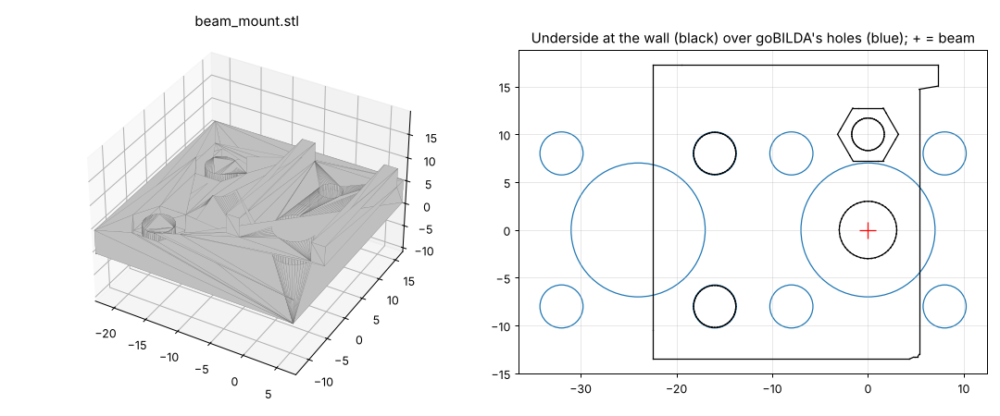

# Beam mount: one beam-break half on a goBILDA face

A printed holder for one half (emitter or receiver) of the Adafruit 2168 IR break beam, for the transfer's
beam-break (issue #213). It bolts to **any goBILDA channel face or plate** and looks through one of its 14 mm holes,
so it fits whatever lane walls the transfer ends up with, or the drive rails. Print two per beam, one for the emitter
and one for the receiver, facing each other across the lane.

| File | What it is | Print |
|---|---|---|
| `beam_mount.stl` | 30 x 31 x 9 mm, flat on the bed, no supports | 2 per beam |
| `parts.py` | Makes the STL. Every size is a constant at the top | `pip install trimesh manifold3d` |
| `render.py` | Draws the picture above | `+ matplotlib` |

## The sensor (not yet measured with calipers)

- **Body:** 20 x 10 x 8 to 9 mm (Adafruit says 8, the QT50CM datasheet 9).
- **LED:** looks out of a big face, 5 mm from the end **opposite the wires**.
- **The body's screw hole:** 5 mm from the wire end, 10 mm from the LED, on the same centre line.

These come from TheTapeWaster's holders and photos ([Thingiverse 2772303](https://www.thingiverse.com/thing:2772303),
CC BY) and a photo of a pair in another holder; the sources agree. Only the numbers are used: the mount isn't
their design.

## Fitting it

1. Pick the 14 mm hole the beam should pass through. On the transfer it's the one nearest **X 2.85 in, Z 1.96 in**
   (robot frame), just behind the pinch wheels. Use the matching hole on the opposite wall, so the beam runs straight
   across.
2. The mount's screws go through the two 4.5 mm holes **16 mm apart, 16 mm to one side** of that hole. Those holes
   belong to the ring of the next 14 mm hole along, and every goBILDA face has them. The mount turns 180°, so the
   screws can go either side.
3. Put an M3 nut in the small hex pocket in the **underside** first; the wall traps it there. Then put a plain M4 nut
   in each of the two big hex pockets on top.
4. Screw on with two **M4 x 8 button heads** from the lane side. That length suits a 2.5 mm goBILDA wall; for a
   thicker wall use (wall + 5.5 mm), rounded up. Only the two button heads end up in the lane.
5. Lay the sensor between the side walls, **LED down over the 6 mm window** and wires out the far end. Fix it with an
   **M3 x 14** through the body's hole into the trapped nut.

## Why it's shaped like this

- **The goBILDA pattern instead of a drawn wall.** The transfer's walls aren't in the CAD yet. On the robot CAD's 1107
  rails, a 14 mm hole sits right at the beam spot, with 4.5 mm holes at ±8 mm round it. That pattern is the same on
  every goBILDA face, so the mount doesn't need the wall's drawing, only one of its holes.
- **The sensor's own screw holds it**, so the short side walls only square it up, and both ends stay open for the wires.
- **No locating boss.** The 10° beam doesn't need better than the screws' ±0.25 mm. A flat back prints without supports.
- **The 6 mm window** fits a 5 mm LED's dome and shades the receiver a little from sunlight.
- **Nuts in the print, screws from the lane side**: no nut sticks into the lane for a piece to catch on.

## After measuring the sensor

Check the body's width, the LED's distance from its end and the LED-to-screw distance. Then change `BODY_W`,
`LED_FROM_END` and `LED_TO_SCREW`, run `python3 cad/beam-mount/parts.py`, and print again. If the body's hole is
smaller than M3, set the `S_*` constants to M2.5 (comments in `parts.py`).
