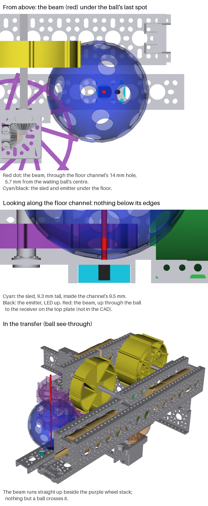

# Beam mounts: the new transfer's gate beam, and a holder for any goBILDA face

Two printed holders for the Adafruit 2168 IR break beam (issue #213), placed on the new transfer (the mentor's Onshape
export of 23 Nov 2026):

- **`floor_sled`**: the **emitter**, inside the lane's floor channel, under the spot where a ball waits at the gate.
  It shines up through the channel's 14 mm hole.
- **`beam_mount`**: the **receiver**, on the top plate over the lane, looking down through one of the plate's 14 mm
  holes. It bolts to any goBILDA face.




| File | What it is | Print |
|---|---|---|
| `floor_sled.stl` / `.3mf` | 28.6 x 43.3 x 9.3 mm (pins included). Upside down: its top face (the one with the sensor pocket) on the bed | 1 per robot |
| `floor_sled_screwed.stl` / `.3mf` | Option B: 26.6 x 81.2 x 9.3 mm, four floor-screw places (use 2 to 4), no pins. Prints like the sled | 1 per robot, to try |
| `beam_mount.stl` / `.3mf` | 32.7 x 30.7 x 14.3 mm. Plate down, as exported | 1 per robot |
| `*.step` | The same parts as solids: import these into Onshape, not the STLs | |
| `floor_sled.py`, `parts.py` | Make them. Every size is a constant at the top | `pip install cadquery` |
| `render.py` | Draws `parts.png` (the receiver mount on a goBILDA wall) | `+ trimesh manifold3d matplotlib` |

**Print:** PETG (PLA is fine indoors, but it creeps under the screws in a hot pit), 0.2 mm layers, 4 walls, 40 %
gyroid. No supports. The sled's pins stick out 1 mm from its sides and the receiver's lip overhangs 1.5 mm; both print clean.

## Where the beam crosses, and why there

- **Behind the gate, under the ball's last spot.** Every ball passes this spot, and a ball waiting at the gate sits
  in the beam. The beam runs straight up, 5.7 mm from the waiting ball's centre: the floor channel's 14 mm hole nearest
  that ball (CAD x 14.1, z 140, in the transfer export's frame). In the CAD nothing else crosses that line: the gate
  swings 40 mm clear of it, and the purple wheel stack 32 mm clear.
- **It tells the code "a ball is at the gate", not "a ball has left".** While the gate is shut and a ball waits, it
  reads blocked. During a volley the balls come through touching, so it stays blocked until the last one has gone,
  then clears: that moment is "empty". It cannot count balls, because two touching balls leave no gap the robot can
  see. **The merged code (`throatBeam`, `FeedWatch`) expects a beam past the gate that clears between balls**, so this
  beam needs its own small code change before its switch goes on (see `doc/robot-todo.md`).
- **The emitter is below and the receiver above.** Looking down, the receiver sees the dark floor channel, not the
  venue lights through the top plate's hole and the ball's holes (halogen and sunlight carry enough IR to make a
  broken beam read clear). And dust falls on a window that faces up: on the emitter, a little dust does not matter.
- **The range** is the floor to the top plate, about 100 to 130 mm: fine for both the 3 mm (25 cm) and the 5 mm
  (50 cm) versions of the 2168.

## Fitting the emitter (the floor sled)


The floor there is the 11-hole goBILDA Mini U-Channel, lying open side down. Its inside is 27.0 mm wide and 9.5 mm
tall, and the sled is 26.6 wide and 9.3 tall: **nothing sticks out below the channel's edges, and nothing is on the
floor the balls roll on.** It holds by the channel's side walls: their 4 mm holes, every 8 mm, one level with each
14 mm hole. Four pins, two in each wall 32 mm apart, so it cannot rock, slide or drop.

1. Push the emitter into the sled's pocket, LED end against the closed end, wires along the middle slot to the far
   end. Its top face sits flush with the sled's top.
2. From below, put the sled up into the channel under the 14 mm hole nearest the ball's last spot, its long end (the
   wire end) away from the gate and the purple wheels, so the wires leave toward that end of the channel. Push it straight up: each pin sits on a springy arm (a strip of the sled joined at one end only), the
   channel's edges bend the arms in, and at the side-wall holes they spring back and the pins click in. The LED then
   sits on the 14 mm hole's centre: the holes place it, nothing to adjust.
3. **Wires** run inside the channel to its open end, with a zip tie through a side-wall hole there. Nothing hangs
   below.
4. **To take it out:** push the open side's two pins (the side facing the purple wheels, with nothing beside it
   there) in through
   their holes with two small screwdrivers, and pull the sled down. The other side's pins are ramped both ways and
   let go.
5. **Backup, only if a sled ever works loose:** drop an M3 nut into the slot in the sled's top (open side, halfway
   between the pins) before pushing it in, then an **M3 x 10 button head** through the open side's wall hole there
   into it. The head is outside the channel's wall on the open side, nowhere near the ball, reached straight on;
   unused, the slot is just an empty pocket.

### Option B: the screwed sled (`floor_sled_screwed`)

The same pocket, no pins: 81 mm long, reaching 40 mm each way along the channel from the beam's hole. Print both and
keep the one that holds better.

1. Emitter in as for the snap sled. Slide an M3 nut into each tunnel you will use (one in each corner, opening at
   the sled's ends) until it sits under its slot.
2. Put the sled up into the channel, LED under the beam's 14 mm hole, wire end away from the gate.
3. From the top, **M3 x 8 button heads** down through the floor's 4 mm holes 9.4 mm either side of the centre line,
   33 mm along the channel each way from the beam's hole, into the nuts. Four places, one per corner: use any two,
   one at each end, or all four. The two on the wheel side at the gate end sit under the purple wheels, so use them
   only if a screwdriver gets there. The balls cross the channel at the beam: a NECTAR's surface is 10 mm or more
   above these heads, a POLLEN's 4.5 mm or more. An M3 x 8 ends inside the sled; a 10 would poke out of the bottom.
4. Slide the sled to centre the LED in the hole (the slots allow 3 mm either way), then tighten: it pulls the sled,
   and the emitter on its crush ribs, flat against the floor.

## Fitting the receiver (`beam_mount`, on the top plate)

1. Find the top plate's 14 mm hole straight over the emitter's hole (a square laid on the floor hole, or a laser
   level). Within about 5 mm is enough: the emitter's cone is wide, and the slots take up the rest.
2. Put the receiver into the cradle, **LED down**: slide its LED end under the lip on the end wall, then lay the wire
   end down. Fix it with an **M3 x 14** through the body's hole into an M3 nut in the small hex pocket underneath.
   **It is held at both ends, so it sits flat.** The first version held only the screw end, and on the robot its LED
   end stood proud.
3. Put a plain M4 nut in each of the two big tracks on top. Bolt the mount down onto the top plate with two **M4 x 8
   button heads** from underneath (the lane side), through the 4.5 mm holes 16 mm apart beside the beam hole. For a
   plate thicker than 2.5 mm use (plate + 5.5 mm), rounded up. The mount turns 180°, so the screws can go either side.
4. Slide it within its slots (±3 mm) until Check: Hardware reads the beam clear with nothing in it and broken with a
   hand in it, then tighten.

## The sensor (not yet measured with calipers)

- **Body:** 20 x 10 x 8 mm (Adafruit; the QT50CM datasheet says 9). **Measure the thickness first.** The sled's floor
  under the body is 9.3 − thickness: 1.3 mm at 8, and `floor_sled.py` refuses to build below 0.8. The receiver's lip
  sits 0.1 mm over the thickness you set. Change `BODY_T` in both files and run them again.
- **LED:** looks out of a big face, 5 mm from the end opposite the wires.
- **The body's screw hole:** 5 mm from the wire end, 10 mm from the LED, on the same centre line (the receiver only).

These come from TheTapeWaster's holders and photos ([Thingiverse 2772303](https://www.thingiverse.com/thing:2772303),
CC BY) and a photo of a pair in another holder; the sources agree. Only the numbers are used: the mounts aren't
their design. If the body's hole is smaller than M3, set `parts.py`'s `S_*` constants to M2.5 (comments there).

## After measuring

Set `BODY_T`, `BODY_W`, `LED_FROM_END` (and `LED_TO_SCREW` in `parts.py`), then:

```
python3 cad/beam-mount/floor_sled.py && python3 cad/beam-mount/parts.py && (cd cad/beam-mount && python3 render.py)
```

`lane_floor_placement.png` and `lane_floor_prints.png` were drawn from the transfer's STEP, which is not in the repo
(22 MB). To draw them again, export it from Onshape and ask a session to.
