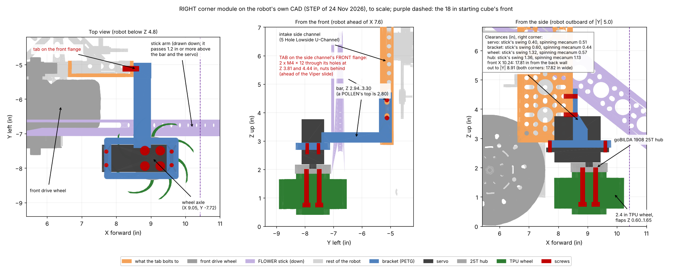

# Corner wheels: prototype 3, fitted to the robot's own CAD

These parts put a TPU flap wheel on a vertical axle at each front corner, ahead of the front drive wheel, turned inward
by a CR servo. They rake a POLLEN at the robot's corner, or one pinned on a wall there, into the intake mouth. Why, and
the rules: [`doc/corner-wheels.md`](../../doc/corner-wheels.md).

**Prototype 3 (24 Nov 2026)** is placed on the mentor's STEP export of the whole robot as it is now, not the 31 Oct
model:

- The servo sits **outboard of the FLOWER stick's arm**, spline down, its body pointing back.
- The printed bracket bolts to the **front flange of the intake's side channel**, the 5 Hole Lowside U-Channel the
  intake's Viper slide runs inside. Its two M4 nuts sit in the gap ahead of the slide, so nothing reaches the slide.

The modules are drawn for the **right** corner's stick arm (|Y| 6.60..7.08). **The left module is its mirror image**,
which assumes the left arm moves out to match the right. Today the left arm is at |Y| 5.99..6.47, and the left module
clears it anyway (0.91 in).

## Where it bolts

**To the intake side channel's front flange,** the narrow strip of the channel that faces forward, 12 mm wide, just
ahead of the front drive wheel. It has a row of 4 mm holes, 8 mm apart, from Z 3.18 in up.

- **The holes:** the tab uses two of them, **Z 3.81 and 4.44 in**, the 3rd and 5th from the bottom.
- **The bolts:** M4 × 12 from the front, with nuts behind the flange.
- **Why not the two lowest holes:** behind them a nut would sit only 0.02 in above the Dual Block inside the channel.

## Parts per robot

| Item | Qty | Notes |
|---|---|---|
| `flap_wheel` (print) | 2 | **One file for both corners**: the same either way up. **Left corner:** this way up (it turns clockwise from above, flaps trailing). **Right corner:** upside down. **TPU 95A**, 3 walls, 30 % infill, no supports. 2.4 in (61 mm) across, 36.7 mm tall |
| `bracket_left` / `bracket_right` (print) | 1 each | **PETG**, 4 walls, 40 % infill. Mirror images |
| goBILDA 2000 Series Dual Mode Servo, continuous mode | 2 | Or any standard servo with a 40 × 20 body and 48 × 10 mm flange holes |
| goBILDA 1908 Series Servo Hub (25 Tooth Spline, 32mm Diameter) | 2 | Counterbored face toward the wheel |
| M4 × 30 socket head | 8 | Wheel to hub, from below, heads in the wheel's counterbores |
| M3 × 10 self-tapping | 8 | Up through the servo's flange into the shelf |
| M4 × 12 and M4 nuts | 4 + 4 | Tab to the channel's front flange |

## The stack, from the floor up (inches)

| Part | Z |
|---|---|
| Wheel flaps | 0.60..1.65 (a POLLEN's middle, 1.40, inside them); the wheel's bosses 0.40..1.85 |
| Hub | 1.85..2.16 |
| Servo top cap and flange (upside down) | 2.02..2.69 |
| Shelf | 2.69..2.94 |
| Bar to the tab | 2.94..3.30, so raked POLLEN (2.80 tall) roll under it |
| Servo body | up to 3.76 |
| Tab | 2.94..4.70 |

**Positions:**
- **Axle:** X 9.05, |Y| 7.72.
- **Servo:** X 7.59..9.73 with its tabs, |Y| 7.33..8.11.
- **Wheel:** to X 10.24 and |Y| 8.91.

## Clearances in the robot's CAD

Measured with the stick swept 162° up from its down pose, and each mecanum spun a full turn:

| | Right | Left (as the CAD is now) |
|---|---|---|
| Servo to the stick | 0.40 in | 0.91 in |
| Bracket to the stick | 0.60 in | 0.68 in |
| Wheel to the stick | 1.32 in | 1.58 in |
| Servo to the spinning mecanum | 0.51 in | 0.52 in |
| Bracket to the spinning mecanum | 0.44 in | 0.45 in |
| Wheel to the spinning mecanum | 0.57 in | 0.58 in |

**Size:**
- **Length:** front X 10.24, which is **17.81 in from the back wall** (X −7.57). With the stick retracted it stays
  within X −0.16..6.82, so the corner wheels are the front of the robot.
- **Width:** both corners together, **17.82 in**.

## Check on the robot before printing

1. Measure from the back wall to the front of the drive wheels. In the CAD it's 15.14 in. The corner wheels add
   2.67 in beyond that.
2. Find the side channel's front-flange holes at 3.81 and 4.44 in up from the tile. Check that an M4 nut fits behind
   each, in front of the Viper slide.
3. Lower the stick slowly by hand past the servo before running it powered.

## Files

| File | What |
|---|---|
| `corner_module_left.step`, `corner_module_right.step` | Each corner assembled in the robot frame (inches in the comments, mm in the file): bracket, servo, hub, wheel, screws |
| `flap_wheel.*`, `bracket_*.*` | The printed parts |
| `parts.py` | Makes them. Every size is a constant at the top. `pip install cadquery` |
| `drawings.py` | The pictures and the clearances, from the robot's STEP (not in git: pass its path) |
