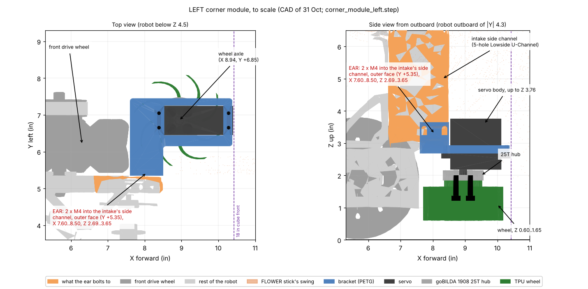

# Corner wheels: prototype 2

These parts put a TPU flap wheel on a vertical axle at each front corner, ahead of the front drive wheels, turned
inward by a CR servo. They rake a POLLEN at the robot's corner, or one pinned on a wall there, into the intake mouth.
Why, where they go, and the rules: [`doc/corner-wheels.md`](../../doc/corner-wheels.md).

**Prototype 2 (24 Nov 2026) fixes the servo.** Prototype 1 had the servo's body hanging below its plate. A standard
servo's flange is near its spline end, so upside down its body stands *up* above the flange. The plate now sits on
the flange and the body passes up through it. Prototype 1 also had no hub; the wheel now bolts to a goBILDA 25T hub.

**Start in Onshape with `corner_module_left.step` and `corner_module_right.step`.** Each is one corner already put
together in the robot frame: bracket, servo, hub, wheel and screws. Insert it, then line the bracket's ear up on the
face it bolts to (below). The robot frame is millimetres, +X forward, +Y left, +Z up, origin on the floor under the
middle of the four drive axles. That isn't the Onshape assembly's origin, so mate the ear rather than trusting the
coordinates. The servo and hub in them are envelopes drawn from goBILDA's STEP files: insert goBILDA's own
(2000-0025-0002, 1908-0025-0032, from gobilda.com) if you want the detail.

## Where each ear bolts

| Corner | Ear bolts to | Where (robot frame, inches) |
|---|---|---|
| **Left** | The **outer face of the intake's left side channel** (the 5-hole Lowside U-Channel the Viper slide is on), just ahead of the front drive wheel | Face at Y +5.35; ear X 7.60..8.50, Z 2.69..3.65 |
| **Right** | The **front face of the short 2-hole channel** standing in front of the right drive wheel | Face at X 7.87; ear across Y −5.55..−7.15, Z 2.69..3.65 |

Each ear has two vertical M4 slots, 16 mm apart, with 8 mm of travel to find the channel's holes. If the holes don't
line up, drill.

## Parts per robot

| Item | Qty | Notes |
|---|---|---|
| `flap_wheel_left` / `flap_wheel_right` (print) | 1 each | **TPU 95A**, boss down as exported, 3 walls, 30 % infill, no supports. 63.5 mm (2.5 in) across, 31.7 mm tall. The two are mirror images because they turn opposite ways |
| `bracket_left` / `bracket_right` (print) | 1 each | **PETG**, plate down as exported, 4 walls, 40 % infill, no supports. The two differ, not just mirrored: the right stick arm sits 0.45 in further out, and the right ear bolts to a front face |
| goBILDA 2000 Series Dual Mode Servo, continuous mode | 2 | Or any standard servo with a 40 × 20 body and 48 × 10 mm flange holes. Set to continuous with goBILDA's servo programmer |
| goBILDA 1908 Series Servo Hub (25 Tooth Spline, 32mm Diameter), 1908-0025-0032 | 2 | Counterbored face toward the wheel, with the servo's screw in it |
| M4 × 16 socket head | 8 | Wheel to hub, from below: heads in the wheel's counterbores, about 4 mm into the hub's threaded holes on the 16 mm circle |
| M3 × 10 self-tapping, or M3 × 12 with 3.4 mm drilled holes and nuts | 8 | Up through the servo's flange slots into the plate |
| M4 × 8 or × 10 with nuts | 4 | The ear to the channel |

## The stack, from the floor up (inches)

| Part | Z |
|---|---|
| Wheel flaps | 0.60..1.65 (a POLLEN's equator, 1.40, inside them) |
| Wheel boss | 1.65..1.85 |
| Hub | 1.85..2.16 |
| Servo top cap and flange (upside down) | 2.02..2.69 |
| Bracket plate | 2.69..2.94 |
| Servo body, through the plate | up to 3.76 |
| Ear | up to 3.65 |

- **Axle:** X 8.94, Y +6.85 (left) and −6.95 (right).
- **Servo body:** runs forward from the spline on both corners, X 8.26..10.40 with the flange tab. That is 0.03 in
  inside the 18 in starting cube's front, X 10.43.
- **Reach:** the wheel's rim comes 2.62 in ahead of the drive wheels and about 0.45 in past each frame side.
- **Spin:** the front of each wheel moves inward. Fit the wheels so the flaps' tips trail.

## Clearances in the CAD

Measured with the stick swept through its whole 0..162° swing (`drawings.py` prints them):

| | Left | Right |
|---|---|---|
| Wheel to the stick | 0.75 in | 0.56 in |
| Servo to the stick | 0.58 in | 0.24 in |
| Hub to the stick | 0.88 in | 0.66 in |
| Bracket to the stick | 0.23 in | 0.25 in |
| Wheel to the frame | 0.34 in | 0.08 in, under the short channel |

The servo sits outboard of the stick arm's band, so the arm's low pass over its own band never reaches it.

## Check before printing, on each robot

1. **Put the stick down and measure its arm's outer face from the robot's centre line.** The CAD says 5.88 in (left)
   and 6.32 in (right). The servo's inner side is at |Y| 6.46 (left) and 6.56 (right). On 19429, also check the
   blue GARDEN guide.
2. **Look at what each ear bolts to:**
   - Left: the side channel's outer face, clear from X 7.60 to 8.50 and Z 2.69 to 3.65.
   - Right: the short channel's front face.
   - If the right channel isn't on the robot, giving the right bracket a side ear like the left one is a change to
     `SIDES["right"]` in `parts.py`.
3. **Lower the stick slowly by hand past the servo** before running it powered.

## Files

| File | What |
|---|---|
| `corner_module_left.step`, `corner_module_right.step` | Each corner assembled in the robot frame |
| `flap_wheel_*.step/.stl/.3mf`, `bracket_*.step/.stl/.3mf` | The printed parts, as they print |
| `parts.py` | Makes them all. Every size is a constant at the top. `pip install cadquery` |
| `drawings.py` | The corner-module pictures in `doc/corner-wheels/` and the clearances |

**Re-run `parts.py`, then `drawings.py`, after any change, and commit the outputs.**
