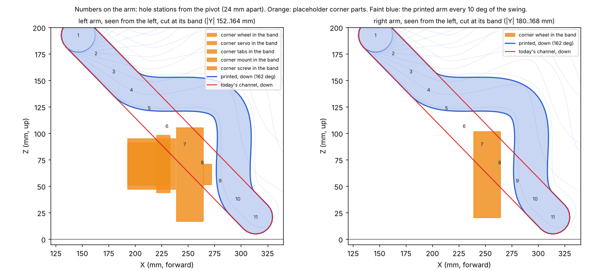

# Printed FLOWER stick arms

**Status: for checking in Onshape, not for printing yet.** The corner wheel's servo and mount are placed from
photos, the mentor's description and the 26 Nov clip, not measured. Put `arm.step` (or `arm_hump40.step`) into the
robot's Onshape assembly first and look at it against the real corner (below).

The idea (mentor, 26 Nov 2026): keep the FLOWER stick's arms exactly where they are, but print them, so an arm can
ride over the corner wheel's servo, which today's flat goBILDA bar can't. The stick is now for FLOWER picks only
(no GARDEN gathers).



## The stick, as a U

| Piece | What | Print / buy |
|---|---|---|
| `arm.step` / `.stl` | Each arm. Both sides use the same part; on the right it goes on flipped. Today's pivot hole and tip hole, 240 mm apart (10 hole stations), with goBILDA's hub patterns round both, so the axle, its hub, the servo hub and the tip shaft bolt on as now | PETG, **on its side** (the flat web down), 4 walls, 40 % gyroid, no supports. 2 per robot |
| `arm_hex_pivot.*` | The same, with a 1/2 in hex bore at the pivot, if the axle through both pivot bosses becomes hex | the same |
| `arm_hump40.*` | A more pronounced hump (40 mm), only for looking at in Onshape | — |
| `foot_skid.*` | Foot (a): a smooth puck in the tip roller's place, the roller's size, bolted to the arm so it never turns | PETG, arm face down. 2 per robot |
| the 312 mm 8 mm REX shaft | Stays, across the tips. It is the mountain's axle and the U's tip cross member | today's |
| `mountain_wide_2in` | Stays on the shaft, between hubs and spacers, as now | today's |
| the pivot axle | Through both arms' pivot bosses, driven by today's servo hub. 8 mm REX as now, or 1/2 in hex with `arm_hex_pivot` | today's |

**Why there's no printed cross piece.** With the stick down, anything spanning between the arms behind the mountain
sits 1.0 to 2.4 in off the tile, across the intake mouth: where the FLOWER is during a pick. The only room across the
tip that the FLOWER leaves free is where the shaft and the mountain already are. A printed beam as stiff as the 8 mm
steel shaft wouldn't fit there, and the mountain needs the shaft as its axle anyway (its hex bore).

## What changes on the arm

- **The hump.** Around hole stations 5 to 7 (counted from the pivot, 24 mm apart) the arm bows forward and up (seen
  with the stick down), so its lower edge passes over the corner wheel's servo and mount with 4 mm (half a goBILDA
  hole) to spare through the whole 0..162° swing. `parts.py` sizes it from the corner parts in `geometry.py`: today
  24.5 mm high. It leaves the old line at hole 3.5 and is back on it by hole 8.3; the arm's centre line never bends
  tighter than a 22 mm radius, which sets how long the ramps are. The pivot and tip holes don't move.
- **The ends** stop 16 mm past the pivot and tip holes (the channel went 24). The arm then fits a Prusa
  250 × 210 mm bed, laid corner to corner, and its tip no longer pokes past the roller.
- **The section** is a ribbed channel: a 2.4 mm web (the face on the bed, against the arm's inner side on the robot),
  3 mm walls round the edges, diagonal ribs, 12 mm deep (the channel's band). Solid round the pivot and the tip.

**Moving the arm outboard instead** (the mentor's first choice): the width is fine (both arms 2 in out: 16.2 in
across, under R102/R105's 18 in) and the FLOWER pick doesn't change (the mountain stays on the same axis, so its lip
height and angle are the same; the feet move further from the FLOWER's sides). It needs a longer tip shaft (about
360 mm for 1 in, 408 mm for 2 in) and a spacer at each pivot. **Whether it clears depends on where the servo mount
sits across the robot,** which these files only guess: with the guess here, a 1 to 2.5 in shift still meets the
mount and the wheel's top between holes 5 and 7. The hump clears whatever the mount's sideways position, so it is
what's drawn.

## Clearance through the swing

`check.py`, 0..162° in 3° steps plus 162°. The corner: the SWYFT wheel from its STEP (`vendor/`), two side by side
(25.4 mm), and the servo and its mount as boxes, **placed** (`geometry.CORNER`) so today's straight arm meets them
between holes 5.2 and 7.0, as the mentor saw. The rest of the robot: the 31 Oct CAD (no corner wheels, no transfer).
`clearance.json` has every number.

CLEARANCE_TABLE

## The tip, the feet and the FLOWER

**What the tip touches during a pick** (the 31 Oct CAD, `FlowerFieldPoints`, `FlowerPicker`, the pick study):

- **The tile.** Down, the stick rests on its tip rollers. Their rim holds the mountain's nose 0.44 in off the tile,
  0.09 in over the FLOWER's 0.35 in lip. Both feet keep that rim exactly, or the nose catches the lip (19429's
  14 Nov stalls).
- **Not the FLOWER.** The rollers are 5.1 in or more out from the middle; the FLOWER's base is about 2.35 in each side
  (a placeholder in `FieldSim`). Only the mountain goes under it. A pick more than about 2.7 in off centre puts a
  foot against the FLOWER's side.
- **Nearly the wall.** At `FlowerPicker`'s 9.0 in contact standoff the wall is about 13.9 in ahead of the drive axles.
  Today's roller reaches 13.4 in: half an inch short. A pose that runs long closes that.

**Which foot:** (b), **today's roller, kept where it is** (no printed part; it stays on the shaft). It rolls on the
drive in and the back out, and 20245's held stick on rollers is the only version that met the bar (4 of 4 on every
clearly seen pick). (a), the skid, slides: PETG on foam tile, over the seams, with the servo holding it down. Print
it as a spare and try it on 10 picks against the roller before trusting it. **A wheel sticking out past the end is
not offered:** at the contact standoff it would reach the wall before the FLOWER seats and stop the push short.

## Weight and the servo

`torque.py`: the gravity moment about the pivot, both arms, through the swing (kg·cm).

TORQUE_TABLE

The FLOWER-stick servo is a SWYFT (the label in the 26 Nov clip reads "BALANCE"; the Hub says Torque). SWYFT's table
gives Balance 27.3 and Torque 33.5 with no unit; read as kg·cm. The margins above are against goBILDA Torque's
25 kg·cm stall, as the Hub asked.

## Print time and weight

PrusaSlicer 2.7, PETG, 0.4 nozzle, 0.2 mm layers, 4 walls, 40 % gyroid, a 250 × 210 bed (`slice.ini`; `slice-fast.ini`
is a faster printer). `print-estimates.json`.

PRINT_TABLE

Today's aluminium arm is ESTIMATED at 75 g (weigh one).

## In Onshape

`arm.step` is in its own frame: the pivot hole on the origin, the tip hole at +X 240 mm, the flat web face on Z 0,
the hump toward +Y. Mate the pivot hole to the stick's axle and the tip hole to the shaft, the web face against
where the channel's inner face is, and the hump on the side away from the tile when the stick is down. Then swing
the stick and look at the corner servo and mount. If a stretch still touches, tell the session the hole station and
how much; `geometry.CORNER` takes it and every file here regenerates.

## The files

| File | What |
|---|---|
| `geometry.py` | The robot frame, the arm's line and swing, the corner parts (placed, not measured) |
| `parts.py` | Builds the parts; sizes the hump |
| `check.py` | The swing clearance check (`clearance.json`) |
| `torque.py` | Weight and holding torque (`torque.json`) |
| `render.py` | `render_*.png` |
| `vendor/` | SWYFT's STEP of the 3.5 in Intake Wheel (1/2 in hex), from the mentor |

```
pip install cadquery numpy trimesh scipy matplotlib
python3 cad/flower-printed-arms/parts.py && python3 cad/flower-printed-arms/check.py
python3 cad/flower-printed-arms/torque.py && python3 cad/flower-printed-arms/render.py
```

## Before printing

1. In Onshape, both corners: the arm (24.5 mm hump, and the 40 mm one) against the real servo and mount, swung
   through.
2. Print one arm first; check the 14 mm holes take the bearing and the hubs (drill to 4.5 if an M4 binds), and that
   the axle and shaft run true.
3. 10 FLOWER picks on the bench with the printed arms, counting 4 of 4, against today's.
