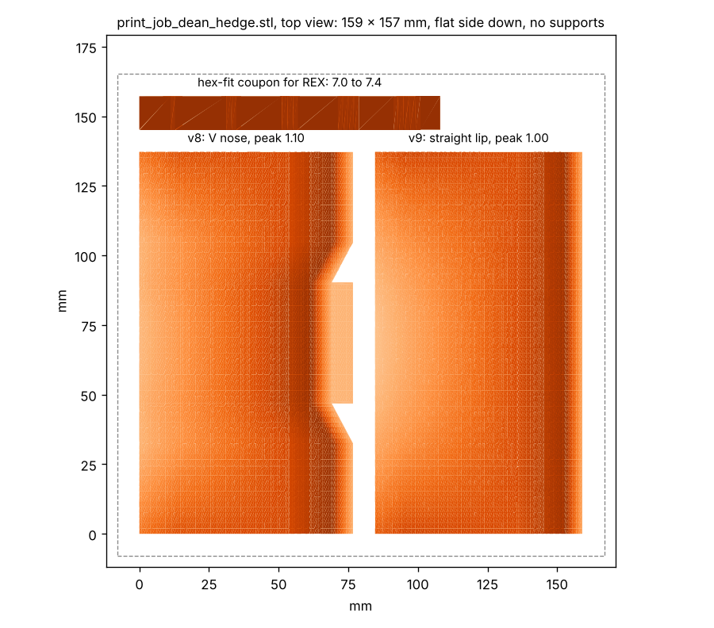
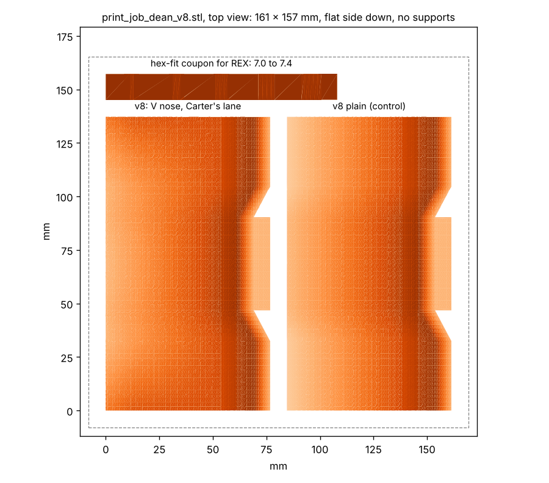

# Print job: FLOWER stick blades (for Dean)

**Newest: `stl/print_job_dean_three.stl`** (24 Oct), 168 x 219 x 15 mm, three blades, flat side down. Needs a bed of
at least 220 x 220. Millimetres. PETG. About 240 cm3 of plastic. If the bed is smaller, print `stl/v7_lane.stl`,
`stl/v8_lane.stl` and `stl/v9_lane.stl` one at a time (each 137 x 74 to 83 x 12 to 15 mm).

Three blades, each one change from the one that works, all with Carter's lane:
- **v7** (top left): the shape that emptied the FLOWER on 19 Oct, now with a snug shaft hole. The baseline.
- **v8** (top right): v7 with a V front. The middle of the front edge juts 0.3 in further between the FLOWER's posts.
- **v9** (bottom, turned sideways): v7 with a lower peak, 1.0 in instead of 1.1, so the ball rides 0.1 in lower.

All three have the **7.15 mm hex, flats top and bottom**, which fit the REX shaft perfectly on the last print. v9's
hole is 0.03 in lower in the blade than the others' because the blade is thinner. No coupon needed any more.

**Settings:** PETG (not PLA), 0.2 mm layers, 5 walls, 40 % infill, 5 top and bottom layers, no supports, brim
optional. Millimetres: if it comes in tiny, scale by 25.4.

Thank you!

---

**`stl/print_job_dean_hedge.stl`** (24 Oct, 166 x 157 x 18 mm): v8 and v9 only, with the coupon. Superseded by the three-blade plate above.

(Details kept for reference.) 166 x 157 x 18 mm, three parts, flat side down. Fits a
220 x 220 bed. Millimetres. PETG. About 175 cm3 of plastic.

Two different blades, each testing one idea about why the ball stops on the peak, plus the fit coupon:
- **v8 with Carter's lane** (left, 137 x 83 x 15 mm): the V front. The middle of the front edge reaches 0.3 in
  deeper between the FLOWER's posts, so the peak gets further under the ball. Same height as before.
- **v9 with Carter's lane** (right, 137 x 74 x 12 mm): a lower blade. The peak is 1.0 in instead of 1.1, so the
  ball's top is 0.1 in lower when it goes over, in case the collar above is what holds it. Straight front edge.
- **a hex-fit coupon** (bottom): skip it if the first one was printed.

Both have the **7.15 mm hex, flats top and bottom**, snug on the REX shaft (7.0 mm across the flats). Tap the shaft
in; file the flats a little if it will not go. v9's hole is 0.03 in lower than v8's (0.74 in above the bottom
instead of 0.77) because the blade is thinner; on the stick that drops the blade 0.03 in, which is fine.

**Settings:** PETG (not PLA), 0.2 mm layers, 5 walls, 40 % infill, 5 top and bottom layers, no supports, brim
optional. Millimetres: if it comes in tiny, scale by 25.4.

If the bed is under 200 mm: `stl/v8_lane.stl`, `stl/v9_lane.stl`, `stl/hex_fit_coupon_7_7.1_7.2_7.3_7.4.stl` one at
a time. STEP for review: `step/v8_lane.step`.

Thank you!

---

**`stl/print_job_dean_v8.stl`** (24 Oct, 175 x 157 x 18 mm): v8 lane, v8 plain, the coupon. Superseded by the hedge plate above, which pairs v8 with v9.

(Details kept for reference.) 175 x 157 x 18 mm, three parts, flat side down. Fits a
220 x 220 bed. Millimetres. PETG. About 180 cm3 of plastic.

What is on it:
- **v8 with Carter's lane** (left, 137 x 83 x 15 mm): v7 with a V-shaped front. The middle of the front edge reaches
  0.3 in deeper than the sides, and the slanted parts sit on the FLOWER's two posts, so the blade centres itself and
  gets further under the ball. Everything else is v7.
- **v8 plain** (right, same size): the control, no lane.
- **a hex-fit coupon** (bottom, 108 x 12 x 18 mm): five hex holes at 7.0, 7.1, 7.2, 7.3 and 7.4 mm across the flats,
  marked with one to five notches. Skip it if the first one was printed.

**The hex holes.** The shaft is goBILDA "8 mm REX": a round 8 mm shaft with six flats **7.0 mm across the flats**.
These are cut at **7.15 mm across the flats, flats top and bottom**: a snug hex. Tap the shaft in; if it will not go,
a few strokes of a flat file on the flats. Tell us which coupon hole is the snug one and the next blades get that
size.

**Settings:**
- **Material:** PETG, or nylon. Not PLA: it cracks when the robot drives the blade into the field element.
- **Layers:** 0.2 mm. **Walls:** 5. **Infill:** 40 %. **Top and bottom layers:** 5.
- **Supports:** none. The hex holes bridge fine at this size. **Brim:** optional, if the bed's adhesion is iffy.
- If the parts come in tiny (or 25 times too big), the slicer read them as inches: scale by 25.4 (or 1/25.4).

If the bed is under 200 mm: `stl/v8_lane.stl`, `stl/v8.stl` and `stl/hex_fit_coupon_7_7.1_7.2_7.3_7.4.stl` one at a
time. STEP solids for review: `step/v8_lane.step`, `step/v8.step`, `step/hex_fit_coupon.step`.

Thank you!

---

**`stl/print_job_dean_v7.stl`** (23 Oct, 162 x 157 mm): v7 lane, v7 plain, the coupon. v7 is v8 without the V front.
Still a good print if v8 is not wanted; the holes are the same.

**v6** (the 50 degree noses, 19 and 20 Oct) is retired: the ball sat on the peak. Its files are gone from the repo.

**Earlier: `stl/print_job_dean_v5.stl`** (16 Oct, 169 x 157 mm): v5 with the lane, v5 plain, a coupon with 8 mm hex
holes. Printed and tested on 19 Oct: it empties the FLOWER, but the hole was an 8 mm hex on a REX shaft (7 mm flats),
so the blade spun on the shaft and the push was hard. Superseded.

The older plates below are superseded; keep them only if already printed.

---

**File:** `stl/print_plate_both_blocks.stl`, one plate of 81 × 69 mm, everything already flat side down.
It holds:
- **Block A** (left, 19.8 mm tall): for the robot's current small wheels.
- **Block B** (right, 16.5 mm tall): for 48 mm wheels.

**Units are millimetres.** If the parts come in tiny (or 25 times too big), the slicer read them as inches: scale
by 25.4 (or 1/25.4).

**Settings:**
- **Material:** PETG, or nylon. Not PLA: it cracks when the robot drives the block into the field element.
- **Layers:** 0.2 mm.
- **Walls:** 5. This matters more than infill, because the wall under the shaft hole is only about 2 mm.
- **Infill:** 40 %. **Top and bottom layers:** 5.
- **Supports:** none. Each block has a hex hole straight through, 8.3 mm across the flats, flats top and bottom. It
  bridges fine at this size.
- **Brim:** optional. Add one if your bed's adhesion is iffy.

**The shaft is 8 mm hex.** The hole is 8.3 mm across the flats, so the shaft should slide in snugly. If it's tight,
file the hole open.

Thank you!
