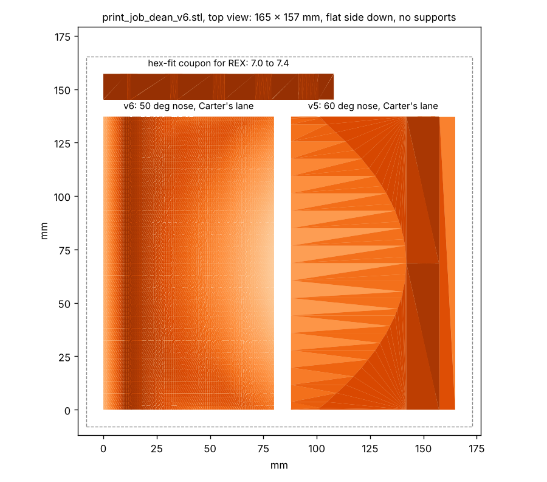

# Print job: FLOWER stick blades (for Dean)

**Newest: `stl/print_job_dean_v6.stl`** (20 Oct), 165 x 157 x 18 mm, three parts, flat side down. Fits a 220 x 220
bed. Millimetres. PETG. About 200 cm3 of plastic. It replaces the two v6 plates sent on 19 Oct: those had the wrong
hole.

What is on it:
- **v6 with Carter's lane** (left, 137 x 80 x 15 mm): the same blade as before with a shallower front (50 degrees
  instead of 60) and the lane reaching up to the peak with an oval front.
- **v5 with Carter's lane** (right, 137 x 77 x 15 mm): the 60 degree front, so the two can be pushed side by side.
- **a hex-fit coupon** (bottom, 108 x 12 x 18 mm): five hex holes at 7.0, 7.1, 7.2, 7.3 and 7.4 mm across the flats,
  marked with one to five notches.

**The hex holes: why every hole so far was loose.** The shaft is goBILDA "8 mm REX": a round 8 mm shaft with six
flats that are only **7.0 mm across the flats**. Every hole we sent before was an 8 mm hex (8.1 to 8.3 across the
flats), which is bigger than the shaft's round part, so the shaft turned freely in it. These blades are cut at
**7.15 mm across the flats**, flats top and bottom, about 2.7 mm of plastic over the hole and 2.2 mm under: a snug
hex. Tap the shaft in; if it will not go, a few strokes of a flat file on the flats. Tell us which coupon hole is the
snug one and the next blades get that size.

**Settings:**
- **Material:** PETG, or nylon. Not PLA: it cracks when the robot drives the blade into the field element.
- **Layers:** 0.2 mm. **Walls:** 5. **Infill:** 40 %. **Top and bottom layers:** 5.
- **Supports:** none. The hex holes bridge fine at this size. **Brim:** optional, if the bed's adhesion is iffy.
- If the parts come in tiny (or 25 times too big), the slicer read them as inches: scale by 25.4 (or 1/25.4).

If the bed is under 200 mm: `stl/v6_lane.stl`, `stl/v5_lane.stl` and `stl/hex_fit_coupon_7_7.1_7.2_7.3_7.4.stl`
one at a time.

Thank you!

---

**Earlier: `stl/print_job_dean_v5.stl`** (16 Oct, 169 x 157 mm): v5 with the lane, v5 plain, a coupon with 8 mm hex
holes. Printed and tested on 19 Oct: it empties the FLOWER, but the hole was an 8 mm hex on a REX shaft (7 mm flats),
so the blade spun on the shaft and the push was hard. Superseded.

The older plates below are superseded; keep them only if already printed.

---

**File:** `stl/print_plate_both_blocks.stl`, one plate of 81 × 69 mm, everything already flat side down.
It holds:
- **Block A** (left, 19.8 mm tall): for the robot's current small wheels.
- **Block B** (right, 16.5 mm tall): for 48 mm wheels.

**Units are millimetres.** If the parts come in tiny (or 25 times too big), the slicer read them as inches: scale
by 25.4 (or 1/25.4).

**Settings:**
- **Material:** PETG, or nylon. Not PLA: it cracks when the robot drives the block into the field element.
- **Layers:** 0.2 mm.
- **Walls:** 5. This matters more than infill, because the wall under the shaft hole is only about 2 mm.
- **Infill:** 40 %. **Top and bottom layers:** 5.
- **Supports:** none. Each block has a hex hole straight through, 8.3 mm across the flats, flats top and bottom. It
  bridges fine at this size.
- **Brim:** optional. Add one if your bed's adhesion is iffy.

**The shaft is 8 mm hex.** The hole is 8.3 mm across the flats, so the shaft should slide in snugly. If it's tight,
file the hole open.

Thank you!
