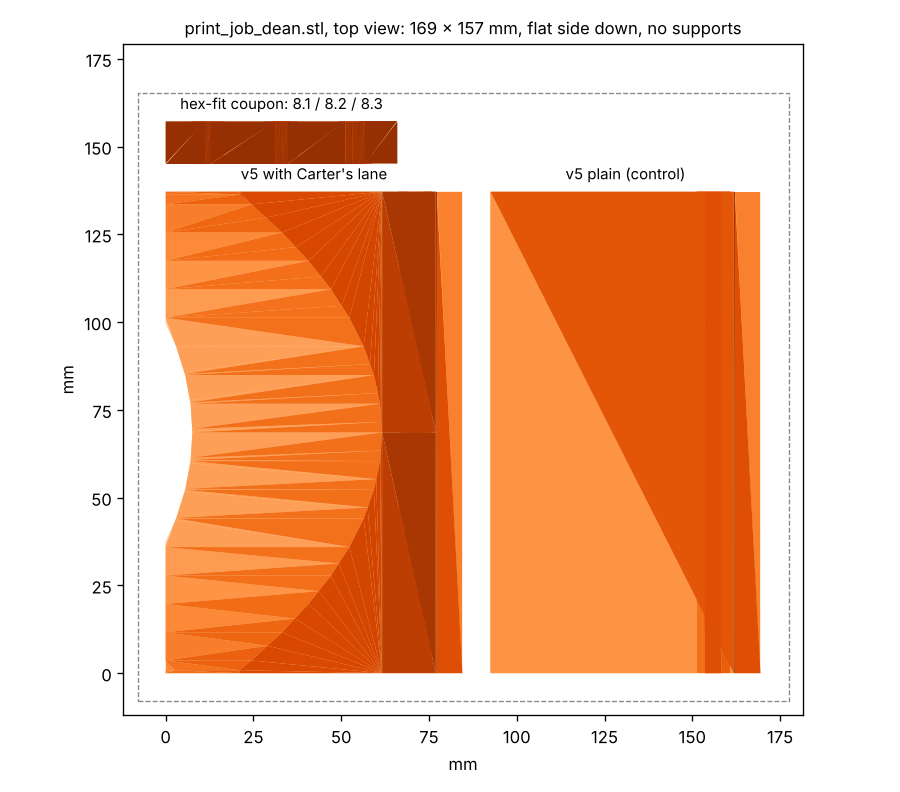

# Print job: FLOWER stick blades (for Dean)

**One file: `stl/print_job_dean.stl`**, 169 x 157 x 18 mm, three parts, everything already flat side down. Fits a
220 x 220 bed. Millimetres. PETG. About 170 cm3 of plastic.

What is on it:
- **v5 with Carter's lane** (left, 137 x 77 x 15 mm): the blade we are going with. The ramp curves gently down toward
  its middle.
- **v5 plain** (right, same size): the control, identical except the ramp is flat across.
- **the hex-fit coupon** (bottom, 66 x 12 x 18 mm): three 8 mm hex holes, 8.1, 8.2 and 8.3 mm across the flats,
  marked with one, two and three notches.

**The hex holes.** The blades are cut at **8.2 mm** across the flats, flats top and bottom, about 4 mm of plastic
over the hole. The first two small blocks were 8.3 and turned on the shaft. When the plate is done, push the 8 mm hex
shaft into the coupon's three holes and tell us which one is snug with no rock. If it is the two-notch hole, the
blades are right. If three notches, a few strokes of a flat file on the blades' flats. If one notch, tell us and we
resend at 8.1 (one number in the script).

**Settings:**
- **Material:** PETG, or nylon. Not PLA: it cracks when the robot drives the blade into the field element.
- **Layers:** 0.2 mm. **Walls:** 5 (this matters more than infill; under the shaft hole there is only about 2 mm, and
  5 walls makes that solid). **Infill:** 40 %. **Top and bottom layers:** 5.
- **Supports:** none. The hex holes bridge fine at this size. **Brim:** optional, if the bed's adhesion is iffy.
- If the parts come in tiny (or 25 times too big), the slicer read them as inches: scale by 25.4 (or 1/25.4).

If the bed is under 200 mm: `stl/v5_lane.stl`, `stl/v5.stl` and `stl/hex_fit_coupon.stl` one at a time.
(`stl/print_plate_v5.stl` is the two blades without the coupon; `stl/v5_scoop.stl` is an earlier reading of the
sketch, superseded; skip both.)

Thank you!

---

The older plates below are superseded; keep them only if already printed.

---

**File:** `stl/print_plate_both_blocks.stl`, one plate of 81 × 69 mm, everything already flat side down.
It holds:
- **Block A** (left, 19.8 mm tall): for the robot's current small wheels.
- **Block B** (right, 16.5 mm tall): for 48 mm wheels.

**Units are millimetres.** If the parts come in tiny (or 25 times too big), the slicer read them as inches: scale
by 25.4 (or 1/25.4).

**Settings:**
- **Material:** PETG, or nylon. Not PLA: it cracks when the robot drives the block into the field element.
- **Layers:** 0.2 mm.
- **Walls:** 5. This matters more than infill, because the wall under the shaft hole is only about 2 mm.
- **Infill:** 40 %. **Top and bottom layers:** 5.
- **Supports:** none. Each block has a hex hole straight through, 8.3 mm across the flats, flats top and bottom. It
  bridges fine at this size.
- **Brim:** optional. Add one if your bed's adhesion is iffy.

**The shaft is 8 mm hex.** The hole is 8.3 mm across the flats, so the shaft should slide in snugly. If it's tight,
file the hole open.

Thank you!
