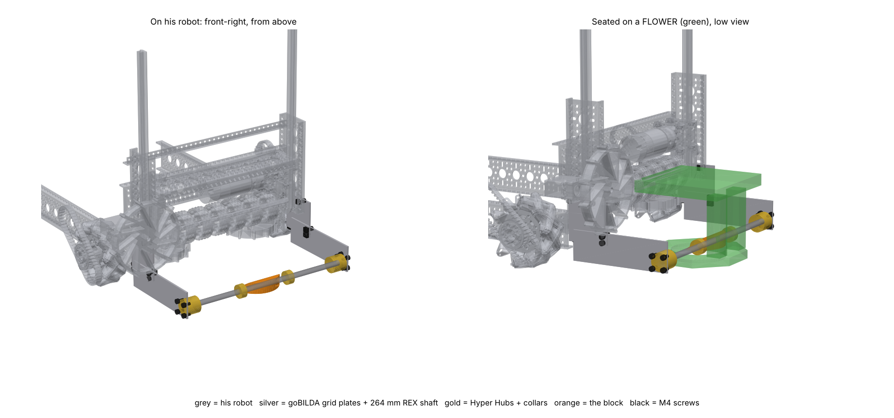
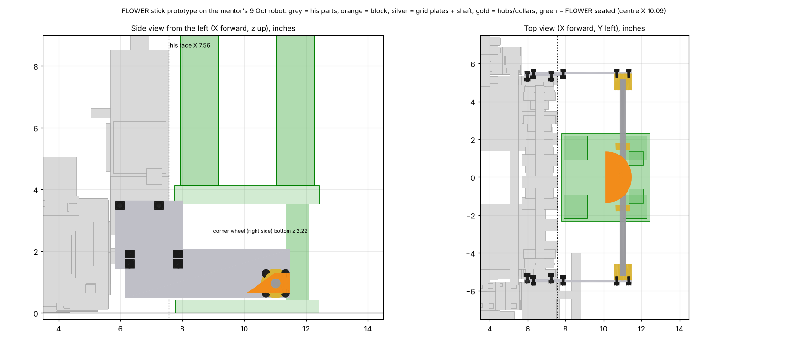
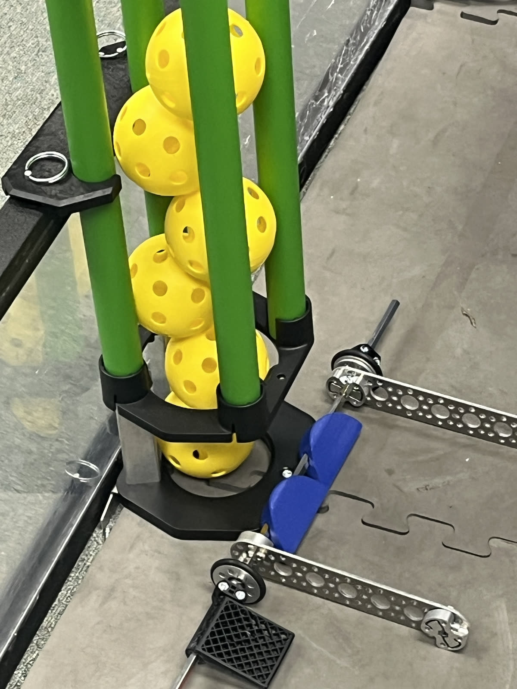
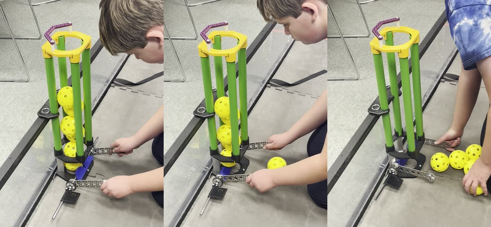
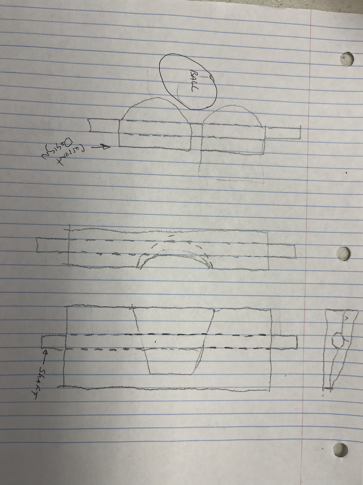
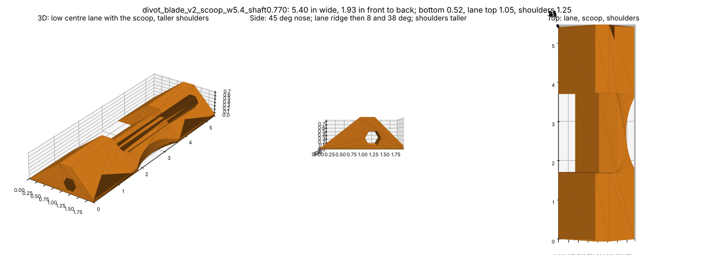
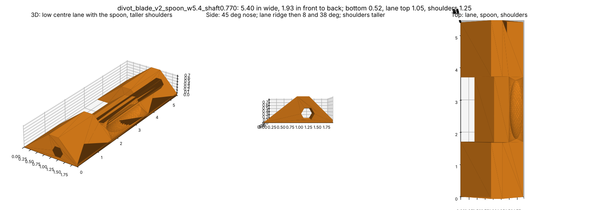
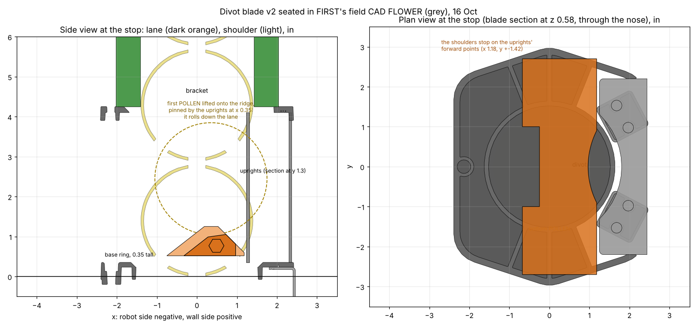

# FLOWER stick prototype: fixed, on the mentor's robot (issue #179)

A quick test of the FLOWER extractor before we build the folding one (`cad/intake-b/` §3). It's the ramp-hook FLOWER
block (`cad/ramp-hook/`) on an 8 mm REX shaft across his front. The shaft is held at both ends by goBILDA Hyper Hubs on
goBILDA grid plates, and the plates bolt to holes his front uprights already have: **no drilling, no cutting.** It
doesn't fold.

Checked on 10 Oct against his 9 Oct Robot.step with `tools/robot-cad/module_check.py flower_stick` and
`flower_stick_seated`. Nothing clashes: the only contact is a POLLEN staged in his CAD. Seated on a FLOWER
(`tools/robot-cad/flower.py`), the FLOWER touches only the block, with its lower bracket 0.17 in ahead of his roller.

| | |
|---|---|
| Shaft | X 11.02, z 0.96 (X 11.33 with the forward reach) |
| Block tip | X 11.49: 3.93 in ahead of his face |
| FLOWER seated | its centre 2.53 in ahead of his face (X 10.09) |
| Robot length | **19.52 in. Breaks the 18 in start (R102)**; deployed it's inside 18 × 24 in (R105) |
| Lowest part | the B plates and hubs, 0.49 in off the tiles |
| Under his corner wheel | the right B plate's top is z 2.06; the wheel's bottom is 2.22 |

**This is a practice-field part only.** It can't start a match. The folding version is the one that does.

## Parts

All goBILDA, all checked on gobilda.com on 10 Oct.

| Part | SKU | Qty |
|---|---|---|
| Grid plate 7 × 7 (56 × 56 mm), plate A | 1116-0056-0056 | 2 |
| Grid plate 5 × 17 (40 × 136 mm), plate B | 1116-0040-0136 | 2 |
| Hyper Hub, 8mm REX bore, clamping | 1310-0016-4008 | 2 |
| 8mm REX shaft, 264 mm, uncut | 2106-4008-2640 | 1 |
| Clamping collar, 8mm REX, 9 mm long | 2910-0920-4008. Any 8mm REX collar from stock works: the discontinued 10 mm 2910-1020-4008, or a 2920 set-screw collar. They only back up the block's set screws. | 2 |
| M4 × 12 socket head | 2800-0004-0012 | 12 |
| M4 × 8 socket head (B into the hubs) | 2800-0004-0008 | 8 |
| M4 nylon-insert lock nut | 2812-0004-0007 | 12 |
| M3 self-tapping set screws, about 6 mm (2 per block) | any | 6 |

**Print** (PETG, 5 walls, 40 % infill; settings as in `cad/ramp-hook/README.md`):
- `stl/block_060.stl`, `block_065.stl`, `block_070.stl`: the same block with its bottom 0.60, 0.65 or 0.70 in off
  the tiles (top 1.25, 1.30, 1.35). The shaft hole is at the same height in all three, so **swapping blocks is the
  height adjustment.**
- `cad/ramp-hook/fit_coupon.stl` first, so the bore fits the shaft.
- `block_070` has only 2.5 mm of plastic under the shaft. Print it, but expect it to be the one that cracks.

## Build

Grid positions count goBILDA's 8 mm holes. On each upright's web, use the two **4 mm holes 0.63 in above the
upright's bottom end**: these are at X 5.98 and X 7.24, z 3.48. The flaps module uses the same two holes; you can't
fit both at once.

**Confirm on the robot:** these holes come from the 9 Oct Robot.step. His built chassis (tall fixed uprights, slider
rails for a floating intake) may differ. Check that the holes are there and that a nut fits behind each one before
bolting anything. Every joint below names its holes or the threaded part it goes into; nothing floats.

1. **Plate A on each upright's web, outside face.** Put A's top-row holes 1 and 5 on the web's two holes. A hangs
   below the upright (to z 1.43), and its front edge is 0.47 in past his face. Fit 2 × M4 × 12 from outside, with
   lock nuts inside the channel, flats up and down. His Dual Block sits about 0.3 mm below the nuts.
2. **Plate B outside A,** lengthwise front to back. Line up B's top two rows on A's bottom two rows, with B's rear
   column on A's column 2. Fit 4 × M4 × 12 (A's columns 2 and 7), nuts on A's inside face. B now runs forward under
   the corner wheel.
3. **Hubs.** Put each Hyper Hub on B's inside face, on B's 2nd row from the bottom, 2nd column from the front.
   Fit 4 × M4 × 8 from outside into the hub's tapped holes. Don't clamp the hubs yet.
4. **Shaft and block.** Slide the shaft through one hub, then a collar, the block (curved face forward), a collar,
   and into the other hub. Centre the block. Clamp both hubs. Tighten the block's 2 M3 set screws onto the shaft's
   flats, square to the tiles. Push the collars against the block's sides and clamp them. They're backups for the
   set screws, and they sit just outside the FLOWER's grey uprights.
5. **Check on a tile:** block bottom 0.60 to 0.70 in, top 1.25 to 1.35 in, flat top level. The B plates, hubs and
   shaft must all be 0.45 in or more off the tiles. Spin the corner wheel by hand over the right B plate.

**Adjustments built in:**
- **Height:** swap the printed block (0.60 / 0.65 / 0.70). Rocking the block a few degrees on its set screws also
  trims the front edge's height.
- **Reach:** move B forward one column on A, and the hub stays on B's same holes. The block goes 8 mm forward
  (`REACH=1 python3 build.py`). That puts the FLOWER's bracket 0.49 in ahead of his roller instead of 0.17, at the
  cost of 8 mm more roll back to the roller. Checked clear too.
- **Sideways:** loosen the collars and set screws and slide the block along the shaft.

## Check on the robot before you build

These need the real robot; none are guesses in the drawing.

- [ ] His CAD has two loose **M4 hex screws just below each upright, at X 6.0, z 1.6 and 2.2**, heads out to |Y| 5.46,
      with nothing visible for them to hold. They fall exactly on plate A's column-1 holes. If they're on the robot,
      swap each for one 4 mm longer, through A. Their hex heads then sit at B's rear edge, so use button heads
      (2802 series). If they aren't, ignore this.
- [ ] Room inside each upright for the lock nuts on the two z 3.48 holes (his Dual Block sits about 0.3 mm below).
      If one won't seat, use a plain M4 hex nut, which is thinner.
- [ ] The bottom of the right corner wheel is 0.16 in above the right B plate. Check it at full travel.
- [ ] Is anything mounted on the outside of either upright's web that the CAD doesn't show? Look for wires and
      the flaps.
- [ ] Measure the robot's front-to-back length with the stick on. It should be about 19.5 in.

## Test on the practice field

A FLOWER loaded with 4 POLLEN, staged the way the match stages them. Drive in under driver control, slowly, until the
block stops on the grey uprights. Stay there, with the intake roller running. Film from the side at 60 fps or more.

| Set | Approach | Runs |
|---|---|---|
| A | centred, square | 20 |
| B | 1 in off-centre, left | 10 |
| C | 1 in off-centre, right | 10 |
| D | 2° yawed, CCW | 10 |
| E | 2° yawed, CW | 10 |

For each run, record:
- the block used (060 / 065 / 070), the reach (0 / 1) and the set;
- **POLLEN out**: 0 to 4, counted at the roller;
- **time**, from the block touching the uprights to the last POLLEN at the roller. Read it off the video. The model
  says about 1.2 s;
- whether the robot ended centred (the curved front should pull it in), and anything that caught: the ring's lip,
  the collars on the uprights, a POLLEN wedged under the bracket.

Run set A with `block_065` first. If set A empties at least 19 of 20, run B to E. If it doesn't, try 070 and then 060
before changing anything else. Then try the forward reach on whichever block did best.

- **Size rules:** fixed, the robot is about 19.5 in long, so it can't start a match (R102, 18 in). Once moving it's
  within 18 × 24 in (R105). The folding version (`cad/intake-b/`) stows to 17.96 in.
- **What to bring back:** the table, and a measurement of the real FLOWER's pocket edge (the base plate's
  thickness). That's the number `doc/ramp-hook.md` says decides a short block against a long one.

## The pivoting build with wheels (what the lab built, 10 Oct)

The fixed plates were hard to get to the right height without a drill, so the lab built a pivot instead. Two pattern
beams swing from a cross shaft at the robot's end. Small wheels at their lower ends roll on the tiles, outside the
FLOWER, and carry the lower shaft and the block. **The wheels set the height:** the shaft sits at the wheels' radius.

A hand push into a FLOWER loaded with 4 POLLEN (slow-mo, filmed from above) brought at least 2 POLLEN out. They then
piled up against the chassis, because that end has no intake. Counts and timing from a side view are still to come.

To print a block for this build, give `block.py` the wheels' diameter. The lab's shaft and wheel bores are **plain
8 mm hex**, not REX, so the block's bore is hex by default: 8.3 mm across the flats, flats top and bottom. A hex
shaft can't turn in it, so the block needs no set screws.

    python3 cad/modules/flower-stick-proto/block.py --wheel-mm 48 --bottom 0.70
    python3 cad/modules/flower-stick-proto/block.py --shaft 0.77 --bottom 0.52 --top 1.30   # the lab's 39 mm wheels

- **The wheels are about 1.55 in (39 mm) across.** That's from a tape stood upright against a wheel (10 Oct): its
  top reads about 1.54 in. So the shaft sits about 0.77 in off the tiles, too low for the standard block. (An
  earlier reading of 1.0 in was a misread of a blurry photo.)
  - **Print `stl/block_hex_shaft0.770_bottom0.52.stl`:** bottom 0.52 in, top 1.30, the shape of the mentor's first
    sketch, which emptied all 4 POLLEN in `ramp.py`. It clears the 0.43 in ring by only about 0.1 in (0.07 to 0.12
    if the shaft is really 0.75 to 0.80).
  - **Better: fit wheels about 48 mm (1.9 in) across.** That raises the shaft to about 0.95 in, so the standard
    block (`stl/block_hex_shaft0.945_bottom0.70.stl`) fits with 0.27 in of clearance over the ring.
- **Wheels much over 52 mm put the shaft too high.** The 0.65 in block can't keep its top under 1.35 in with the
  bore inside it, and `block.py` refuses. Ask for a block that hangs below the shaft.
- Print the fit coupon from `cad/ramp-hook/` first. Its bores are round, so on a hex shaft read it across the
  flats; or print one block and check the fit.

## 15 Oct test: two blocks side by side empty it; one block fights you

Carter and a mentor pushed the wheeled sled into a loaded FLOWER by hand with the two printed blocks (A and B) side by
side on the shaft. Three videos: the FLOWER emptied, all 4 POLLEN out in the last run, in about a second once the blocks
were under. **The concept works.** Two findings:

- **One block on its own is hard to get under the POLLEN.** It's 2.72 in wide with a convex front, and it has to enter
  the FLOWER's 2.79 in hole, so it has to be centred to about 1/32 in. By hand that's luck.
- **Two blocks together go under easily.** The POLLEN sits in the valley between their two curved fronts. The valley
  centres the POLLEN on the blocks instead of the blocks on the hole, and the blocks never enter the hole.

### Why it couldn't be seated against the back (16 Oct)

The concept, as the lab built it: the block drives in **steep face first, ramp toward the robot**. Once the block's
top corner is under the bottom POLLEN, the ball rides onto the flat top and rolls down the ramp, straight out of the
FLOWER perpendicular to the wall, into the intake; the stack drops one and the next ball follows.
`stack_sequence.py` draws that frame by frame from the simulator (`stack_sequence.png`).

A static force balance explains the working back and forth. The bottom POLLEN is pinched between the block's steep
face and the FLOWER's uprights, and a steady push lifts it only if the contact normal is tilted up by more than twice
the friction angle: 33° at μ 0.3, 44° at μ 0.4. Block A's steep face leans 17° from vertical, so the push is tilted up
17°, and it lifts only if μ is under 0.15: it stalls at any realistic friction and goes on only when wiggled or hit.
The 2-D simulator never saw this because its blade is kinematic: it can't stall. The exit half of the concept, the
ramp out toward the robot, is right; the entry is what has to change. The levers, in order of effect: a wedge entry
instead of a wall (the v2 nose: 45° face, its edge at 0.60 in meets the ball at 35°; `v2_steep`, 55° with a sharp
0.52 in edge, 39°), a lower edge still (a sheet lip on the ring at 0.37 in: 47°), a slippery skin (UHMW tape), and a
roller, which removes the limit. v2 keeps the exit ramp (its 38° back slope) and replaces the wall with the wedge.

### The FLOWER, from FIRST's field CAD

The model in `tools/robot-cad/flower.py` was scaled off the manual's figure. On 16 Oct it was replaced with
measurements from FIRST's field CAD (`tools/robot-cad/flower_from_field_cad.py`), about the bottom POLLEN's centre on
the tiles:

| | manual's figure | field CAD |
|---|---|---|
| base ring top | 0.43 | **0.35** |
| hole | 2.79 | **3.08** |
| uprights' forward points behind the POLLEN's centre | 1.25 | **1.18** (at y ±1.42) |
| uprights' inner corners | | (1.61, ±0.61): a lifted POLLEN is pinned at **x +0.35** |
| bracket opening | 3.55 | **3.90** |
| green pipes | reach the base | **start 4.25 in up** |

So nothing in front of the uprights is in the blade's way, and the hard stop is the uprights' forward points.

### The divot blade v2 (`divot_blade.py`)

Carter's sketch, built with a wedge nose and every depth from the field CAD. The sketch's divot can be read two ways,
so both are built and both are on the print plate: a **scoop** cut into the front edge (the sketch's top view: an arc
in plan, 1.8 in across, 0.21 in deep), or a **spoon** hollowed into the nose face (the front view's trapezoid: a bowl,
1.8 in across, 0.15 in deep, concave across and up the face). Everything else is the same. Carter says which he drew;
the test runs both.

- **A 45° nose**, so a steady push lifts the stack (μ up to 0.41 sliding, 1.0 rolling). Tape the nose with UHMW or
  packing tape and it has margin to spare. About 1.6 lb of push lifts the four POLLEN.
- **A low centre lane** (2 in wide, top 1.05 in, under the POLLEN's centre at 1.40) with a shallow divot in its nose
  that centres the POLLEN. It has **no flat top**: `tools/ramp-hook/blade_variants.py` (ramp.py with the CAD FLOWER)
  keeps all 4 POLLEN in when a flat reaches back to the pinned POLLEN, and empties 4/4 at 2, 4 and 12 in/s, μ 0.3 or
  0.5, when the slope starts at the ridge. The pinned POLLEN sits 0.38 in down the lane.
- **Taller shoulders** (1.25 in) either side: they are the hard stop, on the uprights' forward points, and they hold
  the 8 mm hex shaft with 8 mm of plastic over it. The lane only skins over the shaft (1.5 mm): the shoulders take
  the load.
- Width 5.4 in, 1.93 in front to back; bottom 0.52 in (0.17 over the ring); 8 mm hex bore at the sled's 0.77 in.
- **Checked:** swept into the CAD FLOWER, it touches nothing until its shoulders meet the uprights at x 1.18; seated,
  it is clear of the ring, the bracket and the pipes.

**Print:** `stl/print_plate_divot_blade.stl`: both blades, 137 × 108 mm, flat side down, the scoop at one end and the
spoon at the other. PETG, 5 walls, no supports. Every size is a flag: `--divot scoop|spoon`, `--shaft 0.945 --bottom
0.70` for 48 mm wheels, `--width`, `--nose-deg`, `--lane`.

**Six ways to cut it (16 Oct):** all the same body, built by `divot_blade.py` with flags, `stl/v2_<name>.stl` and
`v2_<name>.png` each. The simulator sees the lane and the stop, not the hollow's shape, so it rates them all 4/4; the
hollows differ in how they centre the POLLEN and how a real push feels, which is what the test is for.

| name | flags | what changes |
|---|---|---|
| `v2_scoop` | `--divot scoop` | Carter's top view: an arc in the front edge, 1.8 wide, 0.21 deep |
| `v2_spoon` | `--divot spoon` | Carter's front view: a bowl in the nose face, 1.8 wide, 0.15 deep |
| `v2_vee` | `--divot vee --divot-chord 2.0 --divot-depth 0.3` | a V notch in plan, the strongest self-centring |
| `v2_tongue` | `--divot scoop --lane 1.2 --lane-ahead 0.4 --divot-chord 1.0 --run-len 1.0 --run-deg 3` | a 1.2 in lane reaching 0.4 in past the shoulders, between the uprights' lobes; its ridge 0.78 in past the pinned POLLEN |
| `v2_highride` | `--divot scoop --shaft 0.945 --bottom 0.70` | the scoop for 48 mm wheels, 0.35 in over the ring |
| `v2_plain` | `--divot none` | no hollow: the control |
| `v2_steep` | `--divot scoop --nose-deg 35 --land 0.01` | the scoop with a 55° nose (from horizontal) and a sharp 0.52 in edge: the jam-margin option |
| `v3_peak` | `--divot scoop --nose-deg 35 --land 0.01 --lane-top 1.28 --sh-top 1.28 --lane 5.0 --run-len 0.01 --run-deg 0 --slope-deg 45` | one mountain the full width: 55° up to a 1.28 in peak, 45° down; no flat, no lane, no shoulders |
| `v4_carry` | as `v3_peak` with `--divot none --slope-deg 14.4` | the mountain with a 14° tail to the ring: the ball rides the blade all the way to the Gecko |
| `v5` | `--divot none --nose-deg 30 --land 0.08 --lane-top 1.10 --sh-top 1.10 --lane 5.0 --run-len 0.01 --run-deg 0 --slope-deg 12 --hex 8.2` | the searched shape: 60° nose, 1.10 in peak, 12° tail, 0.54 in of margin |
| `v5_lane` | as `v5` with `--gutter-rise 0.3` | v5 with Carter's lane: one curve across the whole tail (12.3 in radius), 0.3 in up at both edges, from 0.9 in behind the lip, full depth after 1.6 in; no flats |

The write-up with the viewer of all six (and Block A) is the page linked from issue #179.

### Other teams, and into the intake (16 Oct)

Four YouTube Shorts (19705 WXYZ's Ri3D, CrossFire 9968, Hexadecimal Nibble, Eaglebots 13532) show three recipes: a thin
lip with a powered roller right behind it, a big passive wedge, and a servo arm that sweeps the base sideways with the
wall as the stop. All the wedges meet the ball low. The roller is the bigger idea: it pulls the ball back and up, so
the push only has to get the lip under it. For us it says where the intake's first roller has to be.

A full-width ramp (a 12 in sheet with a plate and a roller) was drawn and dropped the same day: it put a sheet in front
of the intake and left the ball on a shelf 2 in from the roller. What replaced it is the original concept with numbers:
the blade releases the ball straight into the intake's mouth, and the mouth sits at the FLOWER's face.

- Blade's stop: 1.18 in behind the FLOWER's centre (the uprights' forward points; the 5.4 in shoulders reach them).
- Blade's back edge: 0.5 in in front of the centre; the ball leaves the back slope there.
- Intake roller's rim: at least 2.5 in in front of the centre, the first spot clear of the bracket (2.41) and the pipes
  (2.25), which is 0.1 in in front of the ring's edge. About 2 in of open tile between.
- So the stick is about 3.7 in long beyond the mouth, the sled arms short, the blade's shaft about 2 in ahead of the
  roller's axle.
- `tools/ramp-hook/intake_sim.py` is the 2-D check (v2 lane profile, the bracket's lintel, a roller at the face):
  all four POLLEN leave and pass the roller at 2, 4 and 12 in/s, friction 0.3 and 0.5. It has no rolling resistance,
  so the 2 in of open tile is the part to doubt until it is tested. `intake_section.py` draws it.

Two things the field CAD rules out for a bigger ramp: a roller cannot sit inside the FLOWER (a ball on a 0.45 in lip
tops out at 3.25, the bracket's underside is 3.90), and a rising ramp cannot carry the ball to a crest (the lip stops
0.83 in past the pinned ball).

**The mentor's 16 Oct `Robot.step` answers that** (Google Drive, 152 MB; read with `cad/full-robot/build.py`'s
loader, but note the export is turned 180° about the left-right axis relative to the 9 Oct one, so `module_check.py`
places it upside down and backwards until its frame is re-derived from the wheels). In a frame with the floor at the
drive wheels' bottoms and x measured back from the intake uprights' front faces:

| what | where |
|---|---|
| first-stage roller | seven 48 mm GripForce Gecko wheels on a 240 mm REX shaft, axle 2.9 in high, wheel bottoms 1.94 in off the floor, rims flush with the uprights' front (0 to 1.9 in back) |
| its width | left −4.0 to +3.5 in: 7.5 in of wheel |
| intake opening | between the 5-hole lowside uprights at ±4.9 to 5.4 in: about 9.8 in |
| second stage | two 96 mm Gecko wheels, 6.3 to 10.1 in back, 1.7 to 3.6 in high |
| ahead of the face | the front omni wheels' rollers 0.3 in (at |y| 5.2 to 7.1), and a servo-driven 4.5 in disc at the front left (1.2 in ahead, |y| 4.0 to 8.4, 2.5 to 6.9 in high) |

So the mouth is the floor itself, at the front: the good case. For the FLOWER: the robot's face sits 2.5 in in front of
the FLOWER's centre (0.1 in off the ring and the bracket), the blade's stop is 3.7 in ahead of the face, its shaft
2.9 in ahead at 0.77 in high, which passes 0.66 in under the gecko row. The sled's arms can hang from the gecko shaft
itself on bearings (4.4 in from the gecko axle to the blade's shaft) or pivot on the uprights beside the outer wheels. The 4.5 in disc clears the
FLOWER only while the robot is within about 1 in of centred on it.

**v3, the mountain (`v3_peak`, `--nose-deg 35 --land 0.01 --lane-top 1.28 --sh-top 1.28 --lane 5.0 --run-len 0.01
--run-deg 0 --slope-deg 45`):** the v2 lane's flat run existed only to leave skin over the 8 mm shaft; with the 55°
nose the peak rises to 1.28 in at the same 0.30 in past the pinned POLLEN, the shaft gets 8.8 mm of plastic over it,
and the profile is one mountain the full 5.4 in width: 55° up, peak, 45° down to the back edge 0.12 in behind the
FLOWER's centre. No lane, no shoulders, so where the ball sits across the width does not matter, and the depth is set
by the nose meeting the uprights' forward points anywhere within ±1.3 in of centre. Exit speed from a 1.28 in peak is
about 19 in/s, enough for the 2 in of tile. The back slope's angle hardly matters (the speed comes from the drop); the
peak height is capped by the ridge rule (55°: 1.28; 60°: 1.44).

**The drive-in animation** (`tools/ramp-hook/animate.py` → `animation_runs.json`, embedded in the page): every blade at
4 and 12 in/s, friction 0.3 and 0.4, in the slice with a stall check (a ball pinched between the blade and the uprights
lifts only if the push at the blade contact is tilted up more than the friction angle, the ball rolling on the blade
and sliding on the uprights). Block A stalls on contact in every case (14° to 17°). v2 steep fails at 4 in/s: its
0.6 in run at 4° leaves the pinned ball on a near-level surface and only momentum at 12 in/s carries it over. v2 and
v3 empty the FLOWER at both speeds, the last ball past the Gecko about 2.5 s after the drive starts at 4 in/s and
1.5 s at 12 in/s. A flat anywhere behind the ridge is the enemy; v3 has none.

**v4, the carry (`v4_carry`, v3's flags with `--slope-deg 14.4`):** v3's ball comes off the back edge into the hole and
has to climb the 0.35 in ring on its own speed (the dip). v4 keeps v3's nose and peak and continues the back slope at
14° down to the blade's bottom 2.3 in in front of the FLOWER's centre, over the ring: the ball never touches the tiles
and reaches the Gecko still on the blade. 137 × 102 × 19 mm, 113 cm³.

**The simulator in the page** (`page/sim.js`, a port of `ramp.py` + `animate.py` to JavaScript; `page/anim2.js` draws
it, and `page/drive3d.js` the same run in 3D, over the FLOWER's section from the field CAD, `page/flower_section.json`, and the mentor's robot cut at the
centreline, `page/robot_section.json` from `page/section.py`): presets Block A, v2, v3, v4, sliders for edge height, nose angle, peak height, tail angle, drive
speed, friction and stop error, readouts of the peak's margin past the pinned ball, the first-contact angle and the
friction it beats, and where the tail ends. The Gecko is a soft drag wheel there (anything within its reach is pulled
toward the robot at its surface speed), not a rigid roller. Findings: v4 feeds all four in 2.1 s at 4 in/s and 1.2 s at
12; it tolerates the robot over-travelling (it cannot, the uprights stop it) but a stop 0.3 in short puts the ball on
the peak, which is the whole margin. A lower peak (1.1 in) with a 60° nose has 0.5 in of margin and feeds just as fast:
with the tail carrying the ball, peak height no longer buys anything, margin does.

**v5, searched (`v5`, `--nose-deg 30 --land 0.08 --lane-top 1.10 --sh-top 1.10 --lane 5.0 --run-len 0.01 --run-deg 0
--slope-deg 12`):** `page/opt.js` ran 882 mountain shapes (edge height 0.52 to 0.60, nose 45° to 70°, peak 0.9 to
1.5 in, tail 10° to 30°) through the browser simulator's physics in node, each in 12 scenarios: friction 0.3 and
0.45, drive 3 and 12 in/s, the robot stopping 0, 0.2 and 0.35 in short of the uprights. 89 shapes fed all four every
time; 4 of those leave enough plastic over the 8 mm shaft. All four are the same family: a 60° nose, a 1.10 in peak
(0.52 to 0.54 in past the pinned POLLEN) and a 10° to 12° tail. v5 is the fastest of them: 60° nose from a 0.60 in
edge, peak 1.10, 12° tail ending over the ring 1.85 in in front of the FLOWER's centre; all four past the Gecko in
2.6 s worst case. v4's 0.30 in margin fails the 0.35 in short-stop scenario; v5's 0.54 passes it. 137 × 90 × 15 mm.
Results in `page/opt_all.jsonl`.

**Carter's lane, and the sideways model (16 Oct).** Carter's divot was misread twice (a scoop in the front edge, a
bowl in the nose face). What he drew: the front edge stays plain; the ramp toward the intake has a rounded lane down
its middle, like the valley the two blocks made by accident, with no sharp edges. That is `v5_lane` (`--gutter-rise`,
`--gutter-r`, `--gutter-start`, `--gutter-lead` in `divot_blade.py`): material is added above the tail and a cylinder
tangent to the tail at the centreline is cut out of it, so the centreline profile and everything the search found are
unchanged. With `--gutter-r 0` (the default) the cylinder's radius is chosen so the curve spans the whole width, from
the centre up to `--gutter-rise` at both edges: no flats, no shoulders. A smaller radius gives a trough with flat
shoulders outside it, which the model found worse (below). To judge it, `page/sim.js` gained a sideways dimension: the ring's hole (±0.14 in) and the uprights' vee
hold the bottom POLLEN on the FLOWER's centreline until its centre is 0.85 in behind the lip; the four pipes
(0.525 in radius at ±1.72) hold the stack, which lets the upper balls lean ±0.85; a ball on the lane feels its
cross-slope as a sideways push, with rolling friction across the contact; ball-ball contacts are 3-D; the Gecko row
grabs a ball only inside the intake's mouth. Three disturbances: the robot parked off-centre, the robot turned, the
stack leaning. `page/lat_sweep.js` ran the plain tail and five lanes through offset 0/0.8/1.3 in, lean 0/0.3/0.6 in,
turn 0/8°, a 7.5, 4 or 3 in mouth (324 runs, `page/lat_sweep.jsonl`). What it says:

- With the 7.5 in Gecko row at the FLOWER's face, the plain v5 tail fed all four in every case. The wheels take the
  ball about 1.4 in after the FLOWER lets go of it: there is no stretch of tail for a lane to act on.
- Carter's lane as one full-width curve (0.3 in at the edges) does the same in every case, whether it starts 0.9 or
  0.5 in behind the lip and whatever its lead-in. A deeper full-width curve (0.5 in at the edges, 7.5 in radius) is
  also clean on the 7.5 in row and rescues a few leaning-stack runs with a 3 or 4 in mouth.
- A trough with flat shoulders (4 in radius, 0.4 in shoulders) misses or sticks when the robot is 0.8 to 1.3 in
  off-centre: the FLOWER is still holding the ball on its own line while the ball meets the shoulder's edge head-on.
  The flat is what hurts, not the depth.
- A leaning stack squirts the bottom ball sideways (its weight on an off-centre ball, released when the vee lets go)
  at 10 to 20 in/s, more than a 0.3 in curve holds (12 in/s). With a 3 in mouth no lane rescues all of that; with the
  7.5 in row nothing needs rescuing.

So on this robot the lane is neither needed nor harmful as a full-width curve; it would matter if the intake were
narrower or further back, or on the sled, where the balls roll out across the floor. Decision (16 Oct): the lane
blade is the design, since the curve costs nothing in the model and may help on the floor; v5 plain is printed beside
it as the control for the stick test. The model's weak point is how a real stack settles in its pipes (the balls are taken as rigid, and a
tilted stack settles into a zigzag against the pipes); the lean slider is an input, the squirt is its consequence.

**The mentor's corner disc.** The servo-driven 4.5 in disc at the front right is for POLLEN in the wall corner by the
garden. It is a flat disc facing forward, spinning about a fore-aft axis, so its face sweeps a ball sideways out of
the corner toward the intake: 0.5 in thick, 1.2 in ahead of the face, 4.0 to 8.4 in off centre, 2.5 to 6.9 in high.
It clears the FLOWER only while the robot is within about 1 in of centred on it.

**The sled arms pivot outboard of the drive wheels**, 8.3 in off centre: the chassis is 16.0 in wide and the 18 in box
allows 9, so there is room past the front omni wheels (which end at 7.1). The blade's shaft runs 17 in across under
the Gecko row (0.77 in high; the wheels' bottoms are at 1.94). On the right the arm passes under the corner disc:
where the disc sits, 0.7 to 1.2 in ahead of the face, the arm is 1.8 to 2.0 in high and the disc's bottom is 2.5.

**Test it the same way:** 5 straight pushes, then 1 in off-centre, with each blade, counting POLLEN out and timing from the side. The
thing to watch is whether it seats with one steady push. If it still needs a wiggle, tape the nose first; if that
fixes it, the friction is higher than 0.4 and the next print gets a 50° nose.

## Files

- `build.py`: the module, in his robot's frame. It writes `flower-stick-proto.step` (insert at the origin of his
  Onshape assembly) and the block STLs. `BLOCK=060|065|070` and `REACH=0|1` pick the variant.
- `divot_blade.py`: the divot blade v2 (16 Oct): wedge nose, low lane, tall shoulders; every size a flag. `--gutter-*` adds Carter's lane on the tail (`v5_lane`).
- `stack_sequence.py`: the 15 Oct concept frame by frame (`stack_sequence.png`). `profiles_compare.py`: Block A, v2 and v3 at their stops with the pinned POLLEN. `intake_section.py`: v3 feeding the intake, from `tools/ramp-hook/intake_sim.py`'s trace (v3 profile, the Gecko as in the 16 Oct CAD).
- `seated_in_field_cad.png`: the blade seated in FIRST's field CAD FLOWER.
- `hex_coupon.py`: a hex-fit coupon (`stl/hex_fit_coupon.stl`), three 8 mm hex holes at 8.1/8.2/8.3 mm across the flats, printed like the blades, to find the hole size that is snug on a given printer. The 15 Oct blocks turned on the shaft; their hole is 8.3 and their hex bearing length only 36 mm. The 137 mm blade bears on 3.8 times the length, and the fitted size goes in with `divot_blade.py --hex`.
- `block.py`: the block's STL for any shaft height (`--shaft`) or wheel size (`--wheel-mm`).
- `proto.png`: the picture above, drawn from his Robot.step.
- `block_template.pdf` (`template.py`): a 1:1 paper template for cutting the block from 3/4 in plywood, hardwood or HDPE when there is no printer.
- To re-check: `python3 tools/robot-cad/module_check.py Robot.step flower_stick_seated`, run from a scratch folder.
