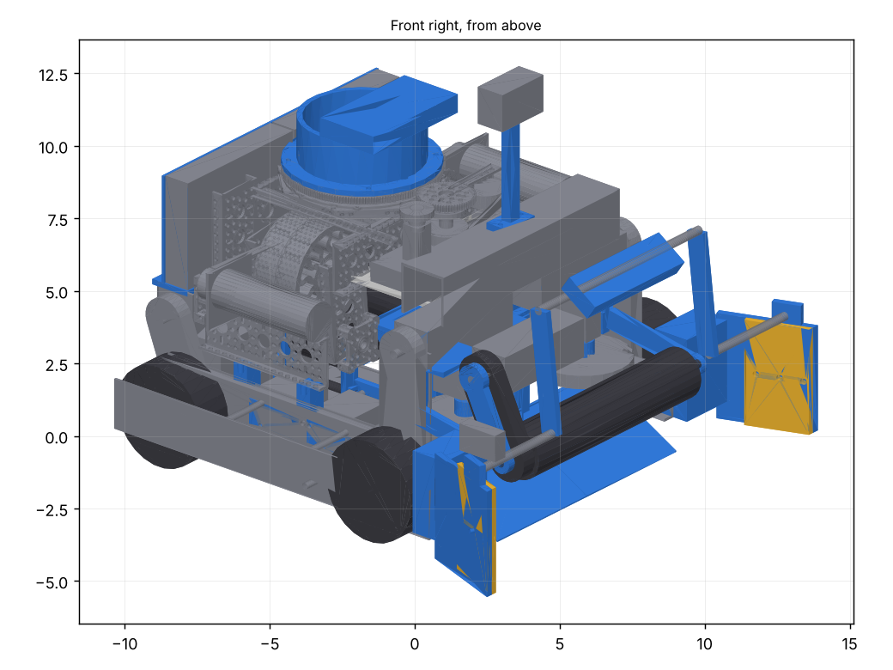
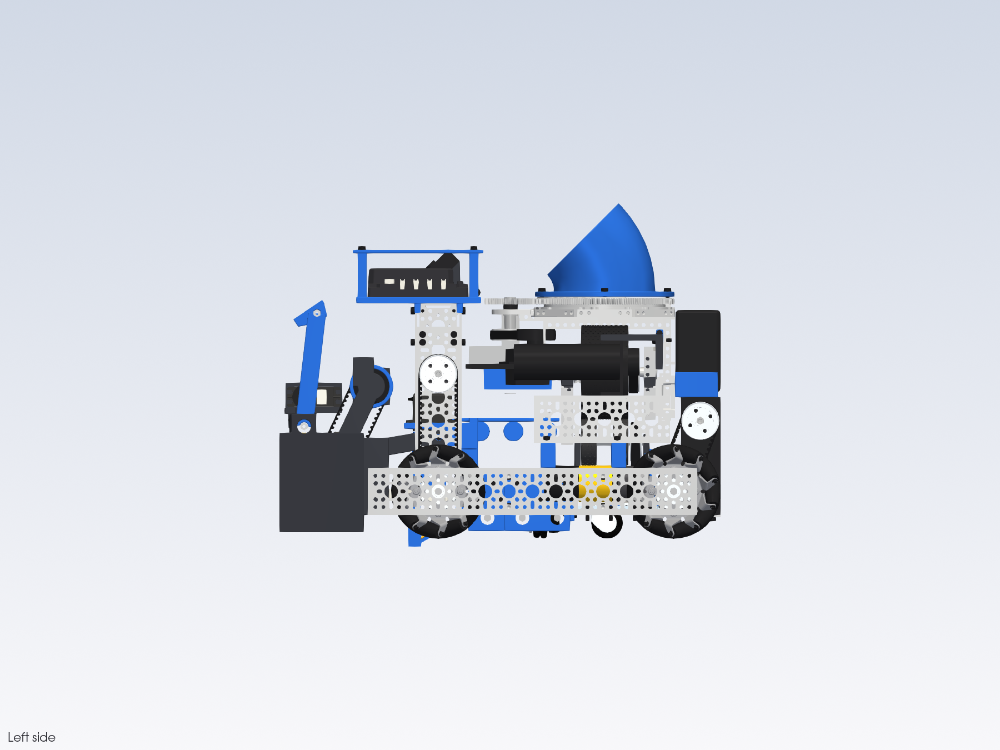

# The printed clean-sheet robot: layout v3 in progress (11 Oct 2026)

> **Layout v3 (11 Oct): all checks pass.** The robot was re-planned top-down around a space budget (`RESERVED` in
> `build.py`: volumes reserved for the feeder's motor and drive and the hood's sweep before anything else was placed;
> the build fails if a part intrudes). Our own four goBILDA corners on the mentor's track and wheelbase (front motors
> straight over their axles, five holes up; rear motors behind and three up, as his); a front cross channel (the
> Limelight's mast on it, centred); the battery against the right rail; the electronics rack on standoffs from the rear
> cross channel; the turret's servo and encoder B swung clear about its drive gear; his launcher frame re-housed with
> the smallest change at each conflict. Every choice and what would reopen it: [DECISIONS.md](DECISIONS.md). Some v2
> notes below predate v3.
>
> **Real parts (11 Oct).** Every bought part is drawn as its maker's own model (goBILDA's and REV's STEP files,
> `vendor.py`), and checked as built: where a real part reaches past the envelope the clash checks use, the build
> checks what it hits there. That found four things the boxes hid: the star servos' mounting, the extractor servo's
> depth, the odometry pods turned 90° off their holes, and standoff lengths goBILDA doesn't sell (DECISIONS.md).
>
> **v3.1, the practicality pass (11 Oct).** Checked as a mechanic would: the battery now lifts straight out from the
> back; the hubs and the Limelight sit on a deck over the front; the star shafts run in bearings; the rear motor plates
> are a cuttable drawing, not an invented part; the intake motor is actually mounted and the swing arms are a braced
> frame; every part said to bolt to another is checked to touch it (that found the front and rear cross channels on
> brackets that were never drawn); the flywheel slides run in printed guides. One joint is left to settle with the
> mentor's parts in hand: the star wheel on its shaft (DECISIONS.md, open).

Issue #172. The concept and its reasoning are in [doc/printed-chassis.md](../../doc/printed-chassis.md). This is the
layout CAD: every module at its real size and place, checked for clashes. The mentor's own goBILDA launcher and drive
corners are in it, placed by their axles. His built robot (photos, 10 Oct) now supersedes his 9 Oct CAD as the reference. **Every
screw is drawn and checked** (v2); belts are drawn with their teeth, the extractor's gears with theirs; the springs are
drawn as their envelopes. Nothing here is built.

    python3 cad/printed-chassis/build.py          # checks, then writes printed-chassis.step, stl/, parts.md, views/
    CHECK_ONLY=1 python3 cad/printed-chassis/build.py
    python3 cad/printed-chassis/budget.py         # 20 s: views/budget.png, every part's box and the reserved volumes
    python3 cad/printed-chassis/vendor.py         # once (needs network): fetches goBILDA's and REV's models into .cache/vendor/
    python3 cad/printed-chassis/render.py         # views/*.png, shaded (VTK; starts its own Xvfb); --near X Y Z R for a close look
    python3 cad/printed-chassis/viewer.py         # .cache/viewer/robot.glb: a light model for the web viewer (viewer/index.html)

A full build takes about 9 minutes; `CHECK_ONLY=1` about a minute. Without `vendor.py`'s cache the checks still run on
the envelopes, and the STEP and views draw those instead.

Settled decisions, why, and what would reopen each: [DECISIONS.md](DECISIONS.md).

Frame: +X forward, +Y left, +Z up, inches, origin on the floor under the body's centre; the STEPs are in millimetres.

**The mentor's modules.** His launcher (with `cad/transfer`'s changes) and his four drive corners come from the CAD
chat's exports on `claude/robotics-meeting-notes-lq2y55` (`cad/modules/launcher-module`, `cad/modules/drive-module`).
They're too big for this branch, so two scripts convert them into a local cache (`.cache/`, not in git), and the build
uses them when they're there:

    git show origin/claude/robotics-meeting-notes-lq2y55:cad/modules/launcher-module/launcher-module.step.gz | gunzip > /tmp/lm.step
    git show origin/claude/robotics-meeting-notes-lq2y55:cad/modules/drive-module/drive-module.step.gz | gunzip > /tmp/dm.step
    cd cad/printed-chassis && python3 launcher_module.py /tmp/lm.step && python3 drive_module.py /tmp/dm.step

Without the cache, the build draws its own stand-ins (the earlier printed launcher and goBILDA corners), which this
README no longer describes.

## What the checks say

| Check | Result |
|---|---|
| Starting outline (R102) | **17.72 × 17.75 in**, 12.2 in tall (the hood; the Limelight on the hub deck): designed 1/8 in a side inside the 18 in cube, for print error, soft faces, screw heads and cables (v2's screws must stay inside it too). The flap tips are the front; the electronics rack and the rear drive mounts the back. Nothing deploys but the extractor. |
| Extractor down (R105) | 20.2 in front to back, of 24 |
| Width behind the face | 15.24 in: nothing behind the face is wider (his shafts' ends at ±7.62) |
| Every screw (104, plus 107 on servos, hubs and motors) | passes through each part it clamps (a real hole in the mentor's goBILDA parts, goBILDA's 8 mm grid on the rails, its hole cut in a printed part), threads into an insert, nut or tapped hole with enough engagement, and its head, its hex key's straight path (0.75 in) and its nut hit nothing. Eight are marked to locate on the robot (below) |
| Service | the battery lifts straight up out of its shelf, nothing over it |
| Mountings | every part said to bolt to or ride on another touches it (127 of them); the star wheels' joint to their shafts is to settle |
| The real parts | each bought part's own model (72 of them) inside its envelope, or, where it reaches past it, hitting nothing there |
| Every part reaches the rails | through screws, bearings and shafts (`CAPTIVE`) or its own mounting screws (`DEVICE`): no part floats |
| The flywheel modules opening 0.41 in each side | clear, motors and the feeder with them; opened, they reach Y ±7.92 (R105 allows 18 wide) |
| Static clashes | none, with his launcher and corners in (shafts in their own hubs, belts on their own pulleys and bolted faces excepted, by name in `ALLOWED`; his modules' own parts aren't checked against each other) |
| The roller rising 1.3 in on its swing arms | clear at 0, 0.33, 0.65, 1.0 and 1.3 in; the axle moves at most 0.06 in forward |
| The extractor, every 10° from down to stowed, roller down and up | clear |
| A NECTAR and a POLLEN on their path (the mouth's edges where they meet the stars, the lane, the column, the turret's bore, the hood) | touch only what should: roller, stars, floor, lane rollers, ceiling, his feeder, pad and flywheels, the hood's lid |
| A NECTAR rolling in across the roller's width | clear of the extractor and the flaps; 0.72 in under the extractor's stub shafts |
| The 4-piece count | roller axle to his backstop 12.43 in, inside the 12.26 to 12.60 window. The backstop sits on ±0.2 in slots, which reach 12.23 to 12.63, so it's set on the robot with real pieces |
| Printed parts within 180 mm each way | all fit (room for a brim on a 210 mm bed, and less warp). Big flat parts are printed in two halves and bolted |

## In Onshape

The whole robot is one STEP, every bought part as its maker's model (the build writes it as
`.cache/printed-chassis-full.step`: about 560 MB, 97 MB zipped; each model is stored once and placed per copy);
`printed-chassis.step` in git holds only our parts, the bought ones as envelopes. To just look at it, use the web
viewer (`viewer/index.html` with `viewer.py`'s model) or `views/`. **Create → Import** it with **Flatten assembly off**. It opens as
one sub-assembly per subsystem, numbered in build order:

01 Frame · 02 Drive corners · 03 Odometry · 04 Flaps and soft faces · 05 Intake roller · 06 Extractor ·
07 Star wheels and front brackets · 08 Mouth and lane · 09 Feeder and backstop · 10 Flywheels (sprung sides) ·
11 Turret and hood · 12 Launcher frame and feet · 13 Electronics

Inside each: its fixed parts, then a **"moves - …"** sub-assembly for each moving body (its name says the mate: a
revolute or a slider, its axis and its range), then its **screws** (named size × length, then the joint). The mentor's
launcher parts are named **"mentor - …"**. Colours: printed parts by material (blue PETG, charcoal PETG-CF, amber TPU,
clear polycarbonate), bought parts in their makers' colours, screws dark grey. To make it move: fix everything, then unfix each "moves" group and give it the mate its name says.

## Layout

| | Where | Notes |
|---|---|---|
| Rails | goBILDA 1121 low-side, 360 mm (14 hole), webs at \|Y\| 5.35 (his track), their holes at the axles' height, front ends 0.15 in behind the face | 0.15 in back so his rear motors clear his launcher's rear channel; the front wheels sit a hole back from the rails' ends, as his, so the flaps' root blocks bolt to the rails ahead of them |
| Drive corners (the mentor's) | his corner exactly, each placed by its axle: the 72 mm shaft in a 1309 hub in the rail's web and in bearings in the wheel's pattern plates, its 24T pulley outboard of the wheel, the 435 RPM motor lying along Y on the rail's top, clamped in a 1-hole U-channel mount (front) or 1201 mounts and a 1107 cross channel (rear) | axles X 4.32 and −5.13, wheelbase 240 mm (10 rail holes, as his). His right corners differ from his left (FR's motor 0.74 in further forward, its shaft 0.1 in further out), so both right corners are mirrors of his left ones: one design, four times |
| Odometry pods | two goBILDA 4-bar pods (96 mm wheel version), both on the right, on printed adapters inside the rail | the left side under the launcher has its feeder belt and gate servo |
| Flaps | root blocks at the front corners, ahead of the wheels and bolted to the rails' ends; tips at X 10.7, Y ±8.875 (3.4 in ahead, 1.255 in out) | PETG-CF, 6 mm; they are also the extractor's side plates. Their soft face is a separate plate on three M3 screws (TPU on a PETG backer; bare PETG or foam for the drop test) |
| Roller | goBILDA 48 mm Gecko wheels, as the mentor's, ±4.35 in, axle 1.0 ahead of the face, 2.4 off the tiles | no vector wheels: his star wheels centre the pieces |
| Roller arms | inside the wheels, at \|Y\| 5.0 to 5.3 over the rails; pivot X 4.3, z 4.05, on the front brackets; the 1620 RPM motor on the right arm above the roller (275 mm belt) | inside the wheels because his belts run outside them; the pivot is level with the roller's mid-float, so it rises nearly straight up |
| Front brackets | printed, one a side, bolted to the front drive motor's U-channel mount | hang the star wheel's servo and carry the arm's pivot |
| Star wheels (the mentor's) | two 3.5 in flexible stars (SWYFT Intake Wheels, 30A, cut into 16 flaps) lying flat, 2.36 in behind the face, ±3.15 in (tips 2.80 apart, as his), at z 3.2: a NECTAR's middle, just over the rails | each driven from above by a continuous servo: a round 8 mm hardened shaft into his one-way needle clutch (HF081412), pressed into a printed hub that drives the star's hex adapter. The clutch locks driving the star inward and free-wheels when a piece overruns it, so the servos turn one way only and a jam is cleared by the roller and lane, not the stars. The servo and its coupling are still TBD |
| Ramp and mouth floor | the whole mouth's width (±4.8, inside the rails), in halves | so a piece taken in off-centre climbs to the lane's height too, where the stars reach it |
| Lane | five TPU-roller shafts, walls at \|Y\| 1.86, a ceiling of free rollers from X −0.55 to 4.5 | the ball moves at the tread's speed, not half of it |
| Launcher (the mentor's) | his goBILDA launcher module with `cad/transfer`'s changes (flywheel motors out and up, the feeder on a yoke with its gate servo, the pad, the backstop, the turret servo and both encoders), placed by the launch column at X −2.37 | the turret's drive gear points forward, as his |
| Hood | printed, on the turret's top | a placeholder until the launcher rig settles its shape |
| Electronics | both hubs standing on edge in a printed rack on the rear motors' cross channel, plugs to the back (X −6.9 to −5.9, z 5.9 to 10.0); the battery on edge across the robot, low between the rails under that channel; the Limelight on a two-piece mast on the left front bracket, lens about 14 in up | his built chassis (10 Oct) stands the hubs on the rails' inner faces; here the lane, feeder and odometry pods fill those, so they stand at the back instead. His battery is a Modern Robotics 12 V NiMH: **CHECK its size** (drawn 5.7 × 3.3 × 1.8 in) |

### What changed, and why

- **The mentor's launcher and drive corners, as he designed them.** The user chose goBILDA for the corners, flywheels
  and turret mount, and his launcher is a goBILDA module. Placed in this chassis, his launcher's side channels sit
  where an inboard drive belt would run; his corners avoid that with the pulley outside the wheel. So the corners are
  his too, and the intake arms moved inside the wheels.
- **The electronics moved to the back.** His turret drive and encoders point forward, through where the tray was.
  Standing the hubs on edge at the back puts their plugs where a person can reach them, and the battery sits low.
- **The lane's ceiling is free rollers, not a driven top run.** A ball on a moving tread under a ceiling that can't push
  back rides at the tread's speed; under a still foam ceiling it rolls at half.
- **The roller is the mentor's (48 mm Geckos) and his star wheels centre the pieces**; the stars are lifted to the
  lane's height by a ramp the whole mouth wide.
- **The flaps are PETG-CF with a swappable soft face.** The flap carries the extractor's stub, so it stays stiff.
- **The 17.75 in outline and parts within 180 mm** (the user's tolerances); the body-designs chat re-scored the outline:
  it costs nothing.

## Bought parts (sources)

goBILDA part numbers are from goBILDA's site (Oct 2026). Counts are for one robot. His launcher's and corners' parts
are in `cad/modules/launcher-module` and `cad/modules/drive-module` on the CAD chat's branch.

| Part | Source | Count | For |
|---|---|---|---|
| 1121-0014-0360 low-side U-channel, 360 mm | goBILDA | 2 | rails |
| The mentor's drive corners: 96 mm mecanum wheels, 72 mm shafts, 1309 hubs, 1611 bearings, 1504/1505 plates, 24T pulleys, 59T (front) and 55T (rear) belts, 435 RPM Yellow Jackets, 1-hole U-channel mounts, 1101/1106 plates, Quad Blocks, 1201 mounts, the 1107-0013-0336 rear channel | goBILDA | 4 corners | drive |
| The mentor's launcher module: the 3208-0004-0001 turret kit, 96 mm flywheels, channels and blocks, 6000 RPM motors, and `cad/transfer`'s feeder, gate servo, pad and backstop | goBILDA and printed | 1 | launcher |
| 2303-4008-0036 36T pinion, servo hub, 3412-0009-0295 belt, Speed servo | goBILDA | 1 each | turret drive and encoder B (`cad/modules/turret-kit`) |
| REV-11-1271 Thru-Bore encoder, OctoQuad | REV, Digital Chicken Labs | 2, 1 | turret angle |
| 3110-0001-0002 4-bar odometry pod | goBILDA | 2 | Pinpoint odometry |
| 5203-2402-0003 Yellow Jacket, 1620 RPM | goBILDA | 1 | roller and lane |
| 3417-4008-0024 24T HTD5 pulleys, 3412-0009-0275 belt | goBILDA | 2, 1 | roller |
| 3632-4008-0048 48 mm Gecko wheels | goBILDA | about 8 | the roller, as the mentor's |
| SWYFT Intake Wheel 3.5 in, 7 mm hex (SR-INTAKEWHEEL-35-7mm), cut into 16 flaps as the mentor's | swyftrobotics.com ($24.99 for 4) | 2 | centre pieces into the lane (30A TPE: squishy enough to squeeze a NECTAR 0.41 in a side; bench-check it) |
| One-way needle clutch HF081412 (8 x 14 x 12 mm drawn cup; the mentor's is Amazon Sankoly-US SK230309GZZC-6P) | Amazon | 2 (6-pack) | the star wheels' one-way drive, pressed into a printed hub (13.9-13.95 mm bore); CHECK with calipers and which way it free-wheels |
| 8 mm round hardened shaft (ground steel, h6), short | any (McMaster, Misumi) | 2 | the clutch runs on it: not REX |
| Continuous servos | as the mentor's (TBD) | 2 | drive the star wheels |
| 2000-0025-0002 Torque servo | goBILDA | 1 | extractor |
| 1611-0514-4008 flanged bearings, 8mm REX shafts and standoffs | goBILDA | stacks | roller, lane, extractor (`parts.md`) |
| 608 bearings | any | 8 | ceiling rollers |
| Foam, 1/2 in | any | | the flaps only if the drop test says TPU bounces |
| M3 / M4 / M5 heat-set inserts, socket-head screws, nylocs | any (goBILDA's M4 for the grid) | | counted per robot and for two in `parts.md` |

Every printed part is listed in `parts.md` with its material, then every screw: the count for one robot and for two, and
each joint (what it holds, the screw, what it passes through, what it threads into). The STLs in `stl/` have their screw
holes, counterbores and insert holes cut; they are **not ready to print** yet: no bearing bores, ribs or fillets.

## Build order and service (layout v3)

The full parts list for one robot and for two, with every screw, insert and nut, and the print list with filament and
printer-hours: [BOM.md](BOM.md). Each step below needs only the ones before it.

1. **Frame:** the two 360 mm rails, the rear cross channel on its brackets, the front cross channel between the front
   motor plates.
2. **Drive corners (all four the same, mirrored):** motor plate on the rail's web, wheel shaft through the web and the
   outer plate (56 mm standoffs), 24T pulleys and belt, the 435 RPM motor on its plate (front: straight above the axle;
   rear: behind and up, its holes slotted to tension the belt).
3. **Under the frame:** battery cradle halves (against the right rail), the launcher tray halves on the rails' bottom
   flanges, the odometry pods through their adapters.
4. **Lane:** walls on their standoffs, shafts with their free TPU rollers, the ceiling posts, the ceiling on its pins.
5. **Mouth:** the two mouth halves (ramp and floor) on the rails' bottom flanges.
6. **Front:** front brackets on the rails' top flanges; star servos, clutch hubs on their horns, round shafts, stars;
   intake arms on their pivots with the roller and its motor; flaps, then their faces; the extractor and its gear pair.
7. **Feeder:** both rear blocks on the tray (the left with the feeder motor's face), front blocks on the lane walls'
   ends, the pivot shafts, the arms with their wheels, belt A and belt B, the springs; set each arm's rest gap with its
   set screw.
8. **Launcher:** the feet on the rails, then the launcher frame down onto them; in each side, the front bearing block
   and the yoke (its rear block) in the plates' slots, the flywheel shaft and wheels, the motor on its bracket under the
   yoke, the belt; the springs to their anchors; set each side's rest gap with its stop screw. The turret kit, its drive
   plate, servo and encoders; the hood.
9. **Electronics:** the rack on its standoffs, the hubs; the Limelight mast on the front cross channel.

**Service:** a flap face is three screws; a feeder arm comes off its pivot shaft after one e-clip; a flywheel side's
spring unhooks and its yoke lifts out with the motor once the front block's two screws are out; the launcher lifts off
its four feet; the hubs come off the rack without touching anything else.

## Open (v2, and before anything is printed)

1. **What v2's screws leave to check.** Done: every part shows what it bolts to, through which holes (the mentor's
   rule), and the build fails if a screw or a part doesn't. Left: **(a)** eight screws to locate on the robot: the
   launcher's side channels to their feet (his channels' flange holes don't read cleanly from his model) and the hood to
   the turret (through the 176T gear into the kit's inner race, as longer copies of the kit's own screws). **(b)** Two
   readings to confirm on a real goBILDA 1121 channel with calipers: the 4 mm holes every 8 mm from 4 mm off its end,
   and the flanges' hole row 8.7 mm from the web's outer face (read from the same channel in his launcher). **(c)** The
   electronics rack screws to his 1107 only at its inner end (his rear motors sit 1.5 mm under the flange from
   |Y| 1.87 out, so no nut fits there); the shelf rests on the flange the rest of the way. Add a zip tie at its outer
   end if it rattles. **(d)** Moved for screws: the odometry pods (forward pod to X −2.15 under the launcher's right
   side, strafe pod to X −0.40, between the lane walls' standoffs; their offsets are measured on the robot anyway); the
   hubs 0.43 in forward; the ceiling now hinges at its front on one post a side (his front drive motors cross the lane
   behind it). **(e)** Fit coupons: print a 20 mm block with each insert size and one hole of each clearance before the
   big parts.
2. **A face that gives.** The simulator needs the flaps' faces at restitution 0.1 or lower (0.2 keeps half the gain,
   0.3 none; the mentor's lane foam drops at about 0.4), and the body-designs chat asks for a flap that can give. The
   flap here also carries the extractor's stub, so it stays rigid; v2 mounts the swappable face plate on compliant
   standoffs (printed TPU flexures or rubber grommets) so the face itself gives, and keeps the face swappable for
   whatever Monday's drop tests pick (TPU, soft foam).
3. **The launcher's mounting and its sprung flywheel modules.** The mentor now wants each flywheel module sprung so the
   pinch sets itself for POLLEN and NECTAR (the fixed 3.19 in gap misses a POLLEN), and has no plan yet for how the
   launcher frame attaches. Confirmed at the lab: the two modules spring toward each other, the stops set the minimum
   gap for a POLLEN (2.80 in, less any squeeze), a NECTAR (3.62) pushes them about 0.41 in apart each side, the pinch
   stays on the column axis, and the springs' rate and preload are his (parameters). The redraw leaves each module's
   swept travel, motors included, plus margin. His built module (photos, 10 Oct): two parallel goBILDA pattern plates on
   edge (about 48 x 96 mm class), two ~4 in grey gripper wheels side by side on one shaft through their top (about 1.5 in
   of tread), a large pulley behind them, belted from a 5203 (apparently 312 RPM) on a small bracket at the plates'
   bottom; a spare ~2 in gripper wheel beside it, likely the feeder's. No pivot, slide or spring yet: the sprung mount is
   undesigned on his side too. The flywheels stay fixed under the turret (the user, 10 Oct): the turret turns only the
   hood above them, so the sprung modules mount to the frame and their motors' wires never cross the ring. **Drawn now
   as a placeholder:** each side's wheels, shaft, hubs, bearings, pulley, belt and motor ride a module that slides out
   0.41 in (`FLY_TRAVEL`, a NECTAR's extra width per side) from his rest pose; his four plates stay as the frame, slotted
   for the shafts' travel. `build.py` slides both open and checks them against everything fixed (clear; opened, the
   motors reach Y ±7.92, inside R105's 18). Still to design: the slide or pivot itself (goBILDA or MGN9 rails, or swing
   arms), the springs (`FLY_SPRING`: rate and preload from the rig) and the stops (rest gap: his CAD has 1.93 in, so a
   POLLEN is squeezed 0.87; the rig sets it). **The feeder is a pair of wheels** (the mentor, 11 Oct): 48 mm Geckos, two
   side by side each side of the column under the flywheels, axes parallel to theirs (Y ±1.975, z 3.87). Each rides its
   side's module, so **one spring a side sets both pinches**, and a NECTAR opens both by the same 0.41 in. The left pair
   is driven by the feeder's own motor, which rides the left module (never from a flywheel: the 8 Oct motor budget); the
   right pair is free and takes the pad's place. The feeder stays put: stopping its motor is the gate, and the gate servo
   goes. The transfer's single feeder, its yoke, gate servo and pad are left out of his module. `build.py` checks the
   handoff: a POLLEN is gripped from the backstop until the flywheels have it (with one feeder wheel there was a 0.25 in
   stretch with nothing driving it). **One known catch:** a NECTAR waiting in the stopped feeder holds that side's
   module open, so a POLLEN being shot then is barely squeezed. Either the lane stops until each shot clears, or the
   rig shows it doesn't matter (hold a NECTAR in the feeder and shoot a POLLEN).
4. **For the mentor:** whether the hubs at the back suit him (his own chassis has them on the rails), the Modern Robotics battery's size, and the star wheels' servo, shaft and adapter (the wheels are SWYFT's; the clutch is identified).
5. **The front of the frame.** Nothing ties the rails together at the front but the flaps' root blocks and the front
   brackets; v2 adds a cross member, or shows those are enough.
6. **The lane's round-belt drive and idler, the roller's spring, the ceiling's pins and bands**: as `cad/transfer`,
   redrawn on this frame.
7. **The hood's real shape**, from the launcher rig.
8. **CHECK items**: the hubs' and battery's sizes, the servo boxes, the pulleys' flange width.
9. **Rig tests** (doc/printed-chassis.md): the drop test (TPU, bare PETG, foam), the roller's grab rate, the free-roller
   lane's speed, and how far a star wheel's flaps bend under a NECTAR.
