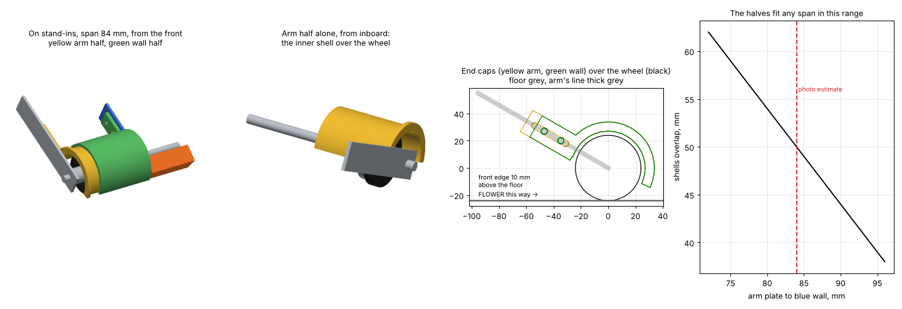

# Stick shoulder for 19429, right arm

> **Superseded, do not print (14 Nov).** The round hood below drops the slanted face that guides GARDEN balls,
> which is what the present blue shoulder does well. Three ways to carry that slant on to the blue wall are sketched on
> the 14 Nov photos in [`concepts.png`](concepts.png), and as 3D shapes on the Onshape robot model in
> [`concepts3d.png`](concepts3d.png) (`concepts3d.py`); the chosen one replaces this part once the lab measurements are in.

On 20245 the FLOWER stick's white walls sit against the arms' wheel hubs. On 19429 the blue wall on the **right
arm** sits well inboard of it, leaving about 1.75 in of bare 8 mm shaft between the wall and the wheel, and on
14 Nov the FLOWER's lip caught there: every Auto WALL FLOWER pick on 19429 stopped 4.4–5.5 in short with nothing
picked, against 20245's 2.6 in with 2–3 pieces (`read_logs.py picks`, `logs/2026-11-14-*`).

This part is a hood over that arm's wheel and the bare shaft, **screwed to the arm at one end and to the blue wall at
the other**, with a rounded front so the lip rides over it. It replaces 19429's present blue shoulder on the right
arm; that one moves to 20245 as it is (20245 has no gap to fill).

| File | What it is | Print |
|---|---|---|
| `shoulder_arm_half.stl` | Screws to the arm plate's inner face; its shell covers the wheel | 1, cap face down |
| `shoulder_wall_half.stl` | Screws to the blue wall's outer face; its shell slides over the arm half's | 1, cap face down |
| `*.step` | The same parts as solids: import these into Onshape, not the STLs | |
| `parts.py` | Makes them. Every size is a constant at the top | `pip install cadquery` |
| `render.py` | Draws the picture above | `+ trimesh manifold3d matplotlib` |

Both print cap-down with no supports. PETG if there is any: the shells take the FLOWER's knocks.

## Nothing here was measured

Every size is a guess from photos (14 Nov) and the Onshape model (its 200 mm Flower Ramp, 8 mm REX shaft, arms about
285 mm apart). The part is made to fit anyway:

- **Two halves that telescope.** Each half screws to its own end, and the overlap takes up whatever the arm-to-wall
  distance is, from 72 to 96 mm (the photo estimate is 84). The halves never need screwing to each other.
- **A slot in the arm tab**, along the arm's centre line from 36 to 62 mm from the shaft, so any goBILDA holes on 8 mm
  pitch along there fit.
- **The blue wall is drilled on the robot**, through the wall tab's two holes. The wall is printed, so it needs no
  holes to match.

What still has to be right, from the biggest risk down:

1. **Nothing may move between the arm and the blue wall.** The photos look like the shaft is clamped at the arm and the
   wheel turns on it. If the bar or wall turns or slides on the shaft, a part screwed to both ends locks it or cracks.
   Wiggle it with the robot off first.
2. **`WHEEL_D` (48 mm, O-ring included).** The hood clears it by 3 mm. A bigger wheel rubs. A smaller one is fine.
3. **`ARM_ANGLE` (30°).** This is the arm above the floor with the stick down, and it sets where the tabs point. The
   front edge sits about 10 mm above the floor, and `parts.py` refuses to export below 6 mm.
4. **The arm's holes are on its centre line**, where the slot is. If they are off it, set `ARM_SLOT_OFFSET`.
5. **The hood stays behind the orange bar's front edge.** It reaches 34 mm ahead of the shaft. If the bar is shorter
   than that, the hood becomes the first thing to hit the FLOWER. That is still better than the gap, but check it.

## Fitting it

1. Take 19429's blue shoulder off the right arm (it goes to 20245).
2. Arm half: cap against the arm plate's inner face, tab along the arm. Use two M4 screws through the arm and the
   slot, with nylocks.
3. Wall half: slide it over the arm half's shell until its cap meets the blue wall's outer face. Clamp it, drill the
   wall with a 4.5 mm bit through the tab's two holes, then fit two M4 screws with nylocks.
4. Turn the wheel by hand: it must spin free. Push the stick down onto the tile: the hood must not touch it.
5. Measure the arm-to-wall span (the inner face of the arm plate to the outer face of the blue wall). Write it here.
   Later prints can set `SPAN` to it and `ONE_PIECE = True`.

**How to tell it worked:** run 19429's R-Solo, then `read_logs.py picks`. Its WALL FLOWER push should stop about
2.6 in short, like 20245, with pieces in the lane.
