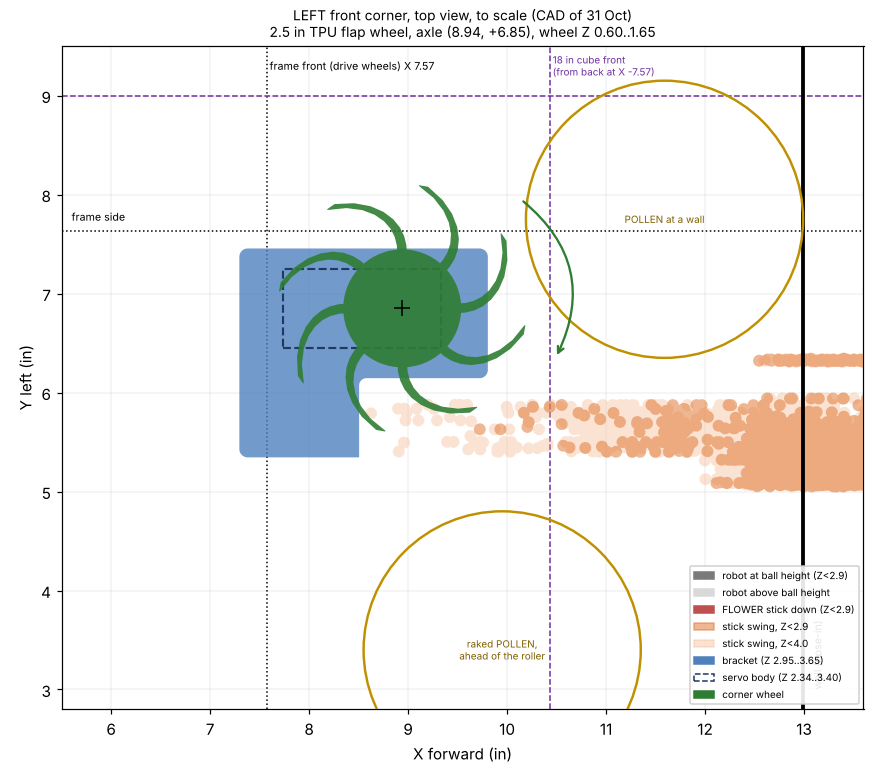
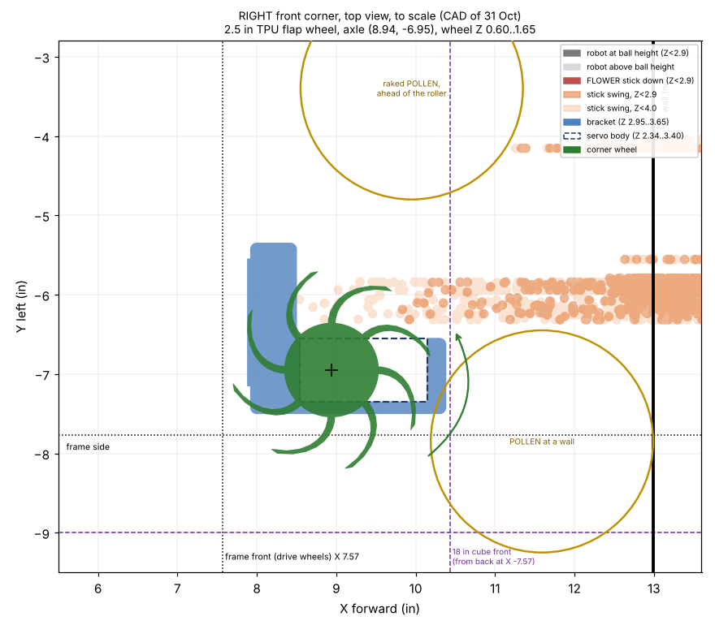

# Corner wheels: do they fit, are they legal, and the centre-mounted stick

The idea (mentor, 23 Nov 2026): stop using the FLOWER stick for GARDEN and corner gathers. Put a small wheel on
a vertical axle at each front corner of the intake, spinning inward, so a POLLEN that touches the robot's corner,
or sits pinned against a wall there, gets raked into the intake mouth. The intake is not widened.

**Short answer: yes, a 2.5 in wheel fits at each corner, ahead of the front drive wheels.** Drive each one with
its own CR servo on the Expansion Hub. It is legal if the wheels stop when the robot holds 4 and stay off during
FLOWER picks. The centre-mounted stick does not fit before States, and the study says it isn't needed.

Prototype parts: [`cad/corner-wheels/`](../cad/corner-wheels/README.md). The build team's 10-minute hand test is
in [`doc/robot-todo.md`](robot-todo.md) ("Corner wheels").

## Where the numbers come from

- **The geometry** comes from the AdvantageScope model of the team's Onshape CAD (`cad/advantagescope/`, built
  31 Oct 2026). The Onshape API refused a fresh read today ("API limit exceeded", HTTP 402).
- **What that CAD doesn't show:** the 23 Nov transfer, 19429's 17 Nov roller stick, and the blue/white GARDEN
  guides on both sticks.
- **Frame:** robot frame in inches, +X forward, +Y left, +Z up, origin on the floor under the middle of the drive
  axles.
- **Ball height** is Z 0 to 2.9.
- **Clearances** are the closest any part of one comes to the other, with the stick swept 0 to 162° in 1° steps.

## 1. Fit

### The space at each front corner (at ball height)

| | Left | Right |
|---|---|---|
| Frame side | Y +7.63 | Y −7.77 (15.4 in across) |
| Front drive wheel | Y 5.42..6.88, front at X 7.57 | Y −5.44..−6.90, front at X 7.55 |
| Intake opening (side rails' inner faces) | Y +4.87 | Y −4.87 (9.7 in; the roller is 7.6 in wide) |
| Ahead of the drive wheel (X > 7.57) | empty | a short 2-hole channel at X 7.39..7.87, Z 1.73..4.42 |
| What's above | intake side channels from Z 2.86, Viper slides to Z 9.6 | the same |
| FLOWER stick arm, down | Y 5.40..5.88, from X 9.56 forward | Y −5.84..−6.32, from X 9.56 forward |
| FLOWER stick swing, lowest Z over the arm's band | 4.6 at X 7.8, 3.6 at X 8.8, 2.6 at X 9.8 | about the same |

The brief's 13.8 in is the distance across the front drive wheels' outer faces (±6.89), so its 0.8 in strip is
the space beside the drive wheel. The wheels don't have to fit in that strip. **Ahead of the drive wheels, the
corners are open at ball height**, and that's where the wheels go.

### Wheel size

The axle sits 0.12 in ahead of the drive wheel. The wheel spans Z 0.60..1.65, so it meets a POLLEN at its equator
(Z 1.40).

| Wheel | Fits? | Front reaches | Closest to the stick swing | Why not |
|---|---|---|---|---|
| 2 in | **yes** | X 9.69 | 0.83 in or more | reaches less far than 2.5 in |
| **2.5 in** | **yes: recommended** | X 10.19 | 0.56 in or more | |
| 3 in | **no** | X 10.69 | −0.15 in: hits the arm | it also passes the 18 in starting cube's front, X 10.43 (R102; the robot's back is at X −7.57) |

**Where the 2.5 in wheel goes:**

| | Left | Right |
|---|---|---|
| Axle | **X 8.94, Y +6.85** | **X 8.94, Y −6.95** |
| Rim past the frame side | 0.47 in | 0.43 in |
| Rim ahead of the drive wheels | 2.62 in | 2.62 in |

The robot is then 16.3 in wide, inside both 18 in limits (R102 at the start, R105 after it).

**Clearances, 2.5 in design (inches):**

| | Left | Right |
|---|---|---|
| Wheel to the stick, anywhere in its swing | 0.75 | 0.56 |
| Wheel to the frame | 0.34 | **0.08** (the 2-hole channel's bottom, Z 1.73, over the wheel's top, Z 1.65) |
| Servo body to the stick | 0.58 | 0.24 |
| Bracket to the stick | 0.21 | 0.21 |

The servo hangs upside down above the wheel, spline down, at Z 2.34..3.40.

**Things to know:**

- **With the stick down, the wheels can't feed.** The stick's arm then lies between each wheel and the mouth from
  X 9.6 forward, so a raked ball hits the arm. The wheels work with the stick up, which is the idea: the stick for
  FLOWERs, the wheels for the GARDEN and the corners.
- **FLOWER, nose-in:**
  - Centred on a FLOWER, the wheels' inner rims (|Y| 5.6) are 3.2 in clear of the FLOWER's sides. The FLOWER's
    half-width is 2.35 in, a placeholder until measured (`FieldSim`).
  - At the wall the wheels are 4.7 in back: R-Quals stops 12.15 in from the FLOWER's centre.
  - If a pick is more than about 3 in off centre, a spinning wheel touches the FLOWER's side (G418, below).
- **HIVE base, nose-in:** the wheel becomes the first thing to touch a foot bar. Foot bars are 2.2 in tall in the
  simulator, also a placeholder. So a nose-in stop at the HIVE base is 2.6 in further out than today, where the
  drive wheels touch first.
- **Robot differences:** the right corner differs from the left in the CAD. Its stick arm is 0.45 in further out,
  and it has the short channel ahead of the drive wheel. So each corner has its own bracket, and the right one bolts
  to that channel's front face. **Check both corners on each robot with a ruler before printing**: 19429's stick and
  guides are newer than this CAD.

### Driving the wheels

**Use a CR servo per corner.** It fits (clearances above), and the code already handles CR servos the way the
star wheels use them (`Kind.CR_SERVO`, `IntakeSubsystem`).

**Use two ports, not one on a Y cable.** The two wheels turn opposite ways, and one signal cannot reverse one of
two servos.

**A belt or bevel off the intake motor doesn't fit.**

- The roller's shaft is horizontal at Z 3.48 and ends at |Y| 4.84, right behind the drive wheels' tops (Z 3.8).
- A take-off would have to run 2 in outboard over the drive wheel, turn 90°, and drop to Z 1.6 ahead of it. That
  is the space the stick's arm swings through (lowest Z 4.6 to 2.6 there).

**Free servo ports** (from `robot_*.xml`):

| Robot | Control Hub | Expansion Hub |
|---|---|---|
| 19429 | none (0–5 all used) | **0, 1, 2, 3** |
| 20245 | 1, 4 (4 is kept for a second star wheel) | **1, 2, 3, 4** |

**Use Expansion Hub ports 1 and 2 on both robots.** That keeps one wiring for both. The Control Hub holds the
mission-critical servos, and the corner wheels aren't.

## 2. Rules

From the 2026-27 BIOBUZZ Competition Manual, TU10 (current), page numbers from its PDF.

### Size

- **R102 (p.121):** "the ROBOT must be fully self-contained within an 18 in. … wide, by 18 in. … long, by 18 in.
  … high volume" at the start. The wheels keep the robot inside it:
  - 16.3 in wide;
  - the front at X 10.19, and X 10.38 for the right servo's bracket, against the cube's X 10.43.
- **R105 (p.122):** "After the start of the MATCH, ROBOTS may expand beyond the STARTING CONFIGURATION but at all
  times must remain within a 18 in. … by 24 in. … by 29 in. … tall sizing volume", and "B. ROBOTS must be
  physically constrained to fit within these limits without the use of software." G416 (p.110) enforces it:
  - So a mechanism may reach past the frame after the start, up to the 18 × 24 in footprint.
  - The rule doesn't say which way the 24 in runs; Figure 12-1 may.
  - The fixed wheels never change the robot's size, so this doesn't limit them.

### CONTROL

- **CONTROL** (glossary, p.170) includes a ROBOT that "intentionally pushes a SCORING ELEMENT to a desired location
  or in a preferred direction (i.e., herding)". **An inward-spinning wheel touching a POLLEN is CONTROL.** It is not
  the excluded "bulldozing" (G407 note D: "inadvertent contact … while in the path of the ROBOT"), because the rake
  is deliberate.
- **G407 (p.107):** "A ROBOT may not simultaneously CONTROL more than 4 SCORING ELEMENTS." Its notes warn that
  repeated 5s are likely STRATEGIC (a MAJOR FOUL and a YELLOW CARD) "even if the ROBOT has a 'keep 4 and discard the
  rest' sorting mechanism".
  - **So the wheels must stop whenever the robot holds 4**, just as the intake does. A 5th ball raked against the
    mouth is CONTROL of 5.
- **G408 (p.108):** "A ROBOT may not CONTROL the opponent's NECTAR."
  - So the wheels run only while the intake takes in, and stop with it when `NectarReject` stops it.
  - They never run on their own as sweepers.

### Other rules

- **G418 (p.111):** POLLEN comes out of a FLOWER only from its bottom; "attempts to pull POLLEN through the side of
  the FLOWER" are likely STRATEGIC. **So the wheels stay off during FLOWER picks.**
- **G406 (p.106) and R201.C (p.124):** no gouging or tearing game pieces, and no "abrasive surfaces that scratch
  objects that rub across them". TPU flaps with rounded tips are fine; a hard plastic star with sharp points is not.
- **G417 (p.110):** the HIVE moves only by launching. Its examples list "A ROBOT accidentally bumping into a HIVE
  frame while attempting to pick up POLLEN" as likely not STRATEGIC.

## 3. A centre-mounted FLOWER stick off the Limelight tower

**The geometry:**

- The tower is two 9-hole Lowside channels at X 1.69..2.20, |Y| ≤ 1.89, Z 6.2..15.6. The Limelight 3A sits on it
  at X 2.68..4.40, Z 14.0..15.7, pitched 45° up.
- Its view is 42° tall, so it sees 24° to 66° above level. Anything below the lens and ahead of it is out of view.

**What a centre stick would mean:**

- **The camera is not the problem.** A stick that comes down ahead of the robot is below the lens (Z 14.8), so
  it never blocks the tags. Stowed, it has to stay behind the lens (X < 2.7) or out to the side. Today's arms
  pass outside the camera's width (|Y| ≥ 5.4).
- **The arm is the problem:**
  - From a pivot on the tower's front (X 2.45, Z 8.0) to today's ramp tip (X 12.6, Z 0.5) is 12.6 in.
  - A straight arm at Y 0 runs through a servo block, the intake motor and the intake roller, which is why the
    arms are at the sides today.
  - Stowed straight up, it reaches Z 20.6, over the 18 in cube (R102). Stowed back under 18 in, it passes
    through the turret.
  - Only a cranked or folding arm could work: over the intake at about Z 8, then down. That is a new mechanism, not
    a remount.
- **The study says the mount isn't what fails.** The FLOWER pick study (`doc/flower-picks/`, 22 Nov) found:
  - 20245's passive stick, held out, got 4 on every pick seen clearly on video (6 of 8 got 4; the other two are
    questionable 3s).
  - 19429's active roller stick, run limp, got 4 on only 4 of 10.
  - The difference is passive against active and held against limp, not where the arms are.

**Verdict: don't build a centre stick before States.** Run the study's test first: 19429 with its stick held. If
it doesn't get 4 on at least 8 of 10 picks, put 20245's passive stick on 19429.

## What the code would need, once the hand test passes

Not done here.

- **Hardware:**
  - Two `DeviceNames` CR-servo names, for example `cornerWheelLeft` and `cornerWheelRight`.
  - Put them in each robot's `RobotIdentity.optional`, so a robot without them still starts.
  - Each robot's XML gets them on Expansion Hub ports 1 and 2.
  - A `RobotDifferences` line turns them on per robot, like the beam breaks.
- **Behaviour,** in `IntakeSubsystem` beside the star wheels:
  - Run them while the intake takes in.
  - Stop them while the lane is full or `colorSensor.wrongNectarMayBeIn()`, and during a FLOWER pick.
  - Each needs its own direction switch.
- **Auto:** a GARDEN or corner gather card that keeps the stick up.
